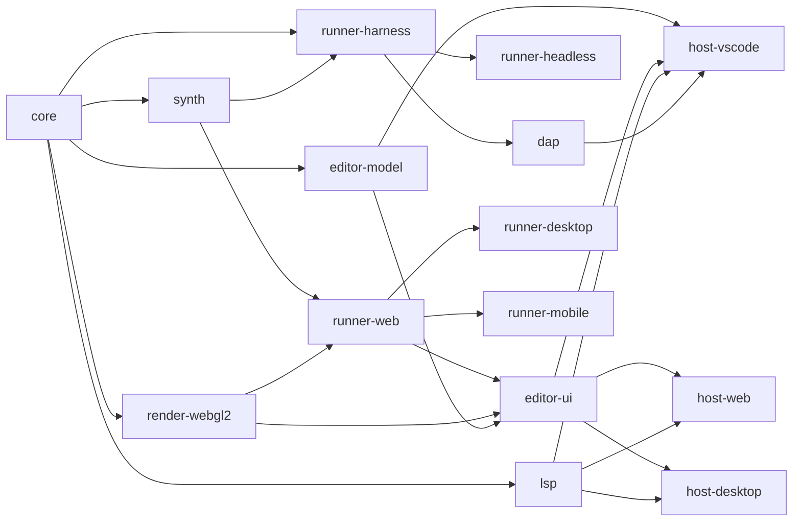
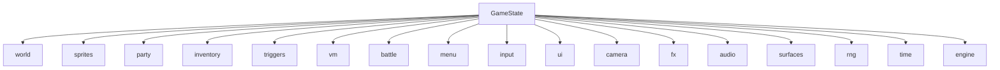
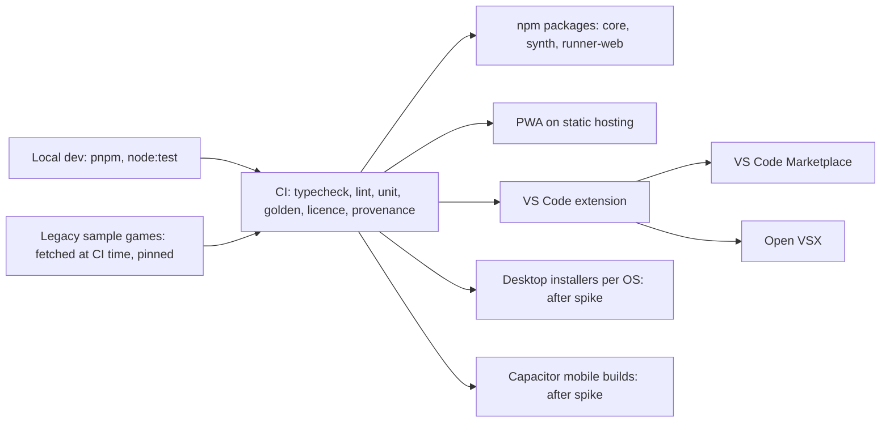

# Architecture Spine — rpgtoolkit-reawakened

## Design Paradigm

Hexagonal. The **core** is a pure, deterministic simulation: bytes and input events in; state, draw lists, audio cues and requests out. Every platform thing (display, sound, devices, files, editor host) is an **adapter** behind a port the core or the editor defines. The core is a step machine, never event-driven or async.

| Layer | Package | Role |
| --- | --- | --- |
| Domain | `core` | formats, resolver, image and font decoding, world, sprites, triggers, script VM, battle, menu, save, step pipeline, draw-list and cue builders, reference rasteriser |
| Ports | `core/ports` | service interfaces for the VM and domain modules; the runner-facing engine API |
| Driving adapters | `runner-*`, `lsp`, `dap`, `editor-ui` | call the core |
| Driven adapters | `synth`, `render-webgl2`, asset sources | realise cues, draw lists and asset requests |
| Editor model | `editor-model` | DOM-free documents and command stacks |
| Hosts | `host-*` | platform-services and chrome only |

One checked-in edge list (`tools/deps/edges.json`) generates this graph and the dependency-cruiser rules (AD-22). An arrow means "may be depended on by". Same-tier imports are allowed only where an arrow is drawn.



## Inherited Invariants

Parent: [ADR 0001](../../../docs/adr/0001-typescript-core.md) and [guardrails.md](../../../docs/guardrails.md). Read-only here. Where an AD extends a guard-rail's enforcement, it says so and is listed under ADR 0002 in Deferred.

| Inherited | From parent | Binds here |
| --- | --- | --- |
| G1 step-machine VM, plain-data state | guardrails | AD-7 to AD-10, AD-26 |
| G2 package boundaries, platform-services only | guardrails | AD-1, AD-6, AD-20, AD-22 |
| G3 determinism: injected clock and RNG, fixed step | guardrails | AD-2, AD-5, AD-11 to AD-14, AD-25, AD-26 |
| G4 renderers only replay draw lists | guardrails | AD-3, AD-4, AD-27 |
| G5 headless goldens required | guardrails | AD-11, AD-14 make hashes and logs the test substrate |
| G6 licence test (Blue Oak Bronze or better, minus MS-PL; ADR 0003) | guardrails | Stack; Deferred names the `ovsx` exemption |
| G7 clean-room | guardrails | every AD cites doc sections, never legacy source |
| TypeScript everywhere; VS Code and standalone hosts first-class | ADR 0001 | Stack, AD-19, AD-20 |

## Invariants & Rules

### AD-1 — One engine API: advance, drawList

- **Binds:** CAP-2, CAP-3, CAP-4, CAP-5, CAP-6, CAP-8, CAP-12, CAP-13, CAP-14
- **Prevents:** runners and tests driving the core differently; replays that depend on how a runner batches steps; mid-step debug states.
- **Rule:** `createEngine(init)` returns `Engine`. `advance(steps, inputs: { step, event }[]) -> StepReport` runs whole fixed steps. A `maxSteps` cap bounds catch-up. `StepReport` carries `stepsRun`, `stepAfter`, `consumed` (the canonical input log, written by the core), audio cues, requests, diagnostics, `loading`, and `paused`. `drawList(alpha?) -> DrawList` is a pure function of current state; `alpha` is 0 in tests. `engine.surfacePixels(id, rev)` is the pixel accessor (AD-27). `engine.setBreakpoints(bps)` takes data; a hit stops mid-step and returns `paused { thread, frame, line }`, with the open-step cursor stored in `GameState` so it snapshots; debug hooks read state and never write it. Every argument and result is structured-cloneable plain data, so the core runs in a Worker. Outputs never alias state: every emitted `Uint8Array` owns its whole buffer (`byteOffset` 0) and is a copy; a host may transfer a buffer only when the core marks it handed off.
- **Check:** type-checked API; a Worker contract test that transfers and mutates every returned buffer and asserts `stateHash` unchanged; a replay test that batches the same input log with different `steps` per call.

### AD-2 — Time is the step counter

- **Binds:** CAP-2, CAP-3, CAP-4, CAP-9, CAP-11
- **Prevents:** wall-clock or frame-rate leaking into state; animation phases rounded differently per epic.
- **Rule:** the simulation step is fixed at 60 Hz. The injected clock of G3.1 **is** the step counter supplied through `advance`; `getTickCount` and `gameTime = steps / 60` derive from it. `core/time` alone owns `secondsToSteps`, `fpsToSteps` and `frameAt(originStep, step, stepsPerFrame, count, loop)`; animated tiles use origin 0. [ASSUMPTION: 60 Hz; rounding values are Deferred.]
- **Check:** lint bans `Date` and `performance` in `core` (G3); only `core/time` may convert seconds or fps to steps.

### AD-3 — Draw list: flat, ordered, plain-data, integer pixels

- **Binds:** CAP-6, CAP-12, CAP-13, CAP-15
- **Prevents:** runners interpreting scenes differently; renderers holding state (G4); unhashable frames; tint and blend results differing between replayers.
- **Rule:** a `DrawList` is `{ step, width, height, commands[] }` rebuilt per frame, with no deltas. `core/ports` publishes one `DrawCommand` union: `blit`, `fill`, `line`, `rect`, `ellipse`, `text`, `pushTarget`, `popTarget`. Types: `Rgb = { r, g, b }` integers 0–255; coordinates are integers in logical-resolution pixels; rectangles are `x, y, w, h`, half-open; `filled: boolean`; lines are 1 px with inclusive endpoints; ellipses are given by bounding box. A texture is a `TexRef = { asset: AssetKey, tile: number | null }` with `tile` 1-based (`null` means no tile; format-spec §1.6). `.tan` and `.tbm` never cross the seam: the builder resolves them to tile `TexRef`s plus per-cell tint. `blit` carries `src` and `dst` integer rectangles, `key`, `tint`, `alpha` 0–255, `blend` (`normal` | `additive` | `translucent`) and an `iso2d` projection flag, with nearest-neighbour sampling. A blit source is a `TexRef` or a persistent surface `{ surface, rev }` (AD-27). `text` carries a `FontRef` and per-glyph advances (AD-15). The core draws the mouse cursor as the last command. Runners replay top to bottom and may cache, but discarding a cache changes nothing observable.
- **Pixel pipeline (normative, in `core/raster`):** (1) skip a pixel that is format-transparent or equals `key`, tested on the untinted source; (2) `c = clamp(src + tint, 0, 255)` once, where `tint` is the full pre-summed shade, board and global ambient offset (range ±1020, format-spec §4.5); (3) blend: `normal` → `c`; `translucent` → `(dst·(255−a) + c·a + 127) / 255`; `additive` → `min(255, dst + (c·a + 127) / 255)`, integer division; `percentToAlpha(p) = (p·255 + 50) / 100`.
- **Check:** one exported union; a lint rule that tint is computed only in `core/render/shade.ts`; per-command CPU-vs-WebGL2 conformance fixtures with exact match for key and tint.

### AD-4 — One reference rasteriser, in core

- **Binds:** CAP-5, CAP-6, CAP-13, CAP-16
- **Prevents:** script-visible pixels depending on the runner; two rasterisers drifting.
- **Rule:** `core/raster` is the single reference rasteriser, pure and I/O-free. It turns a `DrawList` plus surfaces into a bitmap and serves `canvasGetScreen`, `getPixel` and screen save and restore (E-56, E-58). `runner-harness` uses it for goldens and the editor uses it for image export. It amends `architecture-options.md` §2 ("no pixels in the core") and G4 rule 1's wording; see ADR 0002.
- **Check:** CPU-vs-WebGL2 agreement test in CI; `runner-*` import no rasteriser internals (AD-22).

### AD-5 — Assets and requests: blocking or stream, always replied by an input

- **Binds:** CAP-1, CAP-2, CAP-7, CAP-11, CAP-12, CAP-15
- **Prevents:** asset or file latency changing simulation results; per-runner path handling; requests with no way back into the core.
- **Rule:** the runner gives the core an `AssetIndex` (list of relative paths) at start. The shared resolver maps a logical path to a canonical `AssetKey` (ASCII-only case fold [ASSUMPTION], `/` separators, type-folder prefix rules of format-spec §1.5, ignore `projectPath` inside a package). Every request carries a core-assigned `reqId` and is **blocking** (time freezes: `advance` returns `loading` and consumes no steps) or **stream** (music and video bytes: never touches state). Every request that needs a reply has a matching input event: `asset → asset { reqId, bytes: Bytes | null }` (`null` means the asset is missing), `loadBlob → blob.loaded`, `saveBlob → blob.saved`, `listBlobs → blob.listed`, `extension.call → extension.result`. There is no per-thread asset wait. Inputs arriving during `loading` are queued in state and consumed at the next real step. Prefetch hints are allowed and cannot change state. `core` never fetches. [ASSUMPTION: async request and deliver, not a synchronous provider.]
- **Check:** exhaustive `switch` with a `never` default on the request and event unions; a latency-fuzz replay test (random delivery delays) expecting identical per-step hashes.

### AD-6 — Packages and compression live in core formats

- **Binds:** CAP-1, CAP-12, CAP-15
- **Prevents:** each runner shipping its own package reader; `core` importing Node through a dependency.
- **Rule:** `core/formats/package` reads legacy `.tpk` and appended-ZIP EXE (format-spec §13) and reads and writes the project's own distribution package: a `.tpk`-compatible ZIP plus `manifest.json { schema, main, index }`; web and desktop bundles embed it unchanged. `core` imports `fflate/browser` (explicit subpath) and the synchronous APIs only (`unzipSync`, `inflateSync`, with the `unzip` filter for size limits). `fflate` is the first entry on the `core` runtime allowlist (G2). [ASSUMPTION: `fflate`; ZIP methods beyond store and deflate are out.]
- **Check:** lint bans the bare `fflate` specifier and its async exports in `core`; CI asserts the allowlist matches `package.json`.

### AD-7 — VM state shape

- **Binds:** CAP-4, CAP-5, CAP-11, CAP-14
- **Prevents:** state that cannot be saved, hashed or restored; each epic widening the shape its own way.
- **Rule:** `PlainData` is `null`, `boolean`, a finite number that is not `-0`, `string`, an array of `PlainData`, or `{ [k: string]: PlainData }`; `undefined` is not allowed. `VmState = { threads, globals, objects, redirects }`. `Thread = { id, kind, owner, source, target, frames, status, wait }`. `Frame = { program: ProgramRef, ip, locals, operands, errorHandler, autoLocal }`. `ProgramRef = { kind: 'file', path, sourceHash, compiler } | { kind: 'inline', text, compiler }`. Compiled code is held outside state and rebuilt from the file or inline text on restore. A map is an ordered array of `[key, value]` entries; non-finite numbers use a tagged form (`{ t: 'nan' | 'inf' | '-inf' }`); sparse arrays are entry lists. On a `compiler` or `sourceHash` mismatch at restore, the affected thread restarts from its program start and a `restore.restarted` diagnostic is emitted. [ASSUMPTION: restart policy; confirm against format-spec §11.] This list is a minimum; any new field is added here.
- **Check:** `GameState extends PlainData` type check; property test `canon(restore(canon(s))) === canon(s)`; a CI rule that a change to a `*State` type or the opcode table needs a schema or compiler bump plus a fixture save from the previous version, and a restore test over every fixture.

### AD-8 — Built-ins register as plain-data state machines

- **Binds:** CAP-2, CAP-3, CAP-4, CAP-5, CAP-6, CAP-7, CAP-9, CAP-10, CAP-11, CAP-14
- **Prevents:** domain epics adding built-ins that block with closures, drop by-reference outputs, collide on names, or reach into other modules.
- **Rule:** `BuiltinSpec { name, aliases, params: ParamSpec[], call, resume? }` with `ParamSpec { name, optional?, byRef?, variadic? }`. `call(ctx, args: Arg[]) -> { done: Value, out?: [index, Value][] } | { yield: Wait }`, where `Arg = { value, ref?: RefId }`; the VM writes `out` back to the by-reference arguments. A blocking built-in's continuation is plain data in `thread.wait`. The `Value` union is published in `core/ports`. Each domain module exports `builtins: BuiltinSpec[]`; `createEngine` assembles them in fixed module order and rejects duplicate names or aliases. Lookup precedence: redirect, script function, built-in, extension; the VM and the LSP share it. `ctx` exposes only service ports from `core/ports` (`WorldPort`, `SpritePort`, `RenderPort`, `AudioPort`, `BattlePort`, `MenuPort`, `SavePort`, `AssetPort`, `HandlePort`, `StatsPort`, `RngPort`, …). `HandlePort` is the only resolver for `"source"`, `"target"`, names, indices and slots. A built-in imports no domain module and no other built-in. Each built-in name has exactly one owning epic, listed in a table checked in CI.
- **Check:** `createEngine` throws on a duplicate; the catalogue test of epic rpgcode-tooling asserts every by-reference getter of format-spec §9.11 declares `byRef`.

### AD-9 — Waits: one wake contract

- **Binds:** CAP-3, CAP-4, CAP-5, CAP-6, CAP-7, CAP-8, CAP-9, CAP-10
- **Prevents:** two wake paths for the same wait; epics colliding on a shared `ui` kind; threads that resume in a different order.
- **Rule:** `Wait = { kind: string, ...payload }`, payload `PlainData`. Kinds are namespaced by their owner: `input.key`, `sleep`, `movement`, `blob`, `audio.sfx`, `video`, `render.msgbox`, `menu.screen`. Each kind registers `poll(view, wait) -> null | { value }`, called for every waiting thread in ascending thread id after the `waits` phase starts (AD-26). Inputs reach waits only through state sections their owner holds (key queue, audio-ended set). The registry rejects duplicates. Widget state (cursor index, typed text) lives in the owner's section; the wait holds only its id. A wait uses no closure and no timer. A new kind is registered by the epic that owns it.
- **Check:** unit test that a duplicate kind throws at `createEngine`; `poll` is the only resolver signature in the type.

### AD-10 — One state tree, one owner per section

- **Binds:** CAP-2, CAP-3, CAP-4, CAP-5, CAP-9, CAP-10, CAP-11
- **Prevents:** two modules mutating one datum; saves missing state; stats copied into two places.
- **Rule:** `GameState` has exactly these sections, each owned and mutated only by its module. Others use its port and see a `DeepReadonly` view.

| Section | Owner | Holds |
| --- | --- | --- |
| `schema` | `core/save` | per-section schema versions, `compiler` version |
| `world` | `core/world` | board, layers, vectors, programs, board edits, lighting, ambient, movement mode, game-speed offset |
| `sprites` | `core/sprites` | players and items on the board, queues, facing, waypoint links |
| `party` | `core/menu` | roster, selection, steps |
| `inventory` | `core/menu` | items, equipment, gold |
| `triggers` | `core/triggers` | armed and fired state, repeat counters |
| `vm` | `core/script` | threads, globals (incl. character stats), objects, redirects |
| `battle` | `core/battle` | fighter references, charge, status effects only; never copies HP or SMP |
| `menu` | `core/menu` | open screens |
| `input` | `core/input` | key queue, held keys, mouse, on-screen buttons |
| `ui` | `core/render` | message window, fonts, cursor maps, mouse cursor |
| `camera` | `core/world` | camera position and clamp |
| `fx` | `core/render` | persistent animations, transitions, screen effects |
| `audio` | `core/audio` | playing music and effects, `cueId` counter |
| `surfaces` | `core/raster` | persistent bitmaps, `SurfaceId` counter, saved screens |
| `rng` | `core/rng` | generator state |
| `time` | `core/time` | step counter |
| `engine` | `core/engine` | phase state, pending requests, queued inputs, open-step cursor |

Character stats have one owner: `vm.globals` behind `StatsPort` (E-85). `SaveState` is `GameState`; snapshot, save, hash and restore use one canonical form.

- **Check:** dependency-cruiser rule that only `core/<section>/**` imports its mutable `<Section>State`; a type check that `GameState extends PlainData`.



### AD-11 — Canonical form and hashes

- **Binds:** CAP-11, CAP-13
- **Prevents:** hashes that differ by field order, number formatting, or hash implementation.
- **Rule:** the canonical form is RFC 8785 (JCS): keys sorted by UTF-16 code unit, numbers per ECMAScript `Number::toString`, minimal escaping. `-0` is normalised to `0`. `stateHash` and `drawListHash` are FNV-1a 64-bit over the UTF-8 bytes, with offset basis `0xcbf29ce484222325` and prime `0x100000001b3`, written as 16 lowercase hex digits. `drawListHash` covers surface `rev` numbers, not pixel bytes. Both live in `core/canon`, with no `crypto`.
- **Check:** unit tests against the RFC 8785 vectors and fixed hash vectors.

### AD-12 — One seeded RNG

- **Binds:** CAP-3, CAP-4, CAP-5, CAP-9, CAP-11
- **Prevents:** per-module randomness breaking replay and saves; correlated streams from similar seeds.
- **Rule:** one xoshiro128** instance in `core/rng`. `RunConfig.seed` is a `u32`, expanded into the four state words by SplitMix32 with a non-zero guard. Any core module draws through `RngPort` (random built-ins, battle, the random-battle test, `wander`); draw order is fixed by the step pipeline (AD-26). State is in `GameState.rng`. [ASSUMPTION: xoshiro128**.]
- **Check:** dependency-cruiser rule that only `core/rng` constructs the generator.

### AD-13 — Deterministic maths

- **Binds:** CAP-3, CAP-5, CAP-9
- **Prevents:** last-bit differences between JS engines changing movement or damage.
- **Rule:** `core/fmath` provides `sin`, `cos`, `tan`, `atan2`, `exp`, `log`, `pow` and the rest using only `+ − × ÷` and `Math.sqrt`; `pow` with an integer exponent is exact by repeated multiplication. In `core`, `Math` is an allowlist: `abs`, `ceil`, `floor`, `round`, `trunc`, `sign`, `min`, `max`, `fround`, `imul`, `clz32`, `sqrt`. Every other `Math` member and the operators `**` and `**=` are banned. RPGCode `^` calls `fmath.pow`. This adds to G3's enforcement and needs ADR 0002.
- **Check:** ESLint `no-restricted-properties` and `no-restricted-syntax` rules; `fmath` vector tests.

### AD-14 — Everything from outside is an input, and the core writes the log

- **Binds:** CAP-3, CAP-7, CAP-8, CAP-12, CAP-13
- **Prevents:** replays that depend on delivery timing, audio or window events; runners recording the same session differently.
- **Rule:** inputs are `{ step, event }`, where `step` is `time.step` at the start of the consuming step; inputs apply in array order within a step. The core returns the consumed list in `StepReport.consumed`; the canonical log is the concatenation of those lists. Events: `key { name, code, char: string | null, down }` (`null` means no typed character), `pointer { x, y, buttons }` in logical integer pixels, `gamepad`, the replies of AD-5, `audio.ended { cueId }`, `video.ended`, `focus { lost | gained }`. Key `name` is the legacy logical name (`"ENTER"`, `"LEFT"`, `"A"`); the DOM-to-legacy table lives in `core/input`. The core owns the Pause state of E-03: after `focus.lost`, `advance` consumes no steps until `focus.gained`, and runners keep calling it. The headless runner emits `audio.ended` and `video.ended` after the parsed (or transcoded) duration. Replay feeds exactly the log. Every port-contract field is required, and a field with no value holds `null` — never an omitted key and never `undefined` — so every event and cue has one fixed set of keys; `exactOptionalPropertyTypes` in `tsconfig.base.json` stays on as a backstop for this rule, not as the rule itself.
- **Check:** exhaustive `switch` on the event union; the latency-fuzz and batching replay tests of AD-1 and AD-5.

### AD-15 — Text, fonts and layout are core-owned

- **Binds:** CAP-6, CAP-13
- **Prevents:** word wrap or glyph shapes differing per platform font; script-readable text pixels that differ from what the screen shows.
- **Rule:** line breaks, glyph advances and glyph rasterisation come from `core/render` and `core/raster`. Game fonts arrive as assets (E-132) and are rasterised by a pure-TypeScript rasteriser in `core`; a bundled bitmap font is the fallback and the test font. A `text` command carries a `FontRef` and per-glyph advances; runners draw from the same glyph data. Platform fonts are an opt-in runner mode behind `RunConfig.platformFonts`, off in golden and conformance runs. This amends `architecture-options.md` §2 and `packages.md` ("text layout is a runner capability"); see ADR 0002. [ASSUMPTION: a pure-TS TrueType rasteriser on the `core` allowlist; library or hand-written chosen in epic board-rendering.]
- **Check:** conformance fixtures with text replayed through `core/raster` and `render-webgl2`.

### AD-16 — Audio cues: core states what plays

- **Binds:** CAP-7, CAP-11
- **Prevents:** music state living in the runner and being lost on load; cue verbs added by one epic and dropped by a runner.
- **Rule:** `AudioCue = { cueId, kind, asset: AssetKey | null, loop: boolean | null, volume: number | null }` with `kind` one of `music.play`, `music.stop`, `music.pause`, `music.resume`, `sfx.play`, `sfx.stop`, `volume.set`. `cueId` comes from a monotonic counter in `GameState.audio`. `audio.ended { cueId }` replies; an unknown `cueId` is ignored. `volume` is an integer percent. The core records what plays and re-emits it after load. Per-frame `.anm` sounds are emitted by the `animation` phase. `synth` and runners realise cues and hold no game decision.
- **Check:** runner-side exhaustive `switch` with a `never` default; a headless test per audio built-in.

### AD-17 — Host boundary, saves and sandbox

- **Binds:** CAP-5, CAP-7, CAP-11, CAP-12
- **Prevents:** scripts or the extension mechanism reaching files or the network directly; saves colliding across games or hosts.
- **Rule:** the core's only path to the host is `StepReport.requests`: `asset`, `loadBlob`, `saveBlob`, `listBlobs`, `extension.call`, `quit`, `openUrl`, `playVideo`. Blob keys are `{ area: 'saves' | 'files', path }`, case-folded in core. RPGCode file reads try `saves` then fall back to shipped game folders, read-only, through `asset` requests; writes go only to `saves` or `files`. `GameId` is derived in core as a hash of the main file plus the package identity and is the save-area key in every host; only the physical location is a host choice. `openUrl` allows only `https:` and always asks the user. Games are untrusted input. The E-99 extension mechanism uses these same requests.
- **Check:** headless round-trip tests for `save`, `load`, `openFileOutput`/`openFileInput` and `dirSav`.

### AD-18 — Format models round-trip

- **Binds:** CAP-1, CAP-15, CAP-16
- **Prevents:** editors silently dropping data or upgrading versions.
- **Rule:** each reader returns `Result<Model, FormatError>` with `warnings[]`; `FormatError = { path, offset, section }`, `section` citing the format-spec section. Readers never throw for bad data. The model keeps unmodelled fields as residue so unchanged data writes back identically. Writers emit the version that was read; only an explicit upgrade (T-30, T-31) changes it. [ASSUMPTION.]
- **Check:** round-trip tests per format on the sample games.

### AD-19 — Documents: one model per file; the host owns undo and save timing

- **Binds:** CAP-15, CAP-16, CAP-17, CAP-18
- **Prevents:** VS Code and the standalone hosts implementing different undo and save semantics; edit stacks lost when a webview is hidden.
- **Rule:** the document model (bytes plus a stack of serialisable commands) lives in the DOM-free package `editor-model`. `editor-ui` emits `document.edited { editId, label }` for each command; hosts call `undo(editId)` and `redo(editId)`; dirty state is derived by the host from that stream. Hosts drive a `DocumentController`: `save`, `saveAs`, `revert`, `backup`, `onExternalChange`. There is exactly one document instance per URI per host. In VS Code, `host-vscode` runs `editor-model` in the extension host and webviews hold only view state. [ASSUMPTION: over `retainContextWhenHidden`.] Hosts never edit document bytes.
- **Check:** one host-conformance suite run against every host.

### AD-20 — platform-services is the only host door

- **Binds:** CAP-15, CAP-16, CAP-17, CAP-18
- **Prevents:** `editor-ui` importing host APIs; hosts exposing different surfaces.
- **Rule:** an async interface: `fs` (`list`, `read`, `write`, `stat`, `delete`, `rename`, `watch`), `project` (`open`, `recent`), `run` (`startGame`, `startProgram` with a fixture, returning a handle), `export`, `dialogs`, `clipboard`, `document` (AD-19), `language.connect()` (the program editor is an LSP client of `lsp` in every host), `shell.openExternal`, `settings`. Each host declares a `capabilities` set, including `fileAssociation` (T-82); `editor-ui` degrades by capability (for example ZIP import and export where folder writes are unavailable). Errors are `PlatformError { code, message }`. A host adds no editor feature of its own.
- **Check:** dependency-graph rule that `editor-ui` imports no `host-*`; the AD-19 host-conformance suite.

### AD-21 — Language servers are transport-free; the debugger needs no Node

- **Binds:** CAP-14, CAP-18
- **Prevents:** a server or adapter tied to VS Code or Node; debug hooks altering state.
- **Rule:** `lsp` exports `createServer(connection)`; stdio in VS Code desktop, `vscode-languageclient/browser` in a Worker on `vscode.dev`, `MessageChannel` elsewhere. `dap` depends on `runner-harness`, the platform-neutral half of the headless runner (CPU rasteriser, null audio, scripted input); `runner-headless` is only the thin Node shell. On the web, the adapter registers with `DebugAdapterInlineImplementation`. Breakpoints are data and a hit follows AD-1.
- **Check:** the `vscode.dev` build runs LSP and DAP in CI.

### AD-22 — Package surface and one edge list

- **Binds:** all
- **Prevents:** deep imports defeating the dependency graph; the diagram and the rules drifting.
- **Rule:** every package exports one public entry `src/index.ts` (plus `./testing` where needed). ESM only; target ES2022; TypeScript project references; `host-vscode` is bundled to CommonJS with esbuild. `tools/deps/edges.json` is the single edge list, and it generates the diagram above and the dependency-cruiser rules. [ASSUMPTION: path.] Imports of any non-entry path are banned.
- **Check:** dependency-cruiser rules generated from the edge list; CI fails when the generated diagram differs from the committed one.

### AD-23 — Schemas are versioned per section

- **Binds:** CAP-11
- **Prevents:** saves breaking across releases; two epics both numbering a migration 7→8.
- **Rule:** `GameState.schema` is `{ world: n, sprites: n, … }`; each section owner owns its migration chain of pure functions. The compiler version is part of `schema`. Project-level files the project owns carry an integer `schema` too.
- **Check:** CI fixture saves from each previous schema must restore.

### AD-24 — Diagnostics, no console

- **Binds:** CAP-5, CAP-13, CAP-14
- **Prevents:** logging reaching `console` in core; unlocated script errors.
- **Rule:** `core` takes a `Logger` port with levels and plain-data records. A runtime script error is visible to RPGCode handlers and is also a `StepReport` diagnostic `{ code, file, line, message }`.
- **Check:** lint bans `console` in `core`.

### AD-25 — Total order everywhere

- **Binds:** CAP-3, CAP-5, CAP-9
- **Prevents:** pathfinding, sorting and iteration giving different results.
- **Rule:** every search, queue and tie-break uses an explicit total order. Code relies on `Array.prototype.sort` stability and never on object key order for non-string keys.
- **Check:** pathfinding golden tests with equal-cost ties.

### AD-26 — Step pipeline and program modes

- **Binds:** CAP-2, CAP-3, CAP-4, CAP-5, CAP-8, CAP-9, CAP-10
- **Prevents:** epics inserting their phase wherever convenient; changing RNG draw order; undefined behaviour for blocking programs.
- **Rule:** `core/engine` runs a fixed, named phase list each step: `input`, `waits`, `threads`, `movement`, `edges`, `triggers`, `battle`, `animation`, `audio`, `time` (E-03). Modules register into named phases only; order inside a phase is fixed by module rank. `Thread.kind` is `blocking`, `board`, `persistent` or `item`; lifecycle owners are `core/script` for kinds and `core/world` for killing board threads on `send` and item threads on removal (E-19, E-93). At most one `blocking` thread exists; it suspends Idle input and triggers but not other threads. `multiRun` defers movement starts and then yields one `movement` wait over the collected sprites (E-33). A blocking program that never yields is preempted at the per-step budget.
- **Check:** a unit test snapshots the phase list; a test of exclusive-program mode with `multiRun`.

### AD-27 — Surface model

- **Binds:** CAP-5, CAP-6, CAP-13
- **Prevents:** one canvas mutated by both the core and a runner; lost canvases after a cache flush; reused ids serving stale textures.
- **Rule:** persistent surfaces are core-owned bitmaps in `GameState.surfaces`, mutated only by `core/raster`, and read-only in the draw list. `pushTarget` addresses only frame-scoped `ScratchId`s, cleared at push and dead at frame end; `ScratchId` and `SurfaceId` are separate branded types. Ids come from a monotonic counter and are never reused. A blit source is `{ surface, rev }`, and `rev` increments on every mutation. Runners pull pixels with `engine.surfacePixels(id, rev)`, so a cache can refill at any time. Surface 0 is the composed frame: board composite (when world drawing is on), then the persistent script-screen surface, then the overlay (E-57). Bitmaps in snapshots are `{ t: 'rgba', w, h, b64 }`; a decoded cache lives outside state, keyed by `rev`.
- **Check:** a runner-web test that flushes every cache every frame and expects identical pixels.

### AD-28 — Images are decoded once, in core

- **Binds:** CAP-1, CAP-6, CAP-16
- **Prevents:** runner decoders giving different pixels from the ones scripts read; colour-key mismatches.
- **Rule:** `core/formats/image` decodes game images (format-spec §10) to RGBA and applies colour keys. `core` exports `decodeTexture(bytes, ref) -> { w, h, rgba }`; `core/raster`, every runner and the editor use it. Runners never decode game images. PNG inflate uses `fflate`; the JPEG decoder is chosen in epic legacy-formats under the allowlist or written by hand.
- **Check:** dependency-cruiser rule that `runner-*` and `editor-ui` import no `formats/*` decoder except `decodeTexture`.

### AD-29 — One board compositor

- **Binds:** CAP-2, CAP-6, CAP-15, CAP-16
- **Prevents:** the editor writing a second board compositor that drifts from §4.5.
- **Rule:** `core` exports a pure `composeBoard(board, assets, view { camera, layers, include { sprites, images, shading } }) -> DrawCommand[]`. `Engine.drawList`, `viewBrd`, the editor board canvas and export image all call it.
- **Check:** a test comparing editor-canvas output to `Engine.drawList` for the same board and view.

### AD-30 — Hot paths are ports

- **Binds:** CAP-3, CAP-6
- **Prevents:** a Rust/wasm escape hatch (ADR 0001) forcing a core API change.
- **Rule:** pathfinding, rasterisation and synth hot paths sit behind ports. A runner may inject a wasm implementation; the pure-TypeScript one remains the reference for goldens.
- **Check:** golden tests run the reference implementation.

## Consistency Conventions

| Concern | Convention |
| --- | --- |
| Naming | files `kebab-case.ts`; types and classes `PascalCase`; functions and values `camelCase`; ids are branded types (`AssetKey`, `SurfaceId`, `ScratchId`, `GameId`); asset keys use `/` |
| Spec cites | code that implements legacy behaviour carries a comment naming the E-xx, T-xx or format-spec section (G7) |
| Data and formats | JSON (JCS) for state and logs; integers for pixels and steps; doubles for script numbers; no `Date`; no locale APIs |
| Errors | readers return `Result`; the VM raises RPGCode errors; `core` throws only for programmer errors |
| Cross-cutting | `GameSettings` (from `.gam`) plus `RunConfig` (seed, scale, logical resolution, `platformFonts`) from the runner; no globals or singletons in `core` |
| Testing | every domain epic ships a replay test (input log → state and draw-list hashes), a snapshot/restore test, and a latency-fuzz run; goldens change only with a stated reason (G5) |

## Stack

| Name | Version |
| --- | --- |
| `typescript` (alias `npm:@typescript/typescript6`, the API for tools) | 6.0.2 |
| `@typescript/native` (alias `npm:typescript`, `tsc -b` typecheck and build) | 7.0.2 |
| Node.js (LTS; CI and `runner-headless`) | 24.21.0 |
| pnpm | 12.10.1 |
| Vite (not yet installed; needs its dev-only `lightningcss` dependency, MPL-2.0, named in an ADR first) | 8.3.4 |
| esbuild | 0.28.2 |
| Test runner: `node:test` with `node:assert` (built into Node, no dependency) | Node 24.21.0 |
| Playwright (headless-browser tests) | 1.64.0 |
| ESLint | 10.12.0 |
| typescript-eslint | 8.71.1 |
| dependency-cruiser | 18.5.0 |
| fflate (`core` allowlist, `fflate/browser`) | 0.8.3 |
| spessasynth_core (`synth`; pinned by pnpm override with `stb-vorbis`) | 4.3.22 |
| spessasynth_lib (`runner-web` only) | 4.3.14 |
| FluidR3_GM SoundFont, SF3 | artifact, URL, SHA-256 and credits text pinned in epic audio-synth |
| CodeMirror 6 (`@codemirror/state`, `view`, `language`, `commands`) | 6.7.6 / 6.43.14 / 6.13.1 / 6.11.1 |
| VS Code (`engines.vscode` floor; `@types/vscode` pinned to it) | ^1.91.0 |
| vscode-languageserver / vscode-languageclient | 10.1.2 |
| @vscode/debugadapter | 1.68.0 |
| Capacitor | 8.5.3 |
| Tauri crate / `@tauri-apps/cli` (only if the spike selects it; v2, not v3 alpha) | 2.12.2 / 2.12.1 |
| Electron (only if the spike selects it) | 44.7.0 |
| WebGL2 (replayer API) | Baseline |

[ASSUMPTION] Node stays on 24 until 26 becomes Active LTS on 2026-10-28, then moves. The `typescript` alias pair is dropped when TypeScript 7.1 ships an API and both tools declare support.

## Structural Seed

```text
packages/
  core/src/
    index.ts            # public entry only (AD-22)
    ports/              # engine API, DrawCommand, Value, service ports
    engine/             # step pipeline (AD-26)
    canon/  fmath/  rng/  time/  input/
    formats/            # readers, writers, package, image
    asset/              # resolver, AssetIndex
    script/             # parser, compiler, VM, built-in registry
    world/  sprites/  triggers/  battle/  menu/  audio/  save/
    render/             # draw-list builder, composeBoard, text layout
    raster/             # reference rasteriser, glyphs, surfaces
  synth/  render-webgl2/
  runner-harness/  runner-headless/  runner-web/  runner-desktop/  runner-mobile/
  lsp/  dap/  editor-model/  editor-ui/
  host-vscode/  host-web/  host-desktop/
tools/deps/edges.json   # single edge list (AD-22)
```

Deployment and environments (no backend):



Operations: no backend, accounts or telemetry by default (offline-first). Webviews and the PWA run under a strict CSP: `worker-src blob:`, `script-src 'self' 'wasm-unsafe-eval' blob:`, no `unsafe-eval`; the engine worker and the AudioWorklet are single-file IIFE bundles with no runtime `import()`. SF3 decoding needs `wasm-unsafe-eval`. npm packages follow semver from 1.0 with changesets; the PWA updates on next launch, never mid-session, and schema migrations run on load. Browser support: evergreen browsers with WebGL2; the WebView floor comes from the desktop spike. [ASSUMPTION: GitHub Actions for CI, a static host for the PWA, semver and PWA update policy.]

The C4 context, container and component views are in [c4.md](c4.md).

## Capability → Architecture Map

Primary governing ADs per capability. Each AD's `Binds` line lists every capability it touches.

| Capability / Area | Lives in | Governed by |
| --- | --- | --- |
| CAP-1 legacy projects | `core/formats`, `core/asset` | AD-5, AD-6, AD-18, AD-28 |
| CAP-2 world, loop | `core/world`, `core/engine`, `core/time` | AD-1, AD-2, AD-10, AD-26, AD-29 |
| CAP-3 sprites, movement | `core/sprites` | AD-2, AD-13, AD-25, AD-26 |
| CAP-4 triggers | `core/triggers` | AD-7, AD-8, AD-9, AD-26 |
| CAP-5 RPGCode VM | `core/script` | AD-7, AD-8, AD-9, AD-12, AD-17, AD-24 |
| CAP-6 rendering | `core/render`, `core/raster`, `render-webgl2` | AD-3, AD-4, AD-15, AD-27, AD-29 |
| CAP-7 audio | `core/audio`, `synth` | AD-14, AD-16 |
| CAP-8 input | `core/input` | AD-14 |
| CAP-9 battle | `core/battle` | AD-8, AD-12, AD-13, AD-26 |
| CAP-10 menu, party | `core/menu` | AD-8, AD-10 |
| CAP-11 persistence | `core/save` | AD-7, AD-10, AD-11, AD-17, AD-23 |
| CAP-12 runners, packaging | `runner-*`, `core/formats/package` | AD-1, AD-5, AD-6, AD-17 |
| CAP-13 golden harness | `runner-harness`, CI | AD-4, AD-11, AD-14 |
| CAP-14 LSP and DAP | `lsp`, `dap` | AD-8, AD-21, AD-24 |
| CAP-15 to CAP-17 editor tools | `editor-ui`, `editor-model` | AD-18, AD-19, AD-20, AD-29 |
| CAP-18 hosts | `host-*` | AD-19, AD-20, AD-21 |

## Open Questions

- Legacy `.sav` import (E-122): changes AD-10 and AD-23 if in scope.
- Are 2.x text boards, other text-era formats and compiled `.prg` rejected with a clear message or supported? Changes AD-18's error contract.
- AVI video (E-104): transcode on import, or drop? Changes `playVideo` in AD-17.
- API and capability model of the E-99 extension mechanism: AD-17 fixes its boundary, not its API.
- Which sample tile sets are the source for rebuilding the auto-tiler variant order (T-25) under G7?
- Desktop shell: Tauri, Electron or Electrobun (spike); changes AD-20 capabilities only.

## Deferred

- ADR 0002, needed before the guard-rail checks are scaffolded: reference rasteriser and glyph rasterisation in `core` (AD-4, AD-15) amending `architecture-options.md` §2 seam bullets (tick, read-back, text layout), the `packages.md` seam section and G4 rule 1 wording; the `Math` allowlist and `**` ban as extra G3 enforcement (AD-13); an `ovsx` exemption note (EPL-2.0, publish-only, never shipped).
- Per-step thread budget and the legacy seconds-per-step → steps conversion with rounding: tuned against the demo; owners are epics rpgcode-vm and movement-triggers. AD-2 and AD-26 keep them from diverging.
- TrueType rasteriser and JPEG decoder choices (AD-15, AD-28): owners are epics board-rendering and legacy-formats; both go on the `core` allowlist after a licence check.
- Restore policy on compiler or hash mismatch: AD-7 states restart-the-thread; the epic rpgcode-vm confirms against format-spec §11.
- Resource limits for untrusted package import (zip bombs, oversized boards): epic legacy-formats.
- Exact FluidR3_GM SF3 artifact, URL, SHA-256 and credits text for `THIRD_PARTY_NOTICES`; MuseScore's SF3 does not ship while its "exclusively licensed" line is unresolved: epic audio-synth.
- Publisher verification, signing, publish secrets and store accounts: release epics, owners named at their inception.
- Desktop shell and mobile packaging: spikes in epics desktop-shell and web-runner-packaging; both sit behind platform-services and `runner-web`.
- Physical save location per host, behind `GameId` and blob keys (AD-17).
- Accessibility and localisation: no cross-epic divergence point at this altitude.
- Vite 8 depends on `lightningcss` (MPL-2.0). Before the first Vite install (epics web-runner-packaging and editor-foundation), an ADR names it as a dev-only tool, or the web builds use esbuild instead.
- Internal structure of each domain module and each editor tool: per-epic spines at inception.
