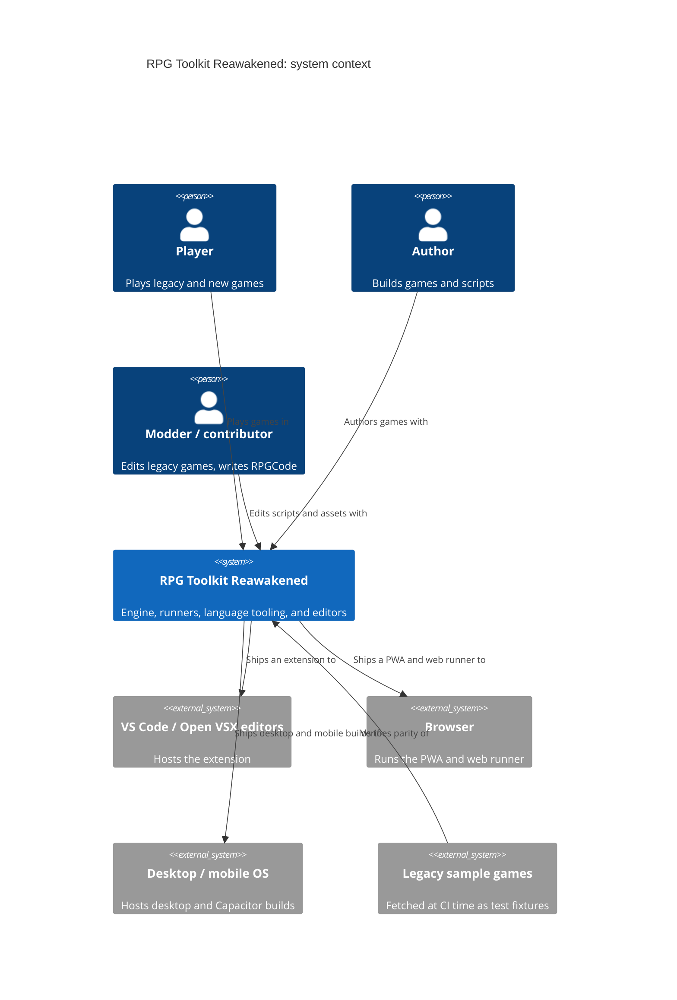
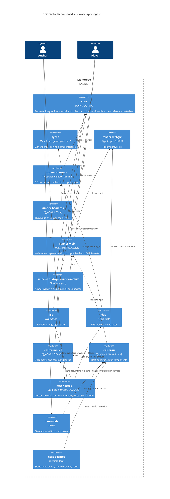
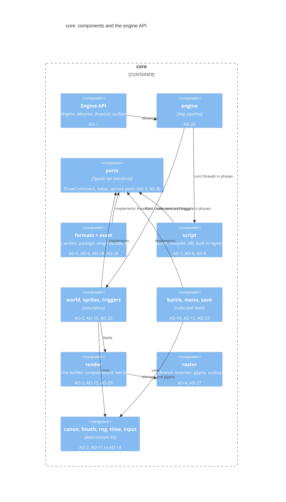
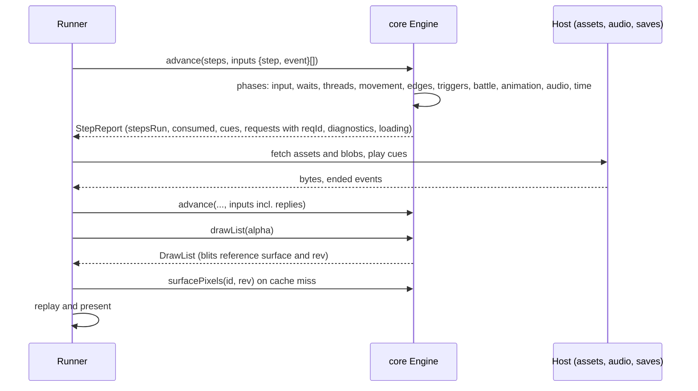

# C4 views — rpgtoolkit-reawakened

Companion to [architecture-rpgtoolkit-reawakened.md](architecture-rpgtoolkit-reawakened.md). Decisions live in the spine (AD-n); these views show them.

## 1. Context

## 2. Containers

## 3. Components of `core`

## 4. Runtime flow: one advance call

