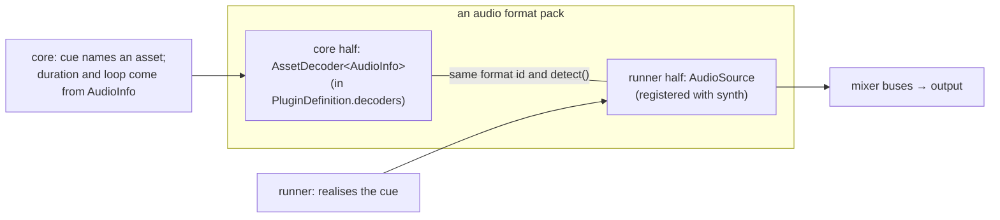

# Pre-inception exploration: audio ecosystem, SoundFonts and asset caching

This records an owner conversation held before epic 6 (`epic-audio-synth`) was incepted. Items marked **Owner direction** are things the owner asked for. Everything else is a proposal, and inception entry 6.1 (rulings) has to confirm it or rule otherwise. Caching items that belong to other epics are also recorded in those epics' envelopes.

## 1. Corpus facts (fetched legacy fixtures, measured 2026-10-18)

| Format | Files | Detail |
|---|---|---|
| MIDI | 182 | 103 SMF type 0, 79 SMF type 1; division 120 to 960 PPQN. A byte scan flagged 28 files with possible Yamaha XG sysex and 23 with possible non-zero bank select (heuristic; may over-count). No CC111 or text loop markers. |
| WAV | 66 | Mostly 8-bit mono (26 at 8000 Hz); odd rates 22255 Hz and 12025 Hz; 2 MS-ADPCM and 1 IMA-ADPCM; 2 stereo. |
| XM (tracker) | 1 | `BusDriver/Media/track02.xm`, although tracker modules are an envelope non-goal. |
| MP3 / OGG | 0 | The spec says they were supported; no fetched game uses them. |

Per-game size (uncompressed): ChimeranEmpire 33.4 MB (audio 3.3 MB, 665 files), School2Demo 22.3 MB, Caoquest 12.3 MB, FinalDestiny 3.7 MB, demo and Basic about 3.2 MB, LittleMan and BusDriver under 0.3 MB.

Audio fields in the formats: board `bkgMusic`; fight background `music`, `selectSound`, `chooseSound`, `readySound`, `cantDoSound`; main file `cursorMoveSound`, `cursorSelectSound`, `cursorCancelSound` (minor ≥ 3); animation frame `sound`.

## 2. Synth: wrap an existing engine, keep it pluggable

- **Proposal:** do not write a MIDI or SoundFont synthesiser. Wrap `spessasynth_core` (Apache-2.0, TypeScript, headless PCM rendering, no DOM) inside `@tk-reawakened/synth`; `runner-web` may use `spessasynth_lib` for Web Audio output. The rejected alternatives are a scratch synth (an SMF sequencer, the SF2 2.04 generators and envelopes, filters, interpolation, voice stealing and effects add up to months of DSP work), FluidSynth (LGPL) and rustysynth (adds a Rust/wasm toolchain).
- **Owner direction:** synths should be pluggable, the way MIDI cards took swappable SoundFonts and hardware modules. `synth` defines a small `MidiSynth` interface (init, optional `loadSoundFont`, play/stop/pause/resume, `setVolume`, optional offline `render`) with capabilities. It ships with `SpessaMidiSynth` and `NullMidiSynth` (headless). Later backends (OPL3 FM, Web MIDI passthrough to hardware, wasm synths) implement the same interface. Neither core nor game logic changes.
- **Proposal:** with PCM decoders, compressed formats, a mixer and duration parsing, `synth` is really the shared audio package, and MIDI is one of its sources. Keep the spine's package name and widen its description; no rename.

## 3. SoundFonts

**Owner direction:** the bundled SoundFont should have a little Super NES character without using ripped commercial samples. Most "SNES SoundFonts" are ROM rips of game samples, which G6/G7 rule out.

What the SNES sound is made of (it can be recreated without rips): 16–32 kHz mono samples in 64 KB of audio RAM, BRR ADPCM grit, short loops, the SPC700 Gaussian interpolation (a soft low-pass around 8–10 kHz) and the 8-tap FIR echo.

- **Path B (curate):** adopt an existing permissively licensed compact GM bank as the immediate default and test font. Candidates:
  - **Florestan Basic GM GS** (3.3 MB, declared public domain): <https://dev.nando.audio/pages/soundfonts.html>
  - **GMGSx** (3.9 MB, declared public domain): <https://musical-artifacts.com/artifacts/841>

  Provenance must be verified before adoption. Florestan's page says it was sampled from a Roland Sound Canvas, which needs a closer licence and provenance check under G6.
- **Path C (author):** build a project-owned "TK-16" GM bank, about 2–3 MB, in Polyphone from CC0/MIT sources (FreePats, Florestan if cleared). Downsample to 16–22.05 kHz mono, set short loops, shape the top end, and give special care to the 16-bit RPG palette (piano, pizzicato, pan flute, slap and acoustic bass, strings, orchestra hit, drum kit). Record every sample's source in `THIRD_PARTY_NOTICES`. The house precedent is the authored `media/fonts/tkr-8x8.fnt` (entry 4.32).
- **Do not use:** Chaos 4M/8M/12M Bank. A copy is labelled "CC0/public domain", but its own readme says "Copyright 1996 Chaos Club by Cyber-Punk. All rights reserved." That is an example of mislabelled provenance.
- **Proposed staging:** Path B lands first so the licence gate, the synth and headless tests are green. Path C is its own entry, and TK-16 becomes the default once it ships. Optional "SNES profile" DSP (low-pass plus echo) can make any bank sound more 16-bit.
- **Where to find more:**
  - Musical Artifacts (filter by licence): <https://musical-artifacts.com/>
  - FreePats: <https://freepats.zenvoid.org/>
  - Debian `main` packages (DFSG-audited; `fluid-soundfont-gm` is MIT)
  - Polyphone's SoundFont hub: <https://www.polyphone.io/en/soundfonts>
  - Internet Archive (historical; provenance often unclear)
  - Larger options: FluidR3_GM (MIT, about 141 MB), GeneralUser GS (custom permissive licence, about 30 MB), FatBoy (CC-BY 4.0, about 330 MB)
- **Owner direction:** keep it in this monorepo. The default bank goes in `media/soundfonts/`, pinned by SHA-256 and licence in `tools/licences/config.json` `bundledAssets` (as the Liberation fonts are) and listed in `THIRD_PARTY_NOTICES`. At 2–4 MB it needs no separate repo or LFS. Big banks stay external (CDN or user disk).

## 4. SoundFont choice is configuration, not a constant

**Owner direction:** our bank must not be the only choice. There are three layers:

1. **Runner:** a `RunConfig` audio part (SoundFont source, initial master volume, synth backend).
2. **Game author:** a project-level default SoundFont. The legacy `.gam` has no field for it, so it needs a Reawakened project setting or sidecar. This ties to research flow `08-project-file-by-convention`.
3. **Player:** runner audio settings offer the bundled default, other bundled or CDN banks, and "Custom…" (pick or drop any `.sf2`). This is a player preference and is never saved in game state.

`synth.loadSoundFont` hot-swaps without restarting playback.

## 5. RPGCode: `soundFont(file)` and `soundFontReset()`

**Owner direction:** a Reawakened addition, like the camera commands.

- `soundFont("bank.sf2")` posts an `audio` effect. The applier records the active bank in `GameState.audio` and emits a new cue kind `soundfont.set` with `asset`.
- `soundFontReset()` returns to the project default.
- Combined with the existing `mediaPlay`/`midiPlay`/`playMidi`, an author can swap the bank and then play a track, or set a bank once in a board's enter program.
- Save/load restores the bank (AD-16 re-emission). A missing or corrupt bank gives a non-fatal diagnostic and the runner keeps the current bank.
- **Needs a docs-first amendment:**
  - AD-16's closed `AudioCue.kind` list gains `soundfont.set`
  - `docs/spec/engine/rpgcode-functions.md` gains both rows
  - the command-effect catalogue gains both names

## 6. What a software audio stack needs that Windows used to provide

Decoding:
1. **A shared WAV decoder** in `synth`: PCM 8/16-bit, MS-ADPCM, IMA-ADPCM, and resampling of odd rates. Browser `decodeAudioData` support for ADPCM is unverified and probably uneven.
2. **MP3/OGG:** browser codecs, bundled permissive decoders, or transcode on import (as E-104 rules for video). No corpus game uses them.
3. **Tracker modules:** remain a non-goal for now, but one corpus game has an XM. Options: a diagnostic only, render to OGG on import, or a later pluggable source (libopenmpt is BSD).
4. **MIDI dialect:** XG/GS bank requests the SoundFont lacks need a ruling: fall back to GM bank 0, or stay silent.

Timing and determinism:

5. **Duration parsing.** AD-14 has the headless runner emit `audio.ended` "after the parsed duration". The shared code must compute durations for MIDI (walking the tempo map), WAV, MP3 and OGG. Blocking `wav(file, true)` and `mp3pause` depend on it.
6. **Music position after load:** restart from the top, or resume from a tick-derived position.
7. **Goldens hash the cue stream, not PCM.** Synth PCM may differ across JS engines; PCM checks need a tolerance or are smoke-only.

Mixing:

8. **SFX channels:** legacy is "one channel". Rule whether a new effect cuts the old one, and which channel menu, battle and frame sounds use.
9. **Battle music hand-off:** after a battle, does board music restart or resume, and does it fade?
10. **Two volume layers.** Game volume (`setVolume`, E-102) is saved, deterministic game state. Player volume (master, music, SFX, mute) is a runner preference. SoundFonts split the same way (author's `soundFont()` versus player override).
11. **Possible Reawakened additions:** crossfades, `musicFade()`, authored loop points (CC111 or markers). Legacy loops whole files only.

Platform (epic 9 wires it; epic 6 rules the contract):

12. **Browser autoplay unlock:** before the user's first gesture, hold only the current music state and drop SFX. The core never waits on unlock.
13. **Focus pause (E-03):** music pauses through the existing `focus` input.
14. **Preload and cache:** see section 7. SF3 needs `wasm-unsafe-eval` in the CSP.

Authoring and distribution:

15. **Project default SoundFont storage** (section 4).
16. **Packaging:** an exported game bundles its authored bank, warns on unclear bank licences, and never redistributes the legacy MIDI pack (own EULA).
17. **Editor preview:** asset editors play MIDI and WAV through `synth` with the project bank, with no running game required.
18. **Accessibility:** mute and per-bus sliders now; visual sound indicators later.

## 7. Asset caching and first-load stalls

**Owner concern:** a first load in the middle of a game could be painful.

Correctness is already safe. Under AD-5, a blocking request freezes time (`advance` returns `loading`, no ticks); music and video are streams that never touch state; prefetch hints are allowed and cannot change state; the core never fetches. `engine.ts` already de-duplicates pending requests. What remains is the visible stall, which comes from **network** and **decode** cost.

Proposals:

1. **Two load modes by package size.**
   - *Whole package* below a threshold (about 64 MB): one download with progress on the title screen, then offline. This covers every corpus game.
   - *Streaming* above the threshold, driven by item 2.
2. **The core computes a deterministic prefetch plan; the runner executes it.** It is sent as AD-5 hints in tiers:
   - *now:* the current board's assets, music and frame sounds
   - *next:* boards reachable by edge links and literal `send(...)` targets, the board's battle background with its music and sounds, and enemy files
   - *always:* main-file cursor sounds, menu assets and the active SoundFont

   Keeping the plan in core avoids a second board parser in each runner.
3. **Content-addressed cache:** hash and size per entry in AD-6's `manifest.json` `index`. Entries become immutable, updates are deltas, offline play is safe (service worker), and stale caches go away.
4. **Decode ahead in a worker on a hint:** images to RGBA, WAV/ADPCM to PCM, MIDI parsing, SoundFont loading.
5. **Audio never stalls the game.** Drop an SFX that arrives more than about 250 ms late. Blocking `wav` just waits longer for `audio.ended`, a logged input.
6. **Stall presentation:** keep the last frame, show a spinner only after about 300 ms, and keep the music playing.
7. **Author feedback:**
   - the editor test run reports stalls with the asset that caused them
   - warn on references the planner can't predict (`send(boardVar$)`)
   - an optional Reawakened `preload("file")` command that is a hint only
8. **SoundFonts are cached per runner and shared across games** (app-shell cache for the default bank).
9. **Storage limits:** call `navigator.storage.persist()`, fall back to streaming on quota errors, and offer PWA install. Safari eviction rules are unverified.

Ownership:

| Who | What |
|---|---|
| Core (AD-5 seam) | prefetch planner, hint tiers, manifest hashes |
| Epic 9 | storage tiers, load modes, service worker, worker decode, stall UX |
| Epic 6 | audio's share of the plan, the late-SFX rule, the shared SoundFont cache contract |
| Editor epics | stall reporting and unpredictable-reference warnings |

## 8. Proposed breakdown (draft, before validation)

| # | Entry |
|---|---|
| 6.1 | Audio rulings (hitl, docs): R-59, sections 5–7 decisions, AD-16 `soundfont.set` amendment, AVI request handling, `GameState.audio` shape |
| 6.2 | `GameState.audio`, the `audio` applier on the effect bus, cue emission, `audio.ended`, save/restore re-emission |
| 6.3 | Audio and video built-ins (14 catalogue names plus `soundFont`/`soundFontReset`), `audio.sfx` and `video` waits |
| 6.4 | `synth`: `MidiSynth` interface, SpessaSynth and Null backends, WAV/ADPCM decoders, duration parsing, mixer buses |
| 6.5 | Path B bundled SoundFont, licence gate and notices |
| 6.6 | Path C TK-16 SoundFont (authored, provenance-recorded) |
| 6.7 | Headless null-audio conformance and cue goldens |
| 6.8 | Browser/offline MIDI render test |
| 6.9 | Refactor sweep |

## 9. Open decisions for 6.1

| Decision | Conservative default if the owner delegates |
|---|---|
| MP3/OGG handling | transcode on import |
| SFX channels | one channel (parity) |
| Music after load | restart from the top |
| BusDriver XM | diagnostic only |
| XG/GS missing bank | fall back to GM bank 0 |
| Late SFX threshold | about 250 ms, drop |
| Path B bank | Florestan or GMGSx, after provenance verification |

## 10. Nice to have: modern and retro audio formats (owner, 2026-10-18)

**Status:** nice to have, not in the epic 6 scope unless the owner promotes it. Also logged in `../../nice-to-have.md`. Library licences and browser support below are from general knowledge and are **unverified**; check each before adoption (G6).

### Modern delivery formats

| Format | Role in a modern game | Fit for Reawakened |
|---|---|---|
| Ogg Vorbis | Standard for music and long ambience; good size/quality; royalty-free; loops cleanly | Strong candidate as the recommended **delivery** format for new music. Loop points can use the `LOOPSTART`/`LOOPLENGTH` comment-tag convention other RPG engines use (a Reawakened rule to confirm). The Ogg granule position gives the exact length cheaply, which is what AD-14's headless `audio.ended` needs. |
| WAV | Uncompressed PCM; editing source; short, low-latency SFX | Already required (legacy SFX, including ADPCM, §6.1). Stays the SFX format; too large for music. |
| MP3 | Historically common; encoder delay and padding cause loop gaps or pops; legacy patent history | Legacy support only. Proposal: transcode looping MP3 music to Ogg on import so loops are gapless; one-shot MP3 can play as is. |
| FLAC | Lossless; archiving and soundtrack distribution; large in builds | **Source** format: accepted on import and in the editor, transcoded to Ogg/Opus when packaging. Exact length is in `STREAMINFO`. |
| Opus | Best quality at low bitrate; decodes at 48 kHz; has pre-skip | Candidate delivery format beside Vorbis for small web bundles; duration must subtract pre-skip. Safari support for Opus in an Ogg container is unverified. |

Proposals:
- **Source and delivery formats are separate** (like the PNG/WebP image question in epic 9). Authors may bring WAV/FLAC/MP3/Ogg; packaging emits Ogg Vorbis or Opus for music and keeps WAV (or a compact form) for SFX. Editor import and export own the transcoding; the encoder dependency must meet G6.
- **Headless needs durations, not decoders.** Under null audio the core only needs each file's length (Ogg granule, FLAC `STREAMINFO`, Opus pre-skip, MP3 frame walk with the Xing/LAME header). Real decoding is a runner concern, either browser codecs or bundled permissive decoders.
- **Authored loop points** fit both MIDI (CC111 or markers, §6.11) and Ogg tags, so one loop rule covers both.

### Classic chip and tracker formats

| Format | What it is | Licence situation of well-known players (unverified) |
|---|---|---|
| MOD / XM / S3M / IT | Tracker modules: notes plus their own samples in one file | libopenmpt is BSD and would pass G6. The one corpus XM (`BusDriver`) would play. |
| SPC | SNES SPC700 program and RAM snapshot | Common players are LGPL or GPL (game-music-emu, snes_spc), which G6 blocks; a permissive SPC700 emulator would need finding or writing. |
| NSF | NES sound program | Same picture as SPC (game-music-emu is LGPL). |
| GBS | Game Boy sound program | Same as NSF. |
| SID | Commodore 64 music | reSID and libsidplayfp are GPL; blocked. |
| VGM / VGZ | Register-level logs for many arcade and console chips | The format is documented; each chip needs an emulator, and their licences vary. |

Proposals:
- **These fit the pluggable design as extra sources.** `synth` gains a general music-source interface beside `MidiSynth` (bytes in, PCM out, length or "loops forever"). Tracker and chip players are optional backends, and only permissively licensed ones may ship. The core stays the same: cues name an asset; the runner picks the source by format.
- **Content provenance is separate from format support.** Most SPC, NSF, GBS, SID and VGM files in circulation are rips of commercial game music. The runner may play files a user supplies but must never bundle such content (architecture-options §6 point 5, G7). Original chiptunes made in trackers are fine.
- **Fits the Super NES direction.** Original music written for SNES-style trackers and shipped as SPC or a tracker module would give the most authentic 16-bit sound. It depends on finding a permissive SPC700 player; until then, tracker modules through libopenmpt are the practical retro route.
- **Determinism is unaffected.** Chip and tracker playback happens in the runner. Files that loop forever never send `audio.ended`, the same as looping MIDI. A tagged length (for example SPC's ID666 length) can be used for one-shot playback.

### Settle first (if promoted)

1. The recommended delivery format for new music (Vorbis, Opus, or both) and the loop-tag rule.
2. Whether import-time transcoding lives in the editor epics, epic 9 packaging, or a shared tool, and which G6-clean encoder it uses.
3. The music-source interface shape in `synth`, and whether libopenmpt is adopted (it would also turn the BusDriver XM decision into "plays").
4. A licence survey of chip emulators (SPC700, NES APU, Game Boy APU, SID, common VGM chips) to see which, if any, pass G6.

## 11. Extensible audio platform (owner direction, 2026-10-18)

**Owner direction:** the audio platform must be extensible, so that a new music source (a tracker player, a chip emulator, a new codec) is easy to add. This promotes the "music-source seam" from §10 into epic 6's design. The individual formats in §10 stay nice to have.

**Proposal: reuse AD-31, not a second plugin system.** AD-31 already makes formats pluggable: `AssetDecoder { id, extensions, detect(header), decode(bytes, context) }`, registered through `PluginDefinition.decoders` (ADR 0004), and the core formats implement the same interface. Audio splits along the existing core/runner line.



1. **Core half: what the simulation needs to know.** An audio format contributes an `AssetDecoder<AudioInfo>`. `AudioInfo` is plain data: format id, length (or "loops forever"), loop points, and whether it needs a bank. It is pure and deterministic. It feeds AD-14's headless `audio.ended`, blocking `wav`, and the prefetch plan. No sample decoding happens in core.
2. **Runner half: how it sounds.** `synth` defines an `AudioSource` contract with:
   - `id` (matching the decoder's), `extensions` and `detect(header)`
   - an optional bank requirement (a SoundFont for MIDI, a patch set for an OPL source)
   - a factory that turns bytes into a playable voice: start, stop, pause, resume, volume, loop, render PCM frames, report end

   `synth` keeps a registry: the runner picks the source by format, routes it to the music or SFX bus, and sends `audio.ended` when the voice ends.
3. **Built-ins use the same seam.** MIDI (`spessasynth_core` plus a SoundFont) and PCM (WAV, including ADPCM) are the first two sources, registered exactly as a third-party source would be. This is the AD-31 practice of core formats implementing the public interface. A Null source serves headless runs.
4. **"Banks" are general.** The SoundFont is the MIDI source's bank. The bank choice (`RunConfig`, project default, player override, `soundFont()`) applies to any source that declares a bank kind, so a later OPL source can take patch sets without new configuration plumbing. The script command keeps the name `soundFont` for now; whether to generalise it is a 6.1 judgement call.
5. **A conformance kit.** One shared suite that every source must pass:
   - its length agrees with its core decoder's `AudioInfo`
   - loops and stop/pause/resume behave
   - volume and bus routing apply
   - an offline render is non-silent
   - a corrupt file gives a diagnostic, never a throw

   This mirrors the host-conformance suite in editor-foundation.
6. **Failure is never a game-state change.** An unknown format, a source the runner lacks, or a bad file gives a diagnostic and silence. The cue stream and game state stay the same in every runner, so replays and goldens are unaffected by which sources are installed.
7. **Distribution and licences.** An audio pack ships both halves: a `PluginDefinition` with the decoder (and any commands) plus a `synth` source module. Anything bundled with the engine passes G6. Packs a user installs are their own business, under ADR 0004's ungated-extension rule. A "write an audio source" guide belongs to epic documentation-website.

**Breakdown impact (draft):** entry 6.4 splits:

| Entry | Scope |
|---|---|
| 6.4a | `AudioInfo`, the `AudioSource` contract, the registry, bus routing, the conformance kit |
| 6.4b | the MIDI source (SpessaSynth) |
| 6.4c | the PCM/ADPCM source and core WAV/MIDI `AudioInfo` decoders |

A tracker source via libopenmpt (§10) would be the first optional pack, and the BusDriver XM is its test case.

**Spine amendments for 6.1 (docs-first):**
- AD-16: runners realise cues through registered audio sources; an unrealisable cue is a diagnostic and silence.
- AD-31: audio formats contribute `AssetDecoder<AudioInfo>`.

## 12. Generic core behaviour, language-neutral runner shape (owner direction, 2026-10-18)

**Owner direction:** there needs to be a way to define "core behaviour" that stays generic, and the runner side needs a well-defined shape that works in most runner setups. A runner may not be written in TypeScript, but it must have the same shape.

**What the spine already gives.** AD-1 makes every engine argument and result structured-cloneable plain data. AD-14 gives every port record a fixed key set (absent is `null`, never omitted). AD-30 already puts synth hot paths behind ports, so a runner can inject wasm while the TypeScript implementation stays the reference for goldens. The draw list is the working precedent: core emits data, any renderer replays it, and conformance vectors (epic 4 entries 4.6, 4.26) prove agreement. Audio should copy that pattern exactly.

**Proposals:**

1. **Core behaviour is normative prose plus data, not code.**
   - A new spec page, `docs/spec/engine/audio.md` (or a section of `display-input-audio.md`), states what each cue means independently of any runner: `music.play` replaces the current track; `loop` semantics; `volume` is an integer percent of the game master; `sfx.play` channel rules; `soundfont.set` (the bank) semantics; when `audio.ended` is owed; what an unrealisable cue does.
   - `AudioInfo` (§11) is a plain-data record. The core never knows source types or codecs, only format ids, lengths and loop points.
2. **The runner shape is a protocol, not a class.** The runner-side contract is written once as messages plus a state machine; the TypeScript `AudioSource` interface is one binding of it. A Swift, Kotlin, Rust or C++ runner implements the same messages and states.

   ```mermaid
   stateDiagram-v2
     [*] --> Loading: load(voiceId, bytes, bank|null)
     Loading --> Ready: ready
     Loading --> Failed: error(code)
     Ready --> Playing: play(loop, volume, bus)
     Playing --> Paused: pause
     Paused --> Playing: resume
     Playing --> Ended: ended (not looping)
     Playing --> Stopped: stop
     Paused --> Stopped: stop
     Failed --> [*]
     Ended --> [*]
     Stopped --> [*]
   ```

   - **Messages in:** `load`, `play`, `pause`, `resume`, `stop`, `setVolume`, `setBank`.
   - **Events out:** `ready`, `ended`, `error`.
   - All are plain-data records with fixed keys and `null` for absence, under the AD-14 rules.
   - The runner maps `cueId` to `voiceId` and turns `ended` into the `audio.ended { cueId }` input.
   - A language-neutral schema (JSON Schema, generated from or checked against the TypeScript types) is published beside the spec page.
3. **Conformance is data-driven, so any language can run it.** The §11 conformance kit becomes vectors: (asset bytes, message script) → expected events, lengths and a non-silent render check. This copies the shape of the rasteriser conformance vectors. A non-TypeScript runner proves itself by replaying the same vectors; the TypeScript implementation stays the reference (AD-30).
4. **What a runner may decide, and what it may not.**
   - It may: choose output API, buffer sizes, threading (AudioWorklet, native thread), and which sources and banks are installed.
   - It may not: change cue meaning, invent or drop `audio.ended` for a cue that owes one, or feed anything back into core except the AD-14 inputs.

**Wider scope (raise at epic 9 inception, not decided here).** The same treatment (a normative behaviour page, a language-neutral message schema and runner-replayable vectors) could cover the whole runner boundary: draw-list replay, audio, input events and AD-5 requests. That would let a fully native runner be built and checked against the same contract. Epic 6 does audio first and keeps the format reusable.

**Breakdown impact (draft):**
- Entry 6.1 writes the core-behaviour page and the runner protocol prose.
- Entry 6.4a publishes the schema and the vector-based conformance kit beside the TypeScript binding.

## 13. Standardized media commands and audio tracks (owner direction, 2026-10-18)

**Status:** owner direction; the exact names, signatures and units are a proposal for entry 6.1 to rule (G7, docs first). Nothing is removed.

**Direction.** Reawakened defines one standard family of media commands that covers everything an author wants to do with audio: load, play, stop, pause, resume and seek to a time. Audio plays on **tracks** so sound effects and background music layer instead of sharing one slot. Every legacy audio command keeps working and is marked **obsolete** in `docs/spec/engine/rpgcode-functions.md`, with a pointer to the standard command that replaces it.

### Tracks

- A track is a named, independent player with its own asset, position, state, flags and volume. The old word "channel" is retired: what §9 called a channel is now a **voice**.
- **Voices are a property of a track** (owner direction, 2026-10-18): the number of sounds that one track can play at the same time. `music` and the legacy `sfx` track have 1 voice, so a new `wav` cuts off the previous one exactly as before. A track may be given more voices for overlapping sounds (see open item 11).
- Five built-in tracks always exist (owner direction, 2026-10-18): `music` (the legacy background-music slot), `sfx` (the legacy single sound-effect slot), `ambience` (looping environment sound), `voice` (dialogue) and `ui` (menu and cursor sounds). `music` and `sfx` carry the legacy commands; the other three give a game's options menu per-category volume sliders (an Epic 8 handoff). Authors may create more tracks by name.
- Tracks mix together; starting audio on one track never stops another. The master volume (`setvolume`) scales all tracks; each track also has its own volume.
- Track state lives in `GameState.audio` as plain data (G1, AD-10), so it saves, restores and replays identically. Position advances on the fixed tick from the asset's known length; the runner never reports position back into core (G2, G3, AD-16).

### Proposed standard commands: control

| Command | Does | Waits? |
|---|---|---|
| `mediaLoad(track, file)` | Put a file on a track without playing it, so the first play does not stall (see §7). | no |
| `mediaPlay(file[, track[, flags]])` | Play a file on a track (default `music`). `flags` combine `tkMD_` play flags (below); default `tkMD_LOOP` on `music`, `tkMD_ONCE` elsewhere. Existing one-argument calls behave as today. | only with `tkMD_WAIT` |
| `mediaStop([track])` | Stop a track and rewind it (default `music`). | no |
| `mediaPause([track])` / `mediaResume([track])` | Pause and resume a track where it stopped. | no |
| `mediaSeek(track, seconds)` | Jump to a time in the track. | no |
| `mediaLoop(track, on)` | Turn looping on or off in place, without restarting the track (a music player's loop toggle). | no |
| `mediaVolume(track, percent)` | Set one track's volume, 0 to 100. | no |
| `mediaWait([track])` | Wait until the track finishes (default `sfx`). Covers the 3.1.0 `mp3pause` behaviour. | yes |

### Proposed standard commands: queries

Every write has a matching read, so an author can build a music player screen in RPGCode (play/pause button, progress bar, scrubbing, loop toggle, per-track volume, playlist). Reads use the by-reference return convention.

| Command | Returns |
|---|---|
| `mediaState(track[, &ret])` | `tkMD_STOPPED`, `tkMD_PLAYING` or `tkMD_PAUSED`: what the track is doing now. |
| `mediaFlags(track[, &ret])` | The track's current `tkMD_` play flags: how it is set to play. Test looping with `mediaFlags(t) & tkMD_LOOP`. |
| `mediaPlaying(track[, &ret])` | Shorthand for `mediaState(track) == tkMD_PLAYING`. |
| `mediaFile(track[, &ret])` | The file on the track, or `""`. |
| `mediaPosition(track[, &ret])` | Current time in the track, in seconds. |
| `mediaLength(track or file[, &ret])` | Length in seconds; by file works before playing (playlist durations). |
| `mediaVolume(track[, &ret])` | The track's volume (the one-argument reading form). |
| `mediaTracks(&ret[])` | The names of all tracks. |
| `getVolume([&ret])` | The master volume, matching `setvolume`. |

**State versus flags.** `mediaState` and `mediaFlags` are deliberately separate: state is what is happening now (exactly one of stopped, playing, paused); flags are settings that hold in every state. A looping song that is paused reports `tkMD_PAUSED` and still has `tkMD_LOOP`, so it loops again after resume. Merging them would lose "paused, will loop" versus "paused, will stop at the end".

### Constants (values illustrative until 6.1 rules them)

Following the existing `tkMV_`/`tkVT_`/`tkPRG_` convention in `docs/spec/engine/rpgcode-language.md`:

| Play flag | Value | Meaning |
|---|---|---|
| `tkMD_ONCE` | 0 | play once and stop |
| `tkMD_LOOP` | 1 | loop until stopped |
| `tkMD_WAIT` | 2 | the script waits until it ends (`mediaPlay` then `mediaWait`) |
| `tkMD_RESTART` | 4 | restart from the top if the same file is already playing on the track (otherwise leave it running) |

| State | Value |
|---|---|
| `tkMD_STOPPED` | 0 |
| `tkMD_PLAYING` | 1 |
| `tkMD_PAUSED` | 2 |

### Waiting rules

- `mediaWait` on a looping track resumes at the end of the current loop pass (useful for switching music on a loop boundary) and posts a debug diagnostic so the author sees it. Rejected alternative: waiting forever, a silent hang.
- `mediaPlay` with `tkMD_LOOP | tkMD_WAIT` is rejected with a diagnostic at the call, since waiting on an endless loop is meaningless.
- A wait ends on the tick its track is stopped, paused or replaced by another `mediaPlay`, so a wait never hangs behind another script's action.
- Every query answer and wait end comes from core state or from asset facts read at load (for example length); none from the audio device (G2, G3). Epic 6 must therefore know each asset's length up front for every format it plays.

Seconds are converted to ticks through `core/time` (AD-2); help text follows the CLAUDE.md rule (plain terms first, then units, ticks, order and whether the script waits).

### Nice to have: media metadata

A fun extra for music-player screens: read title, artist, album and similar tags from the file (ID3 for MP3, Vorbis comments for OGG, the text chunks of MIDI files), for example `mediaInfo(file, key[, &ret])`. Deterministic, since tags are part of the asset bytes, but format-specific; settle which formats and keys are supported and what missing tags return (`""`). Not in the 6.1 scope unless promoted; also log in `../../nice-to-have.md`.

### Legacy commands: obsolete, still working

| Legacy command | Standard equivalent |
|---|---|
| `midiplay`, `playmidi`, `mediaplay(file)` | `mediaPlay(file)` on `music` |
| `mediastop`, `mediarest`, `midirest` | `mediaStop()` on `music` (`midirest` is a stop, not a pause, per the spec row and round-8 Q1) |
| `wav`, `mp3` | `mediaPlay(file, "sfx")` |
| `wavstop` | `mediaStop("sfx")` |
| `mp3pause(file)` | `mediaPlay(file, "sfx", tkMD_ONCE \| tkMD_WAIT)`: plays the sound once and the script waits until it ends (3.1.0 behaviour; see open item 1) |
| `setvolume` | unchanged; master volume over all tracks |

**Corpus evidence (archive census, 2026-10-18).** Of 46,681 program files (43,087 unique) in the RPG Toolkit archive: `wav` 536 call sites, `midiplay` 214, `midirest` 77, `mediaplay` 73, `playmidi` 69, `mp3` 21, `wavstop` 19, `mediastop` 14, `setvolume` 13, `mediarest` 1, `mp3pause` 0. The only `mp3pause` source is the release note in `rpgtoolkit.com/history.txt` (`#Mp3Pause("filename.mp3")`, "plays an mp3 file, except it will pause the game completely while it plays"). The legacy names are common in real games, which is why they stay.

**Legacy looping facts (owner-relayed, `docs/provenance/facts-round-9.md`).** Music always looped in both versions, with no way to play it once (M1); board and battle music loop too (M3); replaying the track that is already playing carries on rather than restarting (M2); `wav`, `mp3` and `mp3pause` never loop (M4). So the `music` default `tkMD_LOOP`, the `sfx` default `tkMD_ONCE` and the opt-in `tkMD_RESTART` all match legacy, and `tkMD_ONCE` on `music` is a Reawakened addition.

### Open items for 6.1

1. `mp3pause` timing (decided direction, owner 2026-10-18): follow 3.1.0, so `mp3pause(file)` is `mediaPlay(file, "sfx", tkMD_ONCE | tkMD_WAIT)`. Evidence: the spec baseline is Toolkit 3.1 (ADR 0007); the command's own release note says it pauses the game while the sound plays; the final version's non-waiting behaviour makes it identical to `mp3`, which reads as a regression; zero archive programs use it. Rejected alternative: the final version's non-blocking alias of `wav`.
2. Answered by round 9 M1: 3.1.0 played MP3, OGG and tracker files as looping music; the final version plays only MIDI (also round 8 Q17). The format policy itself stays with §9's "MP3/OGG handling" decision.
3. Track reuse (accepted direction, owner 2026-10-18): a new play on a track replaces that track's audio (per voice, the legacy single-slot rule), except that replaying the file already playing carries on (round 9 M2) unless `tkMD_RESTART` is set. The maximum number of named tracks remains for 6.1 to set.
4. AD-16 amendment (accepted direction, owner 2026-10-18): replace the fixed `music.*` and `sfx.*` cue kinds with generic per-track kinds (`media.load`, `media.play`, `media.stop`, `media.pause`, `media.resume`, `media.seek`, `media.volume`, `media.fade`, `media.flags`), each carrying a `track` field (and a voice index where a track has more than one voice); `music` and `sfx` become track names. Rejected alternative: keep the old kinds and add a `track` field, which makes the names misleading and needs two copies of every new feature. The cue format is internal (core to runner); 6.1 confirms that nothing built yet produces or consumes the old kinds.
5. Channels (accepted direction, owner 2026-10-18): §9's "SFX channels: one channel (parity)" becomes "the `sfx` track has 1 voice". Old games behave the same; the voice count and the stealing rule are open item 11.
6. Built-in tracks (accepted direction, owner 2026-10-18): `music`, `sfx`, `ambience`, `voice` and `ui`; 6.1 sets each one's default flags and voice count.
7. Ratify the `tkMD_` names and values, the state-versus-flags split, `mediaLoop`, and the waiting rules above.
8. The AD-16 cue amendment also needs a loop-toggle cue and per-track volume, and `GameState.audio` must hold per-track state, flags and asset lengths.
9. Version rule for the other 3.1.0-versus-final splits (round 8 Q7, Q12, Q17): follow 3.1.0 as the spec baseline unless the later behaviour is clearly a deliberate fix; then take the fix and record it as a Reawakened ruling with evidence; a later behaviour that looks like a regression is treated as a bug (as for `mp3pause`).
10. Name clashes (resolved, 2026-10-18). **Rule already in the spec:** built-ins bind at compile time, so a script method with the same name as a built-in is never called at those call sites, and the definition raises a required warning naming the built-in it shadows (`docs/spec/engine/rpgcode-functions.md`, R-35; resolution order in `rpgcode-modules-and-objects.md`). So adding a new media built-in would silently replace an old game's own method of that name, with a warning. **Archive scan:** 3,192 unique `.prg` programs in the RPG Toolkit archive (loose and inside zips, nested to three levels) contain **no** method definitions and **no** calls named `mediaLoad`, `mediaPause`, `mediaResume`, `mediaSeek`, `mediaLoop`, `mediaWait`, `mediaState`, `mediaFlags`, `mediaPlaying`, `mediaFile`, `mediaPosition`, `mediaLength`, `mediaVolume`, `mediaTracks`, `mediaFade`, `mediaInfo` or `getVolume` (case-insensitive). The new names are safe to add; the shadow warning covers any game outside the archive. Caveat: a text scan; non-`.zip` archives and calls without parentheses are not seen.
11. Layered audio (proposal, prompted by owner research on modern engines, 2026-10-18; voices accepted as direction):
   - **Fades:** `mediaFade(track, percent, seconds)` ramps a track's volume over time, computed in core per tick (the runner only smooths between ticks). A fade to 0 leaves the track playing silently, which is how music stems are switched in and out.
   - **Synced stems:** a way to start a track in lock-step with another track's position (for example an extra `sync` argument on `mediaPlay`), so music layers (drums, bass, melody, combat strings) stay aligned when added later.
   - **Voices per track:** a track's voice count is settable; a built-in multi-voice effects track (for example `effects` with about 32 voices, a common engine default) covers overlapping sound effects, while `sfx` stays at 1 voice for legacy parity.
   - **Voice stealing:** when every voice is busy, a fixed core rule picks the sound that stops (oldest first, or lowest priority with play order breaking ties), so replays never depend on the audio device.
   - **Stingers:** a short musical clip on its own track over the music needs nothing new; optional ducking (the music dips while the stinger plays) is a nice-to-have built on `mediaFade`.
