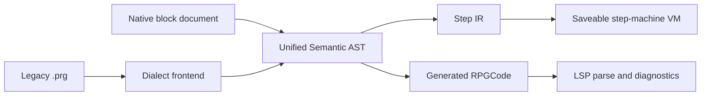

# Program editor and blocks: flows for beginners

The program editor must make a common event feel like arranging a sentence, without making RPGCode a second-class escape hatch. The design below keeps the complete command language, but gives beginners a small, safe path from a trigger to a running program.

## Jobs

Authors describe these jobs as:

- **Make something happen:** when the player touches a door, move them to another board, play a sound, or start a battle.
- **Have a conversation:** show several lines, offer a choice, and make the choice change the game.
- **Track a quest:** remember a fact such as “the chest was opened”, check it later, and change the world when it is true.
- **Make a special screen:** arrange text, pictures, colours, buttons, and rectangles for a title screen, menu, or custom dialogue.
- **Use a recipe from another author:** paste a forum snippet, understand its errors, and either keep it as code or turn the supported parts into blocks.
- **Find and fix a mistake:** see the problem beside the command, run one program in a known situation, and inspect plain-language values while it runs.
- **Go deeper:** use every RPGCode command, not just the beginner catalogue.

## Legacy flow and where it hurts

The functional guide describes a text editor, a separate command reference, an event helper, a test-preferences dialog, and a migration wizard. It does not describe a visual block document as a separate storage model.

| Step | What happens in the legacy editor | Problem (D = discoverability, S = safety) |
|---|---|---|
| 1 | The author creates or opens a `.prg` from a file menu or project tree. | The author must know that an event is a text program and where programs live. **D** |
| 2 | A plain text area accepts any text. Syntax colouring is based on line shape rather than a parser. | A coloured line can still be an unknown command or malformed call. Errors wait until runtime. **D, S** |
| 3 | The author opens a separate quick-reference window, selects a command, and inserts its displayed text. | The reference is modal and separate from the code's context; its list can drift from the engine. **D** |
| 4 | The author writes command names, strings, numbers, labels, and branches by hand. | File names and arguments are easy to mistype. There is no project-aware picker or reference graph. **D, S** |
| 5 | A board event can point to a file or one line of inline code. | The same concept has two homes, and it is not obvious which one should be used. **D** |
| 6 | For a conversation, the author writes message-window calls and key waits manually. | The required ordering of show, wait, and clear is invisible to a beginner. **D, S** |
| 7 | For a choice, the author assembles buttons, keyboard checks, labels, and branches manually. | A choice is a control-flow problem disguised as unrelated commands. **D** |
| 8 | The author draws custom screens by hand with text, colours, fonts, images, and rectangles. | The corpus shows this is common, but the editor gives no screen designer. **D** |
| 9 | The author uses a global variable or a generated flag for “run once” and conditions. | Naming, type, initial value, and lifetime are unclear; a wrong flag can silently prevent an event. **D, S** |
| 10 | Test Preferences are configured separately and kept in memory for the open editor. | Tests are not reproducible, and a test setup can disappear with the window. **S** |
| 11 | Run writes a temporary test program, starts the engine, and leaves that generated file in the project. | Scratch output can be mistaken for authored code and can become stale. **S** |
| 12 | The Debug button is present but unavailable; there are no working beginner debugging affordances. | Authors resort to print/debug messages and guesswork. **D** |
| 13 | Save writes plain text without syntax validation. Close asks about a broad dirty flag. | A failed or unsafe edit is not caught near its cause; the visible undo/redo menu is not a dependable model. **S** |
| 14 | The update wizard closes open program windows, rewrites selected files after making a backup, and asks the author to inspect the result. | Migration is a disruptive, blocking operation with a large blast radius. **S** |
| 15 | The editor can switch to an event list helper, but it writes text back without a separate validation pass. | Two views can disagree, and the author cannot tell what is authoritative. **D, S** |

The command census has 2,550 unique programs in its corpus; command-coverage percentages use the 2,521 programs with at least one call as the denominator. `send` appears in 44.0%, `wait` in 31.8%, and `mwin` in 31.1% of that coverage denominator. Five common commands touch 85.7% of programs, while 51.0% use only the top ten. This supports a small first path, not a small language.

## Redesigned flow

### Screen 1: choose how to author

Opening a board trigger or choosing **New program** opens one document with two views:

```text
┌───────────────────────────────────────────────────────────────────────┐
│ Door to Inn   [Blocks] [Code]                         ● Saved          │
├───────────────┬───────────────────────────────────┬───────────────────┤
│ ADD A STEP     │ When player steps on this         │ DETAILS           │
│ Say            │                                   │ Name: Door to Inn │
│ Go to board    │  1. Play sound [door.wav]        │ Trigger: step-on  │
│ Play sound     │  2. Go to board [Inn] at [door]  │ Runs: once        │
│ Give item/gold │                                   │                   │
│ Start battle   │       + Then...                   │                   │
│ Fade           │  [Show as code]                  │                   │
│ Wait           │                                   │                   │
│ Logic / Code   │                                   │                   │
└───────────────┴───────────────────────────────────┴───────────────────┘
```

The trigger inspector's Advanced options include **Repeat while inside**, **Trigger every [N] px**, and **Stop the player's movement**. They are explicit per-trigger controls, not implied by the event sentence.

The **Blocks** view is a readable ordered list, not a graph that requires programming knowledge. Each row has a sentence, inline blanks, drag-to-reorder, duplicate, disable, and delete. A block's advanced parameters are collapsed until needed. **Code** is always available and is never hidden behind an expert setting.

The first empty state says: “Choose what should happen. You can change any step later in Code.” It offers the seven Tier 1 actions and a search box for the full catalogue. A block can be inserted from the command palette, keyboard, or canvas context menu.

The census share is the percentage of the 2,521 programs with at least one call containing the given command, not the percentage of all calls. Tier labels describe the beginner surface: Tier 1 is a sentence block; Tier 2 is a focused designer; Tier 3 remains a Code step or searchable command. “Companion” means easy to add from **More common steps** without being one of the seven headline actions.


| # | Command | Programs | Share | Proposed surface |
|---:|---|---:|---:|---|
| 1 | `send` | 1,121 | 44.0% | Tier 1 — Go to board |
| 2 | `wait` | 810 | 31.8% | Tier 1 — Wait |
| 3 | `mwin` | 793 | 31.1% | Tier 1 — Say something |
| 4 | `mwincls` | 358 | 14.0% | Tier 1 companion — clear message |
| 5 | `delay` | 269 | 10.5% | Tier 1 companion — pause |
| 6 | `text` | 248 | 9.7% | Tier 2 — screen/menu designer |
| 7 | `wav` | 245 | 9.6% | Tier 1 — Play a sound |
| 8 | `colorrgb` | 219 | 8.6% | Tier 2 — screen/menu designer |
| 9 | `fontsize` | 213 | 8.4% | Tier 2 — screen/menu designer |
| 10 | `branch` | 159 | 6.2% | Tier 3 — Code / Logic |
| 11 | `include` | 158 | 6.2% | Tier 3 — Code / shared program |
| 12 | `setimage` | 139 | 5.5% | Tier 2 — screen/menu designer |
| 13 | `bitmap` | 133 | 5.2% | Tier 2 — screen/menu designer |
| 14 | `put` | 121 | 4.7% | Tier 3 — Code / runtime board edit |
| 15 | `fade` | 119 | 4.7% | Tier 1 — Fade |
| 16 | `end` | 112 | 4.4% | Tier 1 companion — end program |
| 17 | `clear` | 107 | 4.2% | Tier 2 — screen/menu designer |
| 18 | `givegp` | 106 | 4.2% | Tier 1 — Give gold |
| 19 | `giveitem` | 106 | 4.2% | Tier 1 — Give item |
| 20 | `kill` | 106 | 4.2% | Tier 3 — Code / variables |
| 21 | `push` | 104 | 4.1% | Tier 3 — Code / movement |
| 22 | `run` | 103 | 4.0% | Tier 3 — Code / call program |
| 23 | `setimagetransparent` | 102 | 4.0% | Tier 2 — screen/menu designer |
| 24 | `midiplay` | 97 | 3.8% | Tier 1 related — Play music |
| 25 | `done` | 88 | 3.5% | Tier 1 companion — end program |
| 26 | `font` | 87 | 3.4% | Tier 2 — screen/menu designer |
| 27 | `fillrect` | 77 | 3.0% | Tier 2 — screen/menu designer |
| 28 | `color` | 76 | 3.0% | Tier 2 — screen/menu designer |
| 29 | `setbutton` | 75 | 2.9% | Tier 2 — message/screen designer |
| 30 | `pause` | 75 | 2.9% | Tier 3 — legacy compatibility Code |
| 31 | `bordercolor` | 74 | 2.9% | Census only — obsolete; do not offer as a new command |
| 32 | `load` | 74 | 2.9% | Tier 3 — Code / save data |
| 33 | `random` | 73 | 2.9% | Tier 3 — Code / expression |
| 34 | `getgp` | 70 | 2.7% | Tier 3 — Code / condition |
| 35 | `mouseclick` | 70 | 2.7% | Tier 2 — screen/menu designer |
| 36 | `fightenemy` | 67 | 2.6% | Tier 1 — Start a battle |
| 37 | `savescreen` | 65 | 2.5% | Tier 2 — screen/menu designer |
| 38 | `checkbutton` | 65 | 2.5% | Tier 2 — message/screen designer |
| 39 | `dirsav` | 64 | 2.5% | Tier 3 — Code / save picker |
| 40 | `restorescreen` | 61 | 2.4% | Tier 2 — screen/menu designer |

The table keeps `clear`, `setbutton`, and screen-buffer commands in the designer even though some calls are not beginner actions. The census notes that the meanings of `kill`, `push`, `done`, `put`, and `clear` were not independently checked by its scanner; their Tier 3/Tier 2 placement here follows the current function reference where one exists.


### Tier 1 blocks: exact beginner sentences and parameters


| Block sentence (exact UI wording) | Parameters shown to the author | RPGCode lowering |
|---|---|---|
| **Go to board [board] at [spot].** | `board`: named board picker; `spot`: player-start marker or named entrance; Advanced: tile `x`, `y`, and layer `z`. | `send(file, x, y, z)`; the picker resolves the stable board ID to the project path and coordinates. |
| **Say [message].** | `message`: multiline text with variable insertion; optional speaker label and portrait belong to the dialogue designer, not the core text field. | `mwin(text)`, then `wait()`, then `mwincls()` for a complete one-message interaction. A “keep window open” advanced option exposes the individual steps. |
| **Play a sound [sound].** | `sound`: audio picker filtered to sound effects; Advanced: **Wait for sound to finish** (availability depends on the R-59 runtime resolution), **Do not wait**, and stop current effect. | `wav(file)`; optional blocking semantics follow `display-input-audio.md` E-101 and remain subject to R-59. Background music is the related **Play music [track]** variant using `midiplay(file)`. |
| **Give the player [item].** | `item`: named item picker; quantity is an optional repeated-give control if supported by the item model. | One `giveitem(item)` call per requested item, or the equivalent repeated operation. |
| **Give the player [amount] gold.** | `amount`: integer expression, default `1`; the expression editor is available through Advanced. | `givegp(gp)`. |
| **Start a battle against [enemy].** | `enemy`: one or more named enemies; optional battle background under Advanced. | `fightenemy(enemy, ..., background)`; this command has no skill argument. Skill selection belongs to `fight(skill, background)`, a separate Code/catalogue action, not this enemy battle block. |
| **Fade the screen.** | No colour or speed fields: the command uses the current colour. | `fade(type)`, with the named style converted to the required integer. |
| **Wait until the player presses a key.** | Optional result variable under Advanced; default ignores the returned key. | `wait()` or `wait(&key)` when a result variable is selected. The runtime yields; it does not block a host thread. |

The sentence **“Show [message] and wait for the player to continue.”** is the expanded form of **Say [message].** It is used in the block's tooltip so authors can see why the next step does not run immediately. The generated sequence is visible, not magical.

`mwincls`, `delay`, `end`, and `done` are also available as one-click **More common steps**. They are intentionally not required on the first palette: a normal Say block handles its own cleanup, while explicit clearing, pausing, or ending remain easy to find. This preserves the census win without making the primary palette too large.

### Tier 2 designers

**Message with choices** opens a compact designer rather than asking the author to assemble button state manually:

```text
┌ Message with choices ──────────────────────────────────────────────┐
│ Lines:  Old man: “The road is dangerous.”                         │
│         Old man: “Will you take this map?”                        │
│ Choices:  [Yes, take the map]   [No, not yet]   + Add choice       │
│ Yes → [Then steps…]     No → [Then steps…]                         │
│ [Preview dialogue]                                      [Done]      │
└────────────────────────────────────────────────────────────────────┘
```


The T-40 configurable header template is available when creating a `.prg`; the project may configure its contents. T-46 capitalisation is an explicit, undoable formatter that normalises recognised built-in names to canonical case without changing strings or comments.

- a canvas with visible coordinates, safe margins, and a screen-size preview;
- a layer list for background images, rectangles, text, and buttons;
- direct manipulation for position and size, with exact numeric fields beside each handle;
- a font, size, colour, border, alignment, and rectangle inspector;
- button labels and actions expressed as Then lists;
- **Save screen**, **Restore screen**, and **Clear screen** as explicit steps;
- a code preview for unsupported effects, never a claim that every call became a visual object.

The command catalogue and screen designer omit `bordercolor`: it is obsolete and raises an error; its census count is historical, not a proposed command.

### Tier 3: code and full catalogue

The Tier 3 palette is a searchable command catalogue. Selecting a command can insert a typed action or a visibly labelled **Code step** where supported. Parser acceptance alone does not prove that a command resolves or runs; catalogue/plugin validation must diagnose unknown names. The lexical scan found 37.6% of matched texts with an identifier outside the top 30 and 62.4% without one; it does not measure complete-program conversion to blocks.

### Show as code, side by side

A **Show as code** button opens a split view:

```text
┌ BLOCKS (editable) ───────────────┬ CODE (generated, read-only by default) ┐
│ 1 Say “Welcome!”                 │ mwin("Welcome!");                      │
│                                  │ wait();                                │
│                                  │ mwincls();                             │
│ 2 Go to board [Inn] at [door]   │ send("inn.brd", 4, 7, 1);              │
└──────────────────────────────────┴────────────────────────────────────────┘
```

Selecting a block highlights its source range. Selecting code highlights the owning block when the mapping is known. Generated code is formatted by the same parser used by the LSP; line numbers and diagnostics remain stable enough to explain an error.

If a user chooses **Edit generated code**, the editor makes the consequence explicit: “This changes the program's source. Blocks may no longer describe every line.” On the first edit it offers **Import supported edits into blocks**, **Keep as code-only**, or **Cancel**. A successful block import shows a diff. Unsupported or ambiguous edits become a Code step with its exact text preserved. Choosing **Keep as code-only** moves the program out of the generated ownership set; it is then a normal hand-written `.prg` and is never silently regenerated. Choosing **Rebuild from blocks** shows a diff and requires an explicit confirmation. Generated text is never overwritten merely because a block was changed.
Golden verification is a behavioural requirement for the block compiler: representative block documents and generated RPGCode must be checked as exact golden input/output pairs, including ordering, yields, and source mappings. This guards the user-visible lowering contract; source-text assertions alone do not establish equivalent behavior.

The Code view is a real language-server client in every host, not a different editor in the PWA and VS Code. It provides:

- parser-based highlighting and diagnostics beside the offending token, plus a project Problems panel;
- completion, signature help, and hover documentation from the built-in function reference;
- find/replace in a file and across the project, with preview before replacement;
- an outline of methods, labels, and block/code regions;
- snippets for dialogue, choice, condition, and common file references;
- rename for variables, labels, named programs, and project assets when references are known;
- breadcrumbs and go-to-definition/find-references for includes and named things;
- Zen mode that hides panels without changing the document or its storage;
- formatting and indentation as undoable commands;
- **Test this program**, which selects a saved test scenario rather than creating a scratch file.

A test scenario is a project-owned fixture: for example, “Hero at Inn entrance, party = Hero, quest_stage = 2, inventory = empty.” **Run** saves first, starts the selected program through `platform-services.run.startProgram`, and displays the fixture, output, and diagnostics. Scenario files are named, duplicated, reviewed, and versioned like other project data. They are not hidden editor preferences.

### Debugging in plain words

A red dot in the left margin means **pause here next time this line runs**. When execution pauses, the debugger says **The game is waiting at “Give the player Map”** rather than exposing only an instruction pointer. The right panel shows:

- **What is happening:** current program, block, line, and call chain;
- **What the game remembers:** named variables, quest values, inventory, and selected object;
- **What happens next:** the next block or branch;
- **Continue**, **Step over**, and **Stop** buttons.

Watch expressions are added with **Watch this value** and show “not available” rather than throwing an exception when a value is out of scope. Breakpoints and watches are plain data, compatible with the deterministic step machine and DAP. They do not change game state merely by being viewed.

### Named references and “create new…”

A block never asks a beginner to type a path or slot number when the project can name the thing. Every picker has search, recent items, a preview, **Open**, and **+ Create new…** at the top.

| Reference | Picker and inline creation |
|---|---|
| Board | **Go to board [board]** lists boards and entrances. **+ Create new board…** creates a ready board, opens it, and offers to place the destination marker and return door. Cancelling leaves the block unassigned with a clear diagnostic. |
| Program | **Run program [program]** lists hand-written and generated programs. **+ Create new program…** creates an empty code document in the correct folder and returns to the picker. |
| Item | **Give the player [item]** lists item names and thumbnails. **+ Create new item…** opens the item form with a name required, then returns to the block with the stable item ID selected. |
| Sound or music | **Play a sound [sound]** filters by audio role. **+ Import sound…** copies an outside file into the project after a licence/format check, then selects it. |
| Enemy | **Start a battle against [enemy]** lists enemies. **+ Create new enemy…** opens a minimally valid enemy and returns to the choice. |
| Variable or switch | Conditions and assignments use the named variable list. **+ Create new variable…** opens the small variable form, saves a stable ID and type, and returns to the expression. |

A missing reference is not silently replaced. The block says **Board “Inn” is missing** and offers **Create**, **Choose another**, or **Keep as code**.

### Variables and switches

A project has one **Variables** page, presented as a named list rather than a bag of cryptic flags:

| Name | Plain type | Initial value | Used in |
|---|---|---:|---|
| `quest_stage` | whole number | 0 | 4 programs, 2 triggers |
| `has_map` | true/false | false | 3 conditions |
| `old_man_name` | text | “Elder” | 1 message |

The beginner form offers **true/false**, **whole number**, **decimal number**, and **text**. “Switch” is a friendly view of a true/false variable, not a second storage system. Advanced code can still use the language's dynamic values, but the editor warns when a block expects a different plain type.

Rename previews every affected trigger, block, test scenario, and code reference. Cross-document rename and undo are **Conditional** on an approved multi-document transaction contract; absent that contract, show the per-document edits and require explicit review/application, with no claim of one undo. A raw string that might be a variable is listed for manual review. Delete requires the same reference list and offers **replace with…**. Cleanup is non-destructive: offer to wrap loose dialogue lines as explicit Say blocks, preview the diff, and preserve unsupported text unchanged; never auto-delete or rewrite unrecognized commands. The list shows whether a variable is project-wide, board-local, or scenario-only; the default for a beginner-created variable is project-wide.

New `.prg` documents can start from an optional project-configurable header template (T-40). The Code editor provides **Format built-ins to canonical case** as an explicit T-46 command; formatting preserves comments, string literals, and code semantics.


Migration is a quick fix, not a blocking wizard. The LSP underlines a legacy form and offers **Convert this line**, **Convert this file**, or **Convert selected project files**, each with a diff preview and undo. The original text remains available in local history. A TK2-style file is parsed by its dialect frontend without changing the file on disk; a TK3 file is parsed by the corresponding frontend. No migration action closes open documents.

When a beginner pastes a forum snippet:

1. The editor inserts the text and immediately reports syntax, unknown-command, and argument diagnostics beside the pasted lines.
2. If the text looks like an older dialect, the editor says **This looks like older RPGCode** and offers a previewed quick fix, not an automatic rewrite.
3. Hover and completion explain each recognized command and its parameters.
4. The author can click **Wrap as code step** to keep the snippet intact, or **Convert supported lines to blocks**. Unsupported lines remain an explicit code region.
5. **Test this program** asks for a saved scenario before running; it does not invent an invisible scratch file.

A snippet that uses bare dialogue, private extensions, or an unrecognised dialect stays editable code with a useful warning. The editor must not claim that a conversion is safe when the parser cannot prove it.

## Scenarios walked

### (a) Door to the inn: go to board and play sound

| Step | Author action | Design result |
|---|---|---|
| 1 | Drop a Door on the board. | A trigger appears with **When the player steps on this**. |
| 2 | Add **Play a sound [door-open.wav]**. | The sound picker supplies a project asset; missing assets are diagnosed at the field. |
| 3 | Add **Go to board [Inn] at [entrance]**. | **+ Create new board…** is available if Inn does not exist; the destination marker is visible. |
| 4 | Press **Play from here** with the test spot adjacent to the door (not inside its step-on region). | The shared Play contract saves first and runs from the resolved test spot; step-on activates only when the collision base enters the region. The sound and send run in order. |
| 5 | Inspect generated code. | Side-by-side view shows `wav(...)` then `send(...)`; LSP diagnostics are clear. |

The sound effect call is non-blocking by default. The author may enable **Wait for sound to finish** only where the runtime contract supports it; `display-input-audio.md` E-101 specifies one-shot effects as optionally blocking, while R-59 records the open conflict. Until that conflict is resolved, the flow must not promise portable blocking behavior.

### (b) Old man: three lines, yes/no choice, item reward

| Step | Author action | Design result |
|---|---|---|
| 1 | Place a Person and choose **What he says**. | Person flow opens the program editor at the person's trigger. |
| 2 | Add **Message with choices**. | The designer accepts three lines and creates Yes/No branches. |
| 3 | Under Yes, add **Give the player [Map]**. | The item picker offers **+ Create new item…** and returns the selected ID. |
| 4 | Under No, add **Say “Maybe later.”** or leave empty. | Empty branches are allowed but visibly labelled; no accidental fall-through. |
| 5 | Preview dialogue and run the scenario. | The choice preview exercises both branches; the test scenario can start with or without Map. |

**HOLE:** The exact keyboard/cursor behaviour and choice cancellation result need one contract. Fix by making every choice have a named default/cancel branch and requiring the message designer to preview keyboard and pointer paths.

### (c) Quest: talk to A, fetch item from chest B, return, door opens

| Step | Author action | Design result |
|---|---|---|
| 1 | Create variable `quest_stage` as whole number, initial `0`. | The named variable list shows its scope and uses. |
| 2 | Person A gets a trigger: **If quest_stage is 0**, say the request, then set `quest_stage` to `1`. | Condition and assignment sentences keep the state change beside the dialogue. |
| 3 | Chest B gets a trigger: **If quest_stage is 1**, give Map, then set `quest_stage` to `2`. | Item and variable pickers prevent spelling mismatches. |
| 4 | Person A's return branch checks `quest_stage is 2`, says thanks, and sets it to `3`. | The choice/condition designer makes the three states inspectable. |
| 5 | Door trigger checks `quest_stage is 3`, then runs the Go to board block. | The door's blocked state has an inline explanation and a preview of the required state. |
| 6 | Rename `quest_stage` to `inn_quest_stage`. | Known references across documents are previewed and updated; unresolved strings are flagged for review. Cross-document atomicity and one-undo behavior are Conditional on an approved transaction contract, not promised here. |

**HOLE:** The design needs a first-class **set variable** and **compare variable** block, although the agreed Tier 1 list names only actions. Fix by shipping these as foundational composition blocks in the Logic category, with the same sentence grammar and LSP lowering.

The rename scenario's multi-document one-undo claim is a **HOLE** pending that transaction contract; the per-document preview/review path remains available.

### (d) Beginner pastes a forum RPGCode snippet

| Step | Author action | Design result |
|---|---|---|
| 1 | Paste a snippet into Code. | The editor retains exact text and marks the changed range. |
| 2 | Read diagnostics beside a command or argument. | Unknown names, wrong argument counts, and missing references are actionable. |
| 3 | Apply **Convert this line** or inspect the diff. | Migration is local and reversible; no project-wide wizard interrupts work. |
| 4 | Use completion/hover to replace a typo. | The function reference provides the signature and examples in context. |
| 5 | Choose **Convert supported lines to blocks**. | Supported actions become blocks; loops, labels, and unknown extensions remain code steps. |
| 6 | Run with a saved scenario. | The author sees the actual starting board, party, variables, and inventory used by the test. |

**HOLE:** A pasted snippet can contain assumptions about a board, item, plugin, or legacy dialect that static analysis cannot infer. Fix with a **Needs project context** diagnostic listing the missing named things and offering inline creation, while preserving the code unchanged.

## Holes found and fixes

1. **Implicit dialogue timing.** A beginner-friendly Say block must not conceal whether it waits, clears, or leaves the window open. Show the expanded sequence and offer an advanced “keep open” form.
2. **Choice semantics are not only text.** Define cancellation, default choice, keyboard navigation, and branch fall-through in the message designer contract before implementation.
3. **Logic blocks are required for real quests.** Add condition, set variable, and otherwise/else blocks as composition primitives even though they are not the seven headline Tier 1 actions.
4. **Hand-edited generated text can diverge.** Store a source hash, detect edits, offer import/detach/rebuild, and never overwrite without a diff and explicit action.
5. **Screen designer scope can explode.** Start with text, colour, font, image, rectangle, button, and save/restore; expose unsupported commands as code instead of inventing partial controls.
6. **File paths are unsafe as identity.** Pickers display names but store stable IDs and relative paths; rename updates known references and flags unknown string literals.
7. **Legacy and TK2 snippets are ambiguous.** Use dialect detection plus a previewed quick fix; never make migration a prerequisite for opening or testing a file.
8. **A sound does not necessarily yield.** Distinguish “start sound” from “wait for sound” and only expose the latter when a deterministic runtime contract exists.
9. **Test fixtures can drift.** Show the scenario's revision and all initial values beside Run, and save the exact fixture reference with test results.

## Data and native-format implications

### Recommended storage: native block data plus generated RPGCode

The recommendation is **native block data as the editable source of truth**, with a generated `.prg` peer that is the engine/LSP-facing representation. This is a proposed synthesis, not an owner decision. The native block document is lowered through the same Unified Semantic AST used by dialect frontends, then to Step IR. The generated text must pass the LSP before it is marked runnable.

The owner selected keeping generated snippets together under Programs, possibly by board. **Proposed spelling:** `Prg/_generated/<Board>/` for board-owned programs. Stable owner ID plus a readable name is a recommendation; the exact filename, metadata source, extension and non-board grouping remain open. Existing inline legacy programs still import, and `Prg/shared/` is not an established path.

| Option | ADR 0004 pipeline and non-destructive legacy import | `epic-editor-p2` criterion 1: builder emits RPGCode that passes LSP | G1 / G7 | Generated-folder decision and failure mode | Verdict |
|---|---|---|---|---|---|
| Marked regions in generated RPGCode | Natural output, but blocks must be reconstructed from markers after a dialect frontend. Legacy files have no markers and must retain opaque regions. | Possible, but marker edits and malformed regions can make the builder emit text the LSP rejects. | Plain text is G7-friendly; marker conventions are a new syntax burden. Blocking waits still lower correctly only after parsing. | Fits one `.prg` per owner, but hand edits can delete markers or move them. | Good prototype, poor long-term source of truth. |
| Sidecar block file beside generated RPGCode | Native sidecar can lower to Unified AST and preserve legacy `.prg` untouched. | Strong if the builder runs the LSP over generated output before save. | G1 is clean; G7 is clean if sidecar schema is authored from project docs, not legacy source. | Two files must stay paired; rename, copy, orphan cleanup, and manual edits create drift. | Better than markers, but two competing authorities. |
| Native block document lowered to generated RPGCode | Directly represents blocks, code regions, stable IDs, and residue; legacy frontends import to AST without rewriting original files. | Strongest: lower, emit, parse/LSP-check, and reject or surface diagnostics before publishing the `.prg`. | Explicit Step IR keeps waits serialisable under G1. Native data is allowed by ADR 0005; G7 requires a new format defined in project docs. | One generated owner folder still holds the block document and generated peer. Hand edits are detected as generated-output divergence, not silently accepted. | **Recommended.** One conceptual owner, robust round-trip, and a clear escape hatch. |

### Model and lowering rules

A block document needs, at minimum:

- stable document and block IDs, display labels, ordering, and source provenance;
- block kind, typed parameters, named-reference IDs, conditions, and an optional disabled flag;
- explicit code regions for unsupported or hand-written constructs, preserving exact text;
- source-map ranges from each block to generated RPGCode and diagnostics;
- generated-output hash, generator version, and last accepted LSP result;
- residue for fields the native model does not understand, following AD-18's round-trip rule;
- test-scenario references and debug labels that do not alter runtime semantics.

The lowering path is:



Legacy `.prg` files are read through the appropriate frontend and kept unchanged. A user may save an imported project in native form, but legacy-write is not promised. Unsupported syntax becomes an opaque/code node with a diagnostic, not silently dropped data. The plain-text `.prg` format remains available for hand-written programs and generated output.

AD-19 means every block insertion, reorder, parameter change, rename, detach, and regeneration is a serialisable editor-model command. Hosts own save timing, backups, and recovery; editor-ui only emits document edits. AD-20 means both the PWA and VS Code host use the same LSP connection, test-run service, and block UI contracts.

G1 requires `Wait`, dialogue, battles, movement, and any other blocking action to lower to a yieldable Step IR operation. No block may hide a host promise, timer, generator, or closure. G7 requires the implementation to cite the new format and behaviour documents, not legacy source identifiers. Bundled screen samples, sounds, fonts, or art must meet G6 and be listed in `THIRD_PARTY_NOTICES`; the screen designer itself should ship with no unlicensed sample content. This document is research-only UX motivation, not normative implementation authority; promote behavioural requirements to the relevant spec or `docs/editor-features.md` before implementation.

## Challenges to earlier decisions

No binding decision is rejected. Two refinements are necessary:

1. Grouping snippets under Programs is the owner's direction. The exact `_generated/<Board>` path and stable-ID naming are recommendations; identities should survive display-name changes if this model is adopted.
2. The decision to keep the block storage choice open should be resolved before block implementation. Native block data is the recommended choice, but it requires a small format ADR and an explicit generated-output divergence policy. Until then, a marked-region prototype may be used only as a disposable experiment, not as a compatibility promise.

The recommendation also adds Logic blocks (condition, set variable, and else) to the visual composition vocabulary. This does not expand the language or remove the agreed seven Tier 1 actions; it closes the quest-authoring hole found by the scenario walkthrough.

## Open questions for the owner

1. **Approve native block data as source of truth?** Recommended default: yes; define a versioned project-local block schema, generated RPGCode as a checked output, and native migration in the next ADR.
2. **What should happen after a hand edit to generated code?** Recommended default: offer import-supported-edits, detach-to-code-only, or discard-with-diff; never overwrite automatically.
3. **Should Say always wait and clear?** Recommended default: yes for the beginner form, with an advanced keep-open option that exposes `mwin`, `wait`, and `mwincls` separately.
4. **What is the exact choice cancellation contract?** Recommended default: a named Cancel branch with a configurable default choice; no silent fall-through.
5. **Which screen features are in the first designer?** Recommended default: text, image, font, colour, rectangle, button, and save/restore; all other calls remain code steps until a concrete use case justifies a control.
6. **How much legacy dialect detection is automatic?** Recommended default: detect and suggest, never rewrite without a diff preview; preserve every unsupported region as code.
7. **How should generated output be named?** Recommended default: readable owner name plus stable identity within the proposed grouped Programs layout. Confirm the path and collision policy before implementation.
8. **Are test scenarios committed project data?** Recommended default: yes, because repeatable tests and forum snippets need reproducible initial state; allow a local/private flag for secrets.
9. **Which audio actions are blocking?** Recommended default: keep Play sound non-blocking; add a separate Wait for sound block only after the deterministic runtime contract is settled.

## Sources

- `decisions.md`: owner-selected beginner/full-capability direction and grouped generated snippets; the tier catalog, exact paths, Play semantics and storage choice remain recommendations or open questions.
- `research-editor-ux-for-beginners/evidence/command-census.md` — top-40 commands, corpus shares, caveats, and coverage.
- Legacy guide, `04-program-editor.md`, sections **Purpose and scope**, **Window anatomy**, **Quick Reference and command insertion**, **Test Preferences and Run**, **Editing state, save, validation, and links**, and **RPGCode updater**.
- `docs/editor-features.md`, sections **Script tools** and **Cross-cutting editor behaviours worth keeping**.
- `docs/spec/engine/display-input-audio.md` — E-101 optional blocking sound effects and R-59's unresolved audio-routing/frame-audio conflict.
- `docs/spec/engine/rpgcode-functions.md` — command signatures and semantics for message, flow, board, item, battle, and audio calls.
- `docs/spec/formats/rpgcode-program.md` — `.prg` text form, inline programs, and test-run representation.
- `docs/adr/0004-script-ast-step-ir-and-plugins.md` — dialect frontends, Unified Semantic AST, Step IR, deterministic plugin command registry, and non-destructive legacy handling.
- `docs/adr/0005-independent-product-v1-and-native-format.md` — native format permitted when legacy limits a feature; legacy write is not a promise.
- `docs/guardrails.md` — G1 saveable step-machine state and G7 clean-room provenance.
- `architecture-rpgtoolkit-reawakened.md`, AD-18 through AD-21 — format residue/round-trip, editor-model undo and save, platform-services, and transport-free LSP/DAP.
- `epic-editor-p2/epic-editor-p2.md` — acceptance criterion that the visual builder emits RPGCode that runs and passes the LSP.
