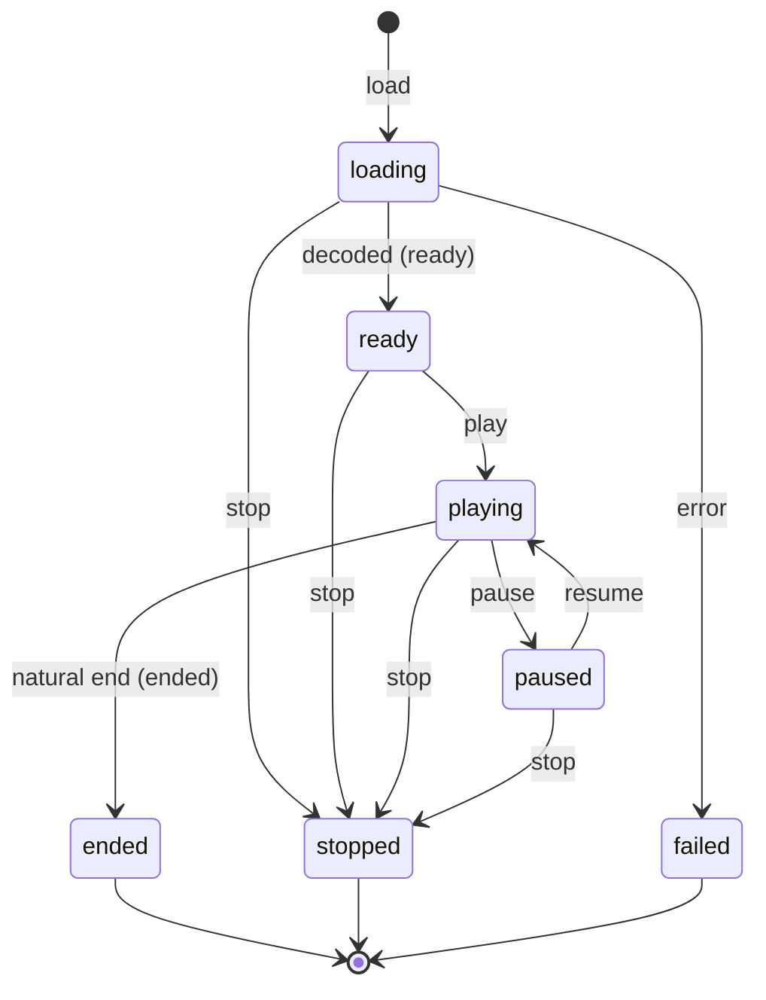

# Audio media: deterministic tracks, time, cues and waits

This page is the normative Reawakened contract for the core audio model. It is
implementation-neutral: `core` describes the game state and the decisions that
a runner must replay, while `synth` and a runner provide decoding and sound
output. The page is the docs-first checkpoint for Epic 6.1, 6.2 and 6.3
(core model, command surface and platform rules); every rule marked
**Proposed ruling (pending owner review)** must be approved before the
implementation entries start.

## What an author sees

An author plays a file on a named track. The built-in tracks are `music`,
`sfx`, `ambience`, `voice` and `ui`; later command work may add an author-named
track. Music normally loops, a sound effect normally plays once, and a track
can be stopped, paused, resumed, sought or faded. A script can wait for a
finite sound to finish. Pausing holds the sound and also holds that wait;
stopping or replacing it ends the wait.

The game, not the speakers, owns the clock. Therefore a wait finishes on the
same simulation tick on every runner, even when a decoder is slow or a headless
runner has no audio device. The runner receives cues and may render silence,
but it does not decide game state. A save carries playback, while the player's
mix and script volume settings are not changed by loading a save.

The technical rules below state exact field names, integer units, ordering and
failure behavior.

## Scope and terms

* A **tick** is one fixed simulation step. Reawakened runs at 60 ticks per
  second ([AD-2], [AD-26]). `time.tick` is the integer at the start of the
  phase list; the `time` phase increments it after `audio`.
* An **asset length** is metadata supplied to core as a positive whole number
  of ticks. Core never reads a file or asks a device for its duration.
* A **pass** is one traversal of a finite asset. A looping voice has a new pass
  at each length boundary; a one-shot voice finishes at its first boundary.
* A **track** is a named, ordered container of voices. Its name is the stable
  identity used in state, cues and waits. The five built-in names are created
  in the order listed above. Author-created track-name validation and voice
  counts are owned by Epic 6.2, but they use this same state shape and cue
  contract.
* A **voice** is one playback slot inside a track. A single-voice track keeps
  the legacy one-slot behavior; multi-voice allocation and stealing are
  specified by Epic 6.2, not by a second core audio model.
* `AssetKey` is the case-folded, package-relative key used by the asset
  resolver. A missing or empty board music request carries no `AssetKey`.

<a id="audio-state"></a>
## P1 — audio state, track lifecycle and settings

<!-- OWNER: 6.1/P1 -->
**Proposed ruling (pending owner review; P1; state schema v2).** In plain
terms, a save remembers what each track was doing, but it never changes the
player's mix. Technically, the runtime `GameState.audio` section is this plain
JSON shape (the arrays are ordered; no map iteration order is observable):

```text
AudioStateV2 = {
  schema: 2,
  cueId: integer,                    // next unused cue id, starts at 1
  soundFont: AssetKey | null,        // 6.3: script-chosen bank; null = author default
  tracks: AudioTrackState[],         // built-ins first, then creation order
  settings: {
    masterVolume: integer,           // script volume, 0..100
    trackVolumes: [{ name, volume }] // script volume, 0..100, name order
  }
}

AudioTrackState = {
  name: string,
  state: "stopped" | "playing" | "paused",
  flags: integer,
  file: AssetKey | null,             // last/current file; stop retains it
  positionTicks: integer,             // primary voice position
  lengthTicks: integer | null,
  voices: AudioVoiceState[],          // ascending voice index
  fade: AudioFadeState | null
}

AudioVoiceState = {
  index: integer,
  state: "playing" | "paused",
  file: AssetKey,
  cueId: integer,
  priority: integer,                  // stealing priority, default 0
  volume: integer,                    // voice script volume, 0..100
  startTick: integer,
  positionTicks: integer,
  lengthTicks: integer | null,
  endTick: integer | null,
  fade: AudioFadeState | null
}

AudioFadeState = {
  fromVolume: integer,
  targetVolume: integer,
  startTick: integer,
  durationTicks: integer
}
```

The `file`, `positionTicks`, `lengthTicks` and `fade` fields on a track are the
primary (voice 0) view. They are retained even when `voices` is empty after a
stop, so `music` can report the last selected file. A track with no primary
voice has `positionTicks: 0`, `lengthTicks: null` and `fade: null`. A track's
state is `playing` when at least one voice is playing, `paused` when its active
voices are paused, and `stopped` when it has no active voice. The state is
canonicalized before it is hashed or saved; voices are sorted by ascending
`index`.

`cueId` is a counter, not a currently playing handle: emitting a cue takes the
current value and increments it. It is never reused, including after a stop,
load or snapshot restore. A runner's device handle is not in this state.

**Evidence.** AD-10 requires one plain-data state tree and AD-16 puts the
monotonic counter in `GameState.audio`; `packages/core/src/save/sections.ts`
currently declares `audio` as the later-epic placeholder. The fixed phase order
is AD-26. The five built-in names and author-track direction are the owner
direction recorded in
`_bmad-output/initiative-rpgtoolkit-reawakened/epic-audio-synth/epic-audio-synth.md`
§ Notes and `discovery/audio-exploration.md` §13.

**Rejected alternative.** Keeping one `audio.music` string and one global SFX
slot (the current placeholder-era shape) cannot represent pause, playback
position, a second track or a saveable voice. Keeping a `Map` of tracks would
break the plain-JSON and explicit-order requirements of G1/G3. Making the
runner's device handle part of the section would make snapshots host-specific.

<!-- OWNER: 6.1/P1-settings -->
**Proposed ruling (pending owner review; P1; settings split).** In plain terms,
there are two volume layers. A script controls the deterministic game volume;
the player controls a private mix on the runner. Technically, `settings` in
`GameState.audio` contains the script master and per-track volumes, clamped to
integer percentages 0..100. It is runtime state for replay and snapshots but
is excluded from the game-save projection and is not written by `reset()` or
`load()`. The player mix (master, per-track gains, mute and output-device
choice) never enters core state or a cue. A runner multiplies it after
applying the script volume. `media.volume` cues therefore carry the script
volume only.

**Evidence.** Owner-relayed Q12 and Q13 in
`docs/provenance/facts-round-8.md` say volume is clamped 0..100, not saved and
not reset. The owner superseded Epic 6 assumption A-3 with “volumes are
settings” in the Epic 6 envelope (2026-10-18). AD-14/G3 require replay-safe
state rather than device timing.

**Rejected alternative.** Putting all volume in the save makes loading one
game unexpectedly change what the player hears in another. Keeping script
volume only in the runner removes script read-back and makes replay depend on a
host preference. Saving the player mix would leak a host concern into core.

<a id="audio-lifecycle"></a>
### Track lifecycle

<!-- OWNER: 6.1/P1-lifecycle -->
**Proposed ruling (pending owner review; P1; lifecycle and loop state).** A
`media.play` transition is evaluated by the audio applier at the effect's
posted tick. `playing` advances from `startTick`; `paused` retains its current
position and freezes both its pass clock and fade clock; `stopped` has no active
voice. A stop retains the track's `file` and flags, so a later play can restart
that file. A replacement on one voice is ordered as stop then play. A board
request with an empty or missing asset stops the current music and clears the
music track's `file`; it is silence, not a runtime error. A same-file request
on a playing single-voice music track carries on unless an explicit restart
flag is present. A same-file request on a playing single-voice `sfx` track is
ignored; a different SFX replaces it. These are core decisions and are not
left to the output device.

A looping voice has no terminal end; its pass boundary is
`startTick + lengthTicks`, then each subsequent multiple of `lengthTicks`. A
one-shot voice is finished at its first end tick and emits the corresponding
stop/finished transition once. A fade changes volume only and never stops a
track implicitly; an explicit stop is required to end a silent stem. Fade
ramp representation and voice-allocation details remain extensible under the
same state fields and cue kinds in Epic 6.2.

**Evidence.** Q3, Q5, Q6, Q7 and Q10 in `facts-round-8.md` establish the
single-slot replacement, same-file, missing-file and stop-retains-name rules.
M1–M4 in `facts-round-9.md` establish looping and the one-shot SFX default.
The fixed-tick and phase rules are AD-2 and AD-26. The effect dispatch rule is
`docs/spec/engine/rpgcode-runtime.md#reawakened-effect-dispatch`.

**Rejected alternative.** Letting the runner choose replacement or loop
behavior would make two devices produce different cue histories. Treating a
fade to zero as an implicit stop prevents layered tracks from being brought
back by a later resume and is not needed by the existing cue set. A separate
`musicAsset` authority in `engine` duplicates this lifecycle and misses a
`mediaStop` followed by a board entry.

<a id="audio-save-load"></a>
### Save, snapshot and reset

<!-- OWNER: 6.1/P1-persistence -->
**Proposed ruling (pending owner review; P1; persistence).** The Reawakened
save projection includes `AudioStateV2.tracks`, `cueId` and (6.3 amendment,
[soundfont-state](#soundfont-state)) `soundFont`, including active
voice positions, flags, pause state and fade descriptors. It excludes
`AudioStateV2.settings`, all player-mix fields and all runner handles. A
snapshot is a full core-state snapshot and therefore includes `settings`; it
is not a device snapshot.

Loading merges the saved playback state into the existing settings. Active
music restarts from position zero at the load tick, preserving its loop flag;
this makes the board's music restart deterministically after load. Active
non-music voices resume at the saved `positionTicks` (a new `startTick` is
chosen so that the position is unchanged), while paused and stopped states
remain paused and stopped. A saved one-shot whose position is at or beyond its
length is restored stopped. On restore, core re-emits cues in track order and
voice-index order, allocating fresh monotonic cue ids; the music cue has the
load tick as its due tick, while a resumed non-music cue carries the past due
tick needed for catch-up. No runner state is trusted from a save.

`reset()` leaves the whole audio section untouched, including active music and
settings. Normal board-entry effects may then be applied; the same-file rule
prevents an unnecessary restart.

This is a deliberate Reawakened departure from the legacy save fact that saves
stored no audio. It preserves useful ambience/voice playback while retaining
legacy music restart behavior and the owner-directed volume settings split.

**Evidence.** AD-16 says core records playback and re-emits it after load;
AD-10/G1 require saveable plain state. Q9–Q13 in `facts-round-8.md` cover the
battle restart, stop retention, save/reset and volume behavior. The save page
([formats/save-game.md#layout-minor-4](../formats/save-game.md#layout-minor-4))
allows a Reawakened save format rather than requiring the legacy binary layout.

**Rejected alternative.** Saving no audio and rebuilding only board music
matches Q11 but loses a saved stinger, ambience or voice and contradicts
AD-16. Resuming music at its saved position makes load behavior device- and
board-history-dependent; restarting every non-music track needlessly discards
state that the track model already records.

## P2 — fixed time and end authority

<a id="audio-time-model"></a>
<!-- OWNER: 6.1/P2 -->
**Proposed ruling (pending owner review; P2; core-owned timeline).** In plain
terms, the core decides when a file ends. A runner that starts late catches up
to the same position; a speaker cannot make a script wait longer or shorter.
Technically:

1. Core advances only on the fixed 60 Hz tick. A finite decoder reports a
   positive duration in seconds or an integer length; conversion of a positive
   seconds value uses the existing `core/time` rule
   `max(1, floor(seconds * 60 + 0.5))`. A non-finite, negative or unavailable
   duration is `lengthTicks: null` and is not waitable. A zero-byte/zero-length
   playable asset is invalid rather than an indefinitely waitable track.
2. A voice that begins at tick `S` with length `L` has
   `endTick = S + L`. While playing, its position is
   `min(max(0, tick - S), L)` for one-shot media and
   `(max(0, tick - S) mod L)` for looping media. Paused voices keep the last
   position; resume sets a new `startTick` so the position is continuous.
3. At the waits phase of `endTick`, a finite one-shot is logically finished
   and its `audio.track` wait can wake. The later `audio` phase emits any
   required stop cue and records the finished transition. This phase ordering
   is intentional: a stop posted in the threads phase at tick `T` changes the
   track immediately, and its waiter is observed in the next waits phase at
   `T + 1`, because waits precedes threads in AD-26.
4. A looping track has a pass boundary at every `S + nL`. A pass wait uses
   the next boundary; ordinary looping playback does not finish.
5. A cue's required `tick` is the tick at which core applied the transition.
   If the runner receives it at a later simulation tick `R`, it starts at
   `max(0, R - tick)` ticks into the asset. A looping asset wraps this offset;
   a one-shot whose offset is at least `lengthTicks` is not started. Late
   playback therefore cannot alter core state.
6. `mediaPosition` and `mediaLength` (owned by Epic 6.2) expose integer ticks
   to core queries; any seconds presentation is a pure conversion from these
   ticks and never a device-reported float.

`audio.ended { cueId }` remains a valid AD-14 input for diagnostics and runner
voice cleanup, but it is advisory. Core ignores an early, late or unknown
reply when deciding end ticks, waits, positions or cue order. An unknown
`cueId` is ignored. A headless/null runner does not need to emit it.

**Evidence.** AD-2/G3 and `packages/core/src/time/time.ts` define the 60 Hz
clock and half-up seconds conversion. The previous AD-14/AD-9 wording let a
headless runner emit `audio.ended` after parsed duration; the conflict is
recorded as F-06 in `discovery/audio-readiness.md`. AD-14's replay log and
AD-26's phase order make the core timeline necessary for deterministic waits.

**Rejected alternative.** Letting the physical audio device or an
`audio.ended` reply wake a script makes latency and browser scheduling part of
save/replay behavior. Emitting volume/position cues every tick would flood the
cue stream without changing the authoritative state; one transition cue plus
an integer due tick is sufficient.

<a id="audio-headless"></a>
### Null and headless behavior

<!-- OWNER: 6.1/P2-headless -->
**Proposed ruling (pending owner review; P2; null backend).** Core emits the
same cue stream whether a runner has a synthesizer or not. A null/headless
backend consumes cues, produces no PCM and never feeds an authoritative end
reply. It may record cue fields and diagnostics for golden tests. An absent or
unsupported source yields silence plus a diagnostic; it does not change the
core timeline except for the explicitly ruled missing-board-music stop. An
unknown length is allowed to remain audible to a capable runner but a wait on
it is a located diagnostic and returns without parking a thread.

**Evidence.** G2 forbids host/audio I/O in core; G4/G5 require replayable
headless behavior. The Epic 6 envelope assigns null audio and cue goldens to
later entries 6.6 and 6.16, and `discovery/audio-exploration.md` §6 says
unknown sources are diagnostic plus silence, never a state change.

**Rejected alternative.** Suppressing cues when audio is unavailable would
make headless and browser state hashes differ. Making a null backend invent
`audio.ended` would restore the very device-timing dependency this ruling
removes.

## P4 — cues, order and the core/synth seam

<a id="audio-cue-contract"></a>
<!-- OWNER: 6.1/P4 -->
**Proposed ruling (pending owner review; P4; generic per-track cues).** In
plain terms, cues say what a named track should do; they do not contain a
runner handle or a callback. Technically, the core port becomes this generic
set. Entry 6.3 adds the platform kind `soundfont.set` as a documented
amendment ([soundfont-cue](#soundfont-cue)); every other kind is unchanged:

```text
AudioCueKind =
  "media.load" | "media.play" | "media.stop" | "media.pause" |
  "media.resume" | "media.seek" | "media.volume" | "media.fade" |
  "media.flags" | "soundfont.set"

AudioCue = {
  cueId: integer,
  tick: integer,
  kind: AudioCueKind,
  track: string | null,
  voice: integer | null,
  asset: AssetKey | null,
  loop: boolean | null,
  flags: integer | null,
  positionTicks: integer | null,
  volume: integer | null,
  targetVolume: integer | null,
  durationTicks: integer | null
}
```

Every key is present. `null` means that a kind does not use that field; an
omitted key or `undefined` is not a valid cue. `media.play` carries `track`,
`voice`, `asset`, loop/flags, starting position and the script volume;
`media.stop`, `pause`, `resume`, `seek`, `volume` and `flags` carry the
corresponding track/voice and field. `media.fade` is one transition cue with
`volume` as the start, `targetVolume`, `tick` as `startTick` and
`durationTicks`; runners interpolate it while core keeps the descriptor. No
per-tick volume cue is emitted.

Cue IDs are allocated at the moment the audio applier accepts the transition.
Within a tick, effects are applied in post order. A board-entry replacement
emits `media.stop` before `media.play`; a restore emits tracks in canonical
track order and voices in ascending index. The `tick` is the due tick for
late-start catch-up, not a wall-clock timestamp.

**Evidence.** Owner direction D-5 and `discovery/audio-exploration.md` §13
choose generic per-track kinds; P4 in that discovery explicitly recommends a
single fade cue. AD-14 requires fixed port keys and AD-16 currently defines the
old closed vocabulary. The existing port is
`packages/core/src/ports/audio.ts`; its exhaustive fixture is
`packages/core/test/fixtures/ports/good.ts`.

**Rejected alternative.** Retaining `music.*` and `sfx.*` plus a new track
field duplicates every future verb and makes the names lie for author-created
tracks. Sending a volume cue every tick is larger and less robust than a pure
fade descriptor. Letting a runner assign cue IDs or retain a game decision
would break load/replay.

<a id="board-effect-mapping"></a>
### Effect records and cue order

<!-- OWNER: 6.1/P4-effects -->
**Proposed ruling (pending owner review; P4; Epic 4 handoff).** Epic 4 keeps
its effect vocabulary. `music.play` and `sfx.play` are effect records, not
`AudioCueKind` values. The audio applier maps them to `music` and `sfx` and
then emits generic cues. The applier, not `engine.musicAsset`, decides
same-file carry-on, replacement, missing-file silence and restart.

The affected producers and validators are fixed for the later implementation:

| Producer/consumer | Required 6.x change | Ordering or validation |
|---|---|---|
| `packages/core/src/engine/engine.ts::postBoardMusic` | post one `music.play` effect for every board arrival, carrying the resolved `AssetKey` or `null` for an empty/missing request; remove the `state.engine.musicAsset` same-file early return | the applier owns Q5–Q7 and Q10; a null board request stops and clears music |
| `packages/core/src/engine/engine.ts::runAnimationPhase` | keep posting one-shot `sfx.play` records for visible `.anm` frame sounds | animation phase order, then frame index, then effect post order |
| Epic 7 battle producer | post a `music.play` effect with source `battle`; no second cue vocabulary | battle hand-off is a later consumer of this track rule |
| script/audio applier | post effects through `postEffect("audio", effect)` | synchronous applier order; VM audit remains bounded |
| `packages/core/src/engine/effects.ts` | retain the bounded per-section pending queue | FIFO drain when `audio` registers; dropped records are diagnosed |
| `packages/core/src/ports/audio.ts` | replace `AudioCueKind` and `AudioCue` with this page's generic shape | exhaustive runner switch; all fields required/null |
| `packages/core/src/validate/input-event.ts` | keep `audio.ended { cueId }` validation | advisory only; no wait wake or position mutation |
| `packages/core/src/script/virtuals.ts::createDefaultVirtuals` | read `music` from the `music` track's `file` | battle track is visible; `mediaStop` retains the name |
| `packages/core/src/save/sections.ts` and save fixtures | replace `Record<string, never>` with `AudioStateV2`; migrate schema v1 placeholder | settings omitted from save; playback re-emits |
| `packages/core/test/fixtures/ports/good.ts` | update the exhaustive cue fixture | no old `music.*`/`sfx.*` cue kinds remain |

A board producer may resolve the requested Media-folder name before posting,
but it must post a null asset for empty/missing music so the applier owns the
stop/silence decision. The old producer diagnostic for “missing music” is not
an audio-state decision; Q6 requires silence without an error. Animation frame
resolution remains the animation producer's asset request and emits no cue
until the asset is available.

Effects posted before the applier is registered remain in the bounded queue
and drain in FIFO order. A cue receives its ID only when drained/applied, so
cue IDs follow effect order rather than registration timing.

**Evidence.** E-16 and the Reawakened effect rule in
`docs/spec/engine/display-input-audio.md`; the Epic 4 handoff in
`_bmad-output/.../epic-board-rendering/tickets.toml` entries 4.20 and 4.23;
F-01/F-02 in `discovery/audio-readiness.md`; AD-10/AD-16 and
`docs/spec/engine/rpgcode-runtime.md#reawakened-effect-dispatch`.

**Rejected alternative.** Renaming the Epic 4 effects would force a migration
of two producers without fixing the actual ownership bug. Keeping the board
producer's `musicAsset` comparison would suppress the restart after
`mediaStop`; dropping empty/missing records would prevent the applier from
implementing the documented silence rule. Draining pending effects in a map or
runner order would lose the documented FIFO ordering.

<a id="audio-synth-seam"></a>
### Core to synth boundary

<!-- OWNER: 6.1/P4-seam -->
**Proposed ruling (pending owner review; P4; package boundary).** Core owns
`AudioStateV2`, asset keys and lengths, lifecycle transitions, integer time,
wait polling, cue IDs and cue order. Core never decodes bytes, opens an audio
device or calls a timer. The runner supplies asset bytes and deterministic
`AudioInfo` metadata through the existing asset/decoder seams; `synth` turns
cues into PCM or device commands behind a small `AudioSource`/`MidiSynth`
interface. `synth` owns no `GameState`, cue counter, wait resolver or gameplay
rule. A null implementation consumes the same cue contract.

The runner may report `audio.ended { cueId }` for cleanup or diagnostics, but
must not report a position or choose a wake tick. A late runner uses the cue's
`tick` and length metadata to seek forward. This keeps the boundary usable by
non-TypeScript runners and leaves the core independent of Web Audio, MIDI,
SoundFont and decoder implementations; entries 6.3 and 6.11 define those
platform details.

**Evidence.** G2/G3; AD-14, AD-16 and AD-30/AD-31; the empty `packages/synth`
scaffold and the `AssetDecoder<T>` registry identified by F-05/F-07 in
`discovery/audio-readiness.md`.

**Rejected alternative.** Putting a MIDI/WAV decoder or Web Audio object in
core breaks G2 and makes duration/replay depend on a host. Making synth own
track state would duplicate save/load and make `audio.track` waits impossible
to replay without the device.

## P5 — audio waits

<a id="audio-track-wait"></a>
<!-- OWNER: 6.1/P5 -->
**Proposed ruling (pending owner review; P5; `audio.track` wait).** In plain
terms, a script can wait for a track or voice to finish, but a paused sound
holds that wait. Technically the unresolved `audio.sfx` kind is replaced by
this plain-data payload:

```text
Wait = {
  kind: "audio.track",
  global: false,
  id: "mediaWait",
  payload: [{ track: string, voice: integer | null,
              cueId: integer, endTick: integer | null,
              pass: boolean }],
  resumeRefs: []
}
```

The implementation may use the repository's positional `NamedWait.payload`
array, but the decoded object above is the normative shape and contains no
closure, timer, device handle or `Promise`. `cueId` identifies the voice that
was playing when the wait was created; a replacement cannot accidentally wake
an old wait for a new voice. `pass: true` means the next finite pass boundary
rather than terminal completion.

The resolver runs in the AD-26 `waits` phase, once per waiting thread in
ascending thread id. Its deterministic table is:

| Track/voice condition at the current tick | Result |
|---|---|
| playing finite one-shot and `tick < endTick` | remain parked |
| playing finite one-shot and `tick >= endTick` | wake with the normal wait result |
| playing loop and `pass` true at next pass boundary | wake |
| playing loop and `pass` false | a direct `mediaWait` is diagnosed; it cannot wait forever |
| paused, with the same `cueId` | remain parked; resume continues the same wait |
| stopped or replaced, with the same `cueId` | wake at the first waits phase after the stop/replacement effect |
| unknown track, voice or `cueId` | located diagnostic; do not park |
| `lengthTicks: null` | located diagnostic; do not park |

`mediaPlay` with a combined loop-and-wait flag is a diagnostic at the call;
`mediaWait` on an already looping track may request its current pass only.
Those command signatures and diagnostics are owned by Epic 6.2, but no command
may recreate `audio.sfx`.

**Evidence.** AD-9 requires one named wait registry, plain-data payloads and
ascending-thread polling. `packages/core/src/ports/wait.ts` currently lists
`audio.sfx`; `script/waits.ts` and the generic catalogue responder are the
live seams identified by F-04. Owner direction D-3 says pause suspends and the
wait ends on finish or stop. The fixed end formula and phase ordering are
[audio-time-model](#audio-time-model) and AD-26.

**Rejected alternative.** Waking on pause makes a script continue while the
sound is held. Polling a runner `audio.ended` set makes wait timing
non-replayable. Reusing `audio.sfx` hides track/voice identity and leaves
legacy catalogue calls parked on an unregistered resolver.
<a id="media-command-family"></a>
## P3/P6/P7 — standard media commands, voices and layers

<!-- OWNER: 6.2/P3 -->
**Proposed ruling (pending owner review; P3; standard command family).** In
plain terms, these commands give an author named players for music, effects,
dialogue and ambience. A command either changes one of those players or waits
for one to finish; it never asks the speaker what happened. Precisely, every
command below is a synchronous RPGCode built-in. A `void` command returns
`null`; a query returns the value shown; an optional `&ret` or `&voice` writes
that same value to the caller's variable. A diagnostic is located at the
argument, makes no state or cue change, and returns the command's documented
failure value.

Track names are non-empty ASCII strings of 1–32 characters matching
`[A-Za-z0-9_.-]+`. Core canonicalizes only ASCII letters to lower case; it
does not use locale-sensitive case folding. The five built-in tracks are
created in this order: `music`, `sfx`, `ambience`, `voice`, `ui`. Unknown
tracks are an error; `mediaPlay` never silently creates a misspelled track.
There are at most 16 named tracks, including the five built-ins. `mediaTrack`
is the only creation/configuration command.

| Command and signature | Return and deterministic behavior |
|---|---|
| `void mediaTrack(string name[, int voices = 1])` | Creates `name` with the requested voice count, or changes an existing track's configured count. `voices` is a positive integer. Reducing below a live voice index is a diagnostic and leaves the track unchanged. |
| `void mediaLoad(string track, string file)` | Resolves `file` and loads its metadata onto the named track without starting it. The track becomes `stopped`, retains the file, and emits `media.load`; an unknown file is a located diagnostic and does not clear a prior file. |
| `void mediaPlay(string file[, string track = "music"[, int flags = default[, int priority = 0[, string syncTrack = ""[, int &voice]]]]])` | Starts or reuses one voice. `&voice` receives the selected zero-based voice index. `default` is `tkMD_LOOP` on `music` and `tkMD_ONCE` on every other track. `tkMD_WAIT` parks this thread until that voice finishes; loop plus wait is a diagnostic. |
| `void mediaStop([string track = "music"[, int voice = 0]])` | Stops and rewinds the selected voice, retaining its file and flags. A stop ends a wait for that voice at the next waits phase. |
| `void mediaPause([string track = "music"[, int voice = 0]])` | Pauses the selected playing voice at its integer position. Its wait and fade clock are suspended. Pausing an already paused or stopped voice is a no-op. |
| `void mediaResume([string track = "music"[, int voice = 0]])` | Resumes a paused voice from its saved position. Resuming a playing or stopped voice is a no-op. |
| `void mediaSeek(string track, number seconds[, int voice = 0])` | Converts a finite non-negative `seconds` value to ticks with `max(0, floor(seconds * 60 + 0.5))`. A known one-shot clamps to its length; a known loop wraps modulo its length. Unknown length is a diagnostic. |
| `void mediaLoop(string track, bool on[, int voice = 0])` | Changes the loop flag in place without restarting. `on=false` lets the current pass finish; `on=true` creates pass boundaries after the current position. |
| `void mediaFade(string track, int percent, number seconds[, int voice = 0])` | Clamps no values silently: `percent` must be 0..100 and `seconds` finite and non-negative. It linearly ramps the selected voice's script volume over the converted duration. A zero-duration fade is an immediate set. With no voice argument, it ramps the track volume setting. |
| `void mediaWait([string track = "sfx"[, int voice = 0]])` | Parks until the selected finite one-shot finishes, or until its current loop pass ends when it is looping. An unknown, stopped, replaced, or unknown-length voice does not park; it returns a located diagnostic or the normal stopped result as specified below. |
| `void mediaVolume(string track, int percent[, int voice])` | Sets the track's integer script volume (0..100), or a selected voice's volume when `voice` is present, without restarting. |

The one-argument `mediaVolume` query is an overload:
`int mediaVolume(string track[, int voice[, int &ret]])` returns the track
volume when `voice` is omitted, or the selected voice volume when it is
present, and optionally writes it to `ret`. The setter and query are
distinguished by the presence of the `percent` argument. Effective script
gain is the deterministic integer product of track and voice volumes,
rounded half-up to a percentage; both settings start at 100.


The matching query built-ins are:

| Query | Return |
|---|---|
| `int mediaState(string track[, int voice = 0[, int &ret]])` | `tkMD_STOPPED`, `tkMD_PLAYING` or `tkMD_PAUSED`. A track query with no explicit voice is the aggregate: playing if any voice plays, paused if active voices are all paused, otherwise stopped. |
| `int mediaFlags(string track[, int voice = 0[, int &ret]])` | The selected voice's current flag bitmask; stopped tracks retain their last flags. |
| `bool mediaPlaying(string track[, int voice = 0[, bool &ret]])` | True exactly when the selected voice is playing. |
| `string mediaFile(string track[, int voice = 0[, string &ret]])` | The selected or last file, or `""` when no file has been loaded. |
| `number mediaPosition(string track[, int voice = 0[, number &ret]])` | Current position in seconds, computed from integer ticks as `positionTicks / 60`; no device float is read. |
| `number mediaLength(string trackOrFile[, number &ret])` | Length in seconds from asset metadata. An unknown length returns `0` and emits a diagnostic only when used by a wait or seek. |
| `string[] mediaTracks([string[] &ret])` | Track names in built-in order followed by creation order, canonicalized as stored. |
| `int getVolume([int &ret])` | Script master volume, 0..100; it is the query counterpart of `setvolume`. |

An invalid query returns the type's zero value (`0`, `false` or `""`) and
diagnoses the call. Query results are from core state and asset metadata, so
a runner cannot make two runs disagree. `mediaPlay` returns no handle by
value: `&voice` is the stable integer slot index, while `cueId` distinguishes
a current occupant from a stale handle after replacement.

The `tkMD_` constants are compile-time integer constants. Flags are
bitwise-orable; state values are mutually exclusive and are not flags:

| Constant | Value | Meaning |
|---|---:|---|
| `tkMD_ONCE` | 0 | Finish at the first asset boundary. |
| `tkMD_LOOP` | 1 | Continue at every asset boundary. |
| `tkMD_WAIT` | 2 | Park the calling thread until this voice's wait condition is met. |
| `tkMD_RESTART` | 4 | Restart a same-file voice from tick zero instead of applying the same-file carry-on rule. |
| `tkMD_STOPPED` | 0 | Query state: no active voice. |
| `tkMD_PLAYING` | 1 | Query state: at least one selected voice is playing. |
| `tkMD_PAUSED` | 2 | Query state: the selected active voice is paused. |

**Errors and no-op rules.** The stable diagnostics are
`media.invalid-track-name`, `media.track-limit`, `media.voice-count`,
`media.voice-cap`, `media.unknown-track`, `media.unknown-voice`,
`media.asset-missing`, `media.asset-length`, `media.invalid-time`,
`media.invalid-volume`, `media.wait-loop`, and `media.sync-source`.
They are located at the offending argument. Invalid names, counts, flags,
times, volumes, missing assets and unknown handles make no mutation and emit
no cue. A requested track configuration cannot make the sum of configured
voice slots exceed 32. The initial master and every track volume are 100.

**Author help text (simple first).** `mediaTrack` gives a name to a player
and reserves its overlap slots; it returns nothing and fails rather than
silently making a typo. `mediaLoad` prepares a file without starting it.
`mediaPlay` starts music or a sound and can tell the script which voice slot
it received. `mediaStop`, `mediaPause` and `mediaResume` control that slot.
`mediaSeek` jumps to a time in seconds, `mediaLoop` changes whether the next
boundary repeats, and `mediaWait` lets a script wait for completion.
`mediaFade` changes loudness smoothly and `mediaVolume` changes it directly.
The query commands report the same track data the engine will replay.

For exact behavior, all times are converted to 60-Hz ticks with half-up
rounding; state changes are applied in the current thread's order and
observed by the waits phase before later threads. `mediaPlay` waits only with
`tkMD_WAIT`; `mediaWait` waits only for a finite voice or its next loop pass.
For example:

```rpgcode
mediaTrack("effects", 8)
mediaPlay("click.wav", "effects", tkMD_ONCE, 1, "", &voice)
mediaFade("music", 30, 0.5)
mediaWait("effects", voice)
```

The example creates eight slots, allocates the lowest free `effects` slot,
ramps `music` to 30% over 30 ticks, then parks until the click's finite
one-shot ends. It does not wait on the fade. A script can layer a stinger
without a special command:

```rpgcode
mediaPlay("stinger.mid", "ui", tkMD_ONCE)
mediaFade("music", 25, 0.25)
```

The two commands apply in source order in the same tick. A later track
controller may use that same fade rule for ducking; this ticket adds no
automatic duck.

**Evidence.** P3 in
`_bmad-output/initiative-rpgtoolkit-reawakened/epic-audio-synth/discovery/audio-exploration.md`
requires exact signatures, a creation command, name validation and
documentation-only deprecation; F-08 and F-14 record the current catalogue
wait and obsolete hazards. AD-1 requires structured-cloneable results,
AD-8/AD-9 require by-reference outputs and named waits, and the existing
`rpgcode-language.md` constants establish the `tk*` naming convention.

**Rejected alternative.** Letting a typo create a track, making every legacy
name runtime-obsolete, returning device handles, or allowing command
failures to partially mutate state would make old games noisy or make a
save/replay depend on the host. The `deprecated` command-docs tag with
`replacedBy` is documentation-only; the catalogue `obsolete` field and the
word `obsolete` in a spec-table row remain reserved for commands that really
raise `builtin.obsolete`.

<!-- OWNER: 6.2/P6 -->
**Proposed ruling (pending owner review; P6; voices and allocation).** A
voice handle is the pair `(track, index)` exposed to RPGCode as the integer
`index` in `&voice`; core additionally checks the current `cueId`, so a
handle from an earlier occupant cannot control a replacement. The configured
voice counts are:

| Track | Default voices | Legacy significance |
|---|---:|---|
| `music` | 1 | Background music single slot. |
| `sfx` | 1 | Legacy sound-effect single slot. |
| `ambience` | 4 | Overlapping environmental loops. |
| `voice` | 2 | Dialogue overlap. |
| `ui` | 4 | Menu and cursor sounds. |

`mediaTrack` may change these counts, and may create up to 16 named tracks,
but the sum of configured slots is at most 32. A new multi-voice track starts
with all voices stopped. With no explicit voice, `mediaPlay` takes the lowest
free index. When none is free, it steals exactly one active voice by lowest
`priority`, then oldest `startTick`, then lowest index. Paused voices remain
active for allocation. An explicit voice always addresses that slot and
replaces its occupant; it never invokes the stealing tie-breaker.

On a single-voice track, a same-file `mediaPlay` while playing carries on
without a cue, except with `tkMD_RESTART`, which stops then starts at zero.
This keeps `music`'s legacy carry-on behavior and `sfx`'s legacy same-file
ignore behavior: both are one-voice tracks, and `sfx` calls without
`tkMD_RESTART` are ignored when the same file is already playing. On a
multi-voice track, each play takes a free slot; the same file may overlap.
Every replacement or steal emits `media.stop` before `media.play` and wakes
the displaced voice's wait in the next waits phase.

The state extension is plain data: each `AudioVoiceState` carries
`priority: integer` (default 0), and a voice's `cueId` remains its identity.
Allocation, stop-before-play ordering, and the ascending-index query order
are part of core state, never runner policy.

**Evidence.** P6 records the recommended `&voice` handle, single-voice
same-file exception, proposed built-in counts, owner decision for the 32
voice cap, and deterministic stealing candidates. Q3/Q5 in round 8 and
M2/M4 in round 9 establish the legacy single-slot and same-file defaults.
AD-10/G1 require plain saveable state; AD-16 requires voice-indexed cues.

**Rejected alternative.** A runner-owned voice pool, oldest-only stealing,
or silently increasing a track on an unknown name would produce different
cue histories across devices and hide author errors. Treating paused voices
as free would cut off a sound merely because its script is temporarily held.

<a id="audio-layer-rulings"></a>
<!-- OWNER: 6.2/P7 -->
**Proposed ruling (pending owner review; P7; fades, sync and ducking
reservation).** A fade is linear in fixed ticks. If its start volume is
`A`, target is `B`, duration is `D > 0`, and `d` ticks have elapsed, the
volume is the nearest integer to
`A + (B - A) * d / D`, with half values rounded upward; `d` is clamped to
`0..D`. Starting a new fade first evaluates the old fade at the current
tick, then replaces it from that integer. A paused voice freezes both
position and fade elapsed time. At `D`, the target is exact. Fading to zero
leaves a playing voice alive and silent; only `mediaStop` ends it.

`mediaPlay`'s `syncTrack` argument names an existing track whose primary
voice is active. At the play tick, the new voice's starting position is the
source's current integer position modulo the destination asset length, and
its `startTick` is chosen to preserve that position. A paused source supplies
its held position but the new voice starts playing. Unknown tracks, inactive
sources or unknown lengths diagnose without starting the new voice. Unequal
lengths are therefore deterministic, but stems stay musically aligned only
when their lengths and loop points agree. For example, a source at tick 137
with position 17 and a 10-tick destination starts at position 7; it does not
round or query the device.

The late-sound threshold is 15 ticks (250 ms at 60 Hz). A runner MAY suppress
rendering of a late, finite, non-looping non-music voice when
`receiveTick - cue.tick >= 15`; it MUST still consume the cue and core keeps
the voice timeline. Music and looping voices catch up by modulo position
instead of being dropped. This is a presentation optimization, not a second
end or wait rule.

Ducking is reserved, not implemented by this ticket. Authors can reproduce a
duck manually with `mediaFade("music", 30, 0.1)` while a stinger plays on
another track. A future `mediaDuck` controller MUST compose the same
per-track fade descriptors and cue ordering; it MUST NOT add runner-owned
mix state or change the `media.fade` meaning. No automatic ducking,
duck-group field or hidden side effect exists in this contract.

**Evidence.** P7 recommends integer linear fades, frozen pause clocks,
modulo sync for unequal lengths, and a fade-based ducking reservation.
P2 fixes integer tick positions and late-start catch-up; AD-2/AD-26/G3 fix
the 60 Hz order; AD-14/AD-16 keep fades as data cues.

**Rejected alternative.** Per-tick fade cues flood the deterministic cue
stream; a fade-to-zero implicit stop prevents stem re-entry; rejecting
unequal sync lengths makes valid authored layers needlessly fragile; and
letting the runner drop late audio or own ducking changes only some
replays. A runner MAY suppress the specified late SFX presentation, but it
cannot alter core state.
<a id="legacy-audio-command-mapping"></a>
### Legacy command mapping and documentation marker

<!-- OWNER: 6.2/P3-legacy -->
**Proposed ruling (pending owner review; P3; quiet legacy aliases).** Old
audio names remain callable so existing games do not change behavior. The
command-docs record for each mapped old name is
`{ deprecated: true, replacedBy: "<standard name>" }`; it is not the
catalogue `obsolete` field. The latter would raise `builtin.obsolete` and
skip the statement. The catalogue and Audio-table rows are deliberately
owned by entries 6.8 and 6.9; this table is the normative mapping those
entries must encode:

| Legacy name | Standard call and disposition |
|---|---|
| `midiplay(file)`, `playmidi(file)`, `mediaplay(file)` | `mediaPlay(file, "music", tkMD_LOOP)`; `mediaplay` is extended, not deprecated. |
| `mediastop()`, `mediarest()`, `midirest()` | `mediaStop("music")`; `mediastop` is extended, not deprecated. |
| `wav(file)`, `mp3(file)` | `mediaPlay(file, "sfx", tkMD_ONCE)`; mark each `deprecated`. |
| `wavstop()` | `mediaStop("sfx")`; mark `deprecated`. |
| `mp3pause(file)` | `mediaPlay(file, "sfx", tkMD_ONCE | tkMD_WAIT)`; mark `deprecated`. The file argument is required. |
| `setvolume(percent)` | `mediaVolume("music", percent)` is not an equivalent because it would change only one track; retain `setvolume` as the master-volume setter and pair it with `getVolume`. |

The aliases retain their legacy defaults (case-insensitive Media-folder
lookup, music looping, one-shot SFX). `mp3pause` follows 3.1.0 and waits;
the final-version non-waiting behavior is treated as a regression under the
P8 version rule. The three legacy plugin stubs
`fademidiin`, `fademidiout` and `setmidivolume` have no owner-relayed
meaning in rounds 8/9. They remain callable but are marked
`deprecated: true` without a `replacedBy` value until that separate fact is
extracted; a guessed fade mapping is forbidden.

**Evidence.** F-08/F-14 identify the catalogue mismatch and the
documentation-only `deprecated` mechanism. Q1/Q2 establish `mp3pause`'s
argument and wait and the `wav`/`mp3` defaults; Q12 establishes the master
volume range. The archive census in the exploration shows the mapped names
are used by real programs.

**Rejected alternative.** Marking a callable alias with `obsolete: true`,
emitting runtime warnings for all 536 `wav` call sites, or inventing
semantics for the three unverified plugin stubs would either break old games
or turn an absence of evidence into a false compatibility claim.


## Legacy parity ledger for the core model

The following facts are recorded once here because they change the state,
cue or wait contract. Command aliases, voice stealing, fade curves and full
format policy are owned by Epic 6.2/6.3; they must preserve these rows.

| Evidence | Owner-relayed 3.1 fact | Reawakened deterministic disposition |
|---|---|---|
| Q1 | `mp3pause` takes a file; 3.1.0 waits while music keeps playing; final does not wait; no command pauses music | Follow 3.1.0: `mp3pause(file)` maps to SFX `tkMD_ONCE \| tkMD_WAIT`; `mediaPause` is a new track command, not a legacy music pause. |
| Q2 | `wav` never waits; `mp3` aliases it | Keep: both map to non-waiting SFX `mediaPlay`. |
| Q3 | One SFX slot replaces a different file and ignores the same playing name | Keep on the one-voice `sfx` track. |
| Q4 | `wavStop` stops the script/default-menu/default-battle SFX slot, not music or animation-frame sounds | Keep its `sfx` mapping; frame sounds retain their separate producer/player path. |
| Q5 | Same music name is case-insensitive; it carries on while playing and restarts when stopped | Keep in the `music` applier; explicit `tkMD_RESTART` is the new override. |
| Q6 | Missing music stops old music first, then gives silent no-error result | Keep: a null/missing board request stops and clears `music` without a runtime error. |
| Q7 | Board entry compares against music loaded now; empty means silence; final blocks replay after failed/empty name | Follow 3.1.0 under the version rule: compare current track, empty means stop, and do not adopt the final-version replay restriction. |
| Q8 | Battle stops board music; a fight without music has no fallback | Keep: battle hand-off uses `music` and no fallback track. |
| Q9 | Pre-fight music restarts from the beginning; in-fight music changes are lost; game-over restores pre-fight music | Keep as the battle hand-off contract; battle owns the saved pre-fight file and posts a restart. |
| Q10 | `mediaStop` retains the name; board, battle or video later restarts it | Keep: stop rewinds but retains `file`. |
| Q11 | Legacy saves store no audio; load plays board music; reset does not stop music | Deliberately depart for Reawakened playback save/re-emission; retain reset behavior and restart music from zero on load. |
| Q12 | Volume clamps 0..100, starts 100, is not remembered; 3.1.0 zero is quiet-but-audible and battle starts full; final has no audible effect | Follow 3.1.0: script volumes are integer settings, initial 100, not save/reset fields; final no-op volume is treated as a regression. |
| Q13 | Volume is not saved and reset does not change it | Keep in the script-settings/player-mix split. |
| Q14 | Frame sounds have a separate player, separate from `setVolume` and `wavStop`; frame-0 trigger depends on an unavailable breakdown | **Amended by 6.3 ([r-59-routing](#r-59-routing)):** the separate player is not reproduced; frame sounds are one-shot `sfx` voices, so `wavstop` and script volume reach them. **Unresolved:** frame-0 per-case timing remains unruled until the missing owner fact is supplied. |
| Q15 | Focus loss pauses the game; the engine does not touch audio; Windows/libraries decide audibility | Keep: core stops advancing and runner focus policy cannot change cue meaning. 6.3 rules the runner default (pause realised voices, restore on gain) in [audio-focus](#audio-focus). |
| Q16 | Video stops music and freezes everything; cannot be skipped; afterwards music restarts from zero even if stopped | Keep; the core hold, the music stop and the restart effect are ruled in [video-wait-hold](#video-wait-hold) and [video-music](#video-music). |
| Q17 | 3.1.0 played all listed formats and looped music; final played only MIDI | Follow 3.1.0 for playback of MP3/OGG through import-time transcoding ([audio-import-policy](#audio-import-policy)); tracker files are a documented departure ([audio-tracker-policy](#audio-tracker-policy)). |
| Q18 | Files are under Media; subfolders allowed; no extension added; case-insensitive; PAK does not unpack frame sounds or check videos | Keep path resolution and case folding. The PAK gaps are not reproduced: frame sounds and videos resolve through the same package index as every asset ([r-59-routing](#r-59-routing), [video-request](#video-request)). |
| Q19 | `music` shows battle music and is non-empty after `mediaStop` | Keep: the virtual reads the canonical `music` file retained by stop. |
| M1 | Music always loops in both versions and had no once argument | Keep `tkMD_LOOP` as the music default; `tkMD_ONCE` is a Reawakened addition. |
| M2 | Replaying an already-playing track carries on | Keep as the same-file rule unless `tkMD_RESTART` is explicit. |
| M3 | Board and battle music use the same repeat setting | Keep: both use looping `music`. |
| M4 | `wav`, `mp3` and `mp3pause` never loop | Keep: all legacy SFX mappings force `tkMD_ONCE`. |

<!-- OWNER: 6.2/P8 -->
**Proposed ruling (pending owner review; parity/version rule).** Where the
3.1.0 release and final legacy version differ, the normative baseline is
3.1.0 unless the later behavior is a clear deliberate fix. A later regression
is not silently adopted. This is the version rule in
`discovery/audio-exploration.md` §13 and is why the Q11 save departure is
explicit rather than accidental.

**Evidence.** ADR 0007 makes `docs/spec/` the Toolkit 3.1 normative source;
rounds 8 and 9 are owner-relayed facts with no independent confidence claim.

**Rejected alternative.** Choosing whichever final-version behavior happens
to be easiest would turn an extraction/version difference into an undocumented
compatibility change.

<a id="platform-rulings"></a>
## Platform rulings — formats, banks, runner protocol and video (Epic 6.3)

<a id="platform-overview"></a>
### What a player and an author see

An author can use a MIDI file or a WAV file directly. An MP3 or Ogg song is
converted to WAV once, when the game is imported, and then plays like any other
WAV. MIDI music needs a **SoundFont**, a file of instrument samples: the game
ships one, an author can pick another for the whole game or for one scene with
`soundFont("file.sf2")`, and a player can override both with a file of their
own. Choosing a SoundFont never changes what the game does, only how the notes
sound. A cutscene video stops the game and the music, plays to its end, cannot
be skipped, and then the music starts again from its beginning.

Behind that, a runner (the browser app, the desktop app, the headless test
runner, or one written in another language) follows one small, language-neutral
protocol: ten messages in, three events out and one voice state machine. A
runner that follows it and replays the conformance vectors of entry 6.15
behaves like the TypeScript reference. The rules below give exact field names,
units, ticks, ordering and what happens without a device.

**Terms.** A **source** is the runner-side component that turns the bytes of one
format into sound (a MIDI synthesiser, a PCM player). A **bank** is the
instrument data a source may need (a SoundFont for MIDI). The **cue player** is
the runner-side component that turns core cues into protocol messages
([cue-player](#cue-player)). The **protocol** is the message set between the
cue player and the sources ([runner-audio-protocol](#runner-audio-protocol)).
`AudioInfo` is the plain-data record a core decoder produces for one file
([audio-info-seam](#audio-info-seam)).

<a id="platform-amendments"></a>
<!-- OWNER: 6.3/amendments -->
**Proposed ruling (pending owner review; 6.3; amendments to 6.1/6.2).** Entry
6.3 keeps every 6.1 and 6.2 ruling except the following, each made explicit
here and at its own anchor:

| # | Amends | Change | Anchor |
|---|---|---|---|
| A1 | P1 state schema | `AudioStateV2` gains the top-level field `soundFont: AssetKey \| null`; it is in the save projection. | [soundfont-state](#soundfont-state) |
| A2 | P4 cue vocabulary | `AudioCueKind` gains `soundfont.set`; `media.volume` with `track: null` is the script master volume. | [soundfont-cue](#soundfont-cue), [cue-player](#cue-player) |
| A3 | P2 restore order | On load, `soundfont.set` is emitted before every media cue; at engine start it is the first cue. | [soundfont-commands](#soundfont-commands) |
| A4 | 6.2 stable diagnostics | Adds `media.asset-format`, `media.soundfont-missing`, `media.soundfont-name`, `media.video-missing`, `media.video-busy`. | [audio-format-policy](#audio-format-policy), [soundfont-commands](#soundfont-commands), [video-request](#video-request) |
| A5 | Parity ledger Q14 | The separate frame-sound player is not reproduced. | [r-59-routing](#r-59-routing) |
| A6 | P7 late-sound threshold | The 15-tick lateness is measured when the voice is ready to start, not when the cue is received. | [audio-late-sounds](#audio-late-sounds) |
| A7 | AD-14 `video.ended` | The input gains `reqId`. | [video-request](#video-request) |
| A8 | 6.5 and 6.10 verify wording | "caller plays silence" means the runner realises silence while core keeps the transition; the headless runner answers a video on its next `advance`, not "after the declared duration". | [audio-format-policy](#audio-format-policy), [video-headless](#video-headless) |

**Evidence.** Each row's evidence is at the linked anchor. **Rejected
alternative.** Changing 6.1/6.2 silently inside the platform text, which would
leave the two checkpoints contradicting each other for the owner's review.

### Formats and sources

<a id="audio-format-policy"></a>
<!-- OWNER: 6.3/F1 -->
**Proposed ruling (pending owner review; F1; format matrix, dispatch and
unsupported files).** In plain terms, the engine plays MIDI and WAV directly;
MP3, Ogg, FLAC and Opus are converted at import; anything else is silent with a
message and never changes the game. The file's bytes, not the track it plays on
and not its name, decide how it is played. Technically:

| Format | Core half (`AssetDecoder<AudioInfo>`) | Runner half (`AudioSource`) | Epic 6 disposition |
|---|---|---|---|
| Standard MIDI file, type 0 and 1 | `audio.midi` (entry 6.5) | MIDI source with a bank (entry 6.12) | Supported |
| WAV: PCM 8-bit, PCM 16-bit, MS-ADPCM, IMA-ADPCM; 1 or 2 channels | `audio.wav` (entry 6.5) | PCM source (entry 6.12) | Supported |
| Any other WAV codec or layout (A-law, µ-law, float, 24/32-bit, more than 2 channels, MP3 inside WAV); SMPTE-division MIDI | none accepts it | none | Unsupported |
| MP3, Ogg Vorbis, Opus, FLAC | none | none | Converted to WAV at import ([audio-import-policy](#audio-import-policy)); an unconverted file is unsupported |
| Tracker modules (XM, MOD, S3M, IT) | none | none | Unsupported ([audio-tracker-policy](#audio-tracker-policy)) |
| SPC, NSF, GBS, SID, VGM | none | none | Not planned; extension packs only |
| SoundFont banks (SF2, SF3) | not an `AudioInfo` format | the MIDI source's bank loader | [soundfont-layers](#soundfont-layers) |

*Dispatch.* A decoder is chosen by header detection: (1) the candidates are the
registered decoders whose `detect(header)` returns true for the first 64 bytes
of the file (or all of it when shorter); (2) among several, those whose
`extensions` contain the file's ASCII-folded extension come first; remaining
ties go in registration order, and the built-in `audio.midi` and `audio.wav`
register before any plugin pack; (3) an extension alone never selects a
decoder. The runner's source registry uses the same rule with each source's
`detect` and `id`; a decoder and its source share one `id`. The track a file
plays on never chooses the source: a WAV may be music and a MIDI may be a sound
effect.

*Unsupported file (core).* A file that exists but that no decoder accepts, or
that a decoder returns a `FormatError` for, is played with an unknown length:
the transition is applied and cued exactly as for a known file, with
`lengthTicks: null` and `endTick: null`; the voice's position is the elapsed
ticks since `startTick`, which never wrap or clamp; it ends only by stop or
replacement; `tkMD_WAIT` and `mediaWait` follow the existing unknown-length
rule (a diagnostic, the thread does not park). The command raises one located
diagnostic `media.asset-format` at the file argument. The cue stream, the
state and the hash are therefore the same on every runner whatever sources it
has installed.

*Unsupported file (runner).* A runner with no source for the bytes realises
silence and reports `error { code: "format.unsupported" }`
([runner-audio-protocol](#runner-audio-protocol)).

**Evidence.** AD-31 dispatches by extension and magic header and defines
`detect(header)`; F-05 records that no audio decoder exists; the exploration
§6.1–§6.4 and §11.6 require failure to be a diagnostic plus silence and never a
state change; Q17 (3.1.0 played every listed format); the corpus (182 MIDI, 66
WAV, 1 XM, 0 MP3/OGG, measured 2026-10-18, exploration §1); the display page
records that the original routed every file through its MIDI path because of a
string-comparison bug, which is a legacy bug note and not a requirement.

**Rejected alternative.** Choosing the source by extension would break
name-preserving import ([audio-import-policy](#audio-import-policy)) and a
mislabelled file. Choosing it by track re-creates the legacy MIDI-path bug.
Refusing the play (no state change, no cue) on an unknown format would hide the
file from a runner that has a runner-only source and would make the cue stream
depend on installed packs. Throwing is forbidden everywhere by AD-18.

<a id="audio-import-policy"></a>
<!-- OWNER: 6.3/F2 -->
**Proposed ruling (pending owner review; F2; MP3, Ogg, Opus and FLAC are
transcoded on import).** In plain terms, if a game uses MP3 or Ogg songs, the
importer turns each into a WAV with the same file name, once; the game then
plays and loops it exactly like any WAV. Technically:

1. Core and synth in epic 6 play WAV and MIDI only (the D-15 conservative
   default is ratified). MP3, Ogg Vorbis, Opus and FLAC are **import-time
   formats**: no runtime decoder for them ships in epic 6.
2. The import output is a WAV with 16-bit signed little-endian PCM, the source's
   channel count (1 or 2) and its sample rate, resampled down to 48000 Hz only
   when above it. An importer option may write IMA-ADPCM instead to save space.
   The frame count is the decoded length **after removing the encoder's delay
   and padding** (the gapless information in the MP3 header, the Ogg final
   granule position, the FLAC stream-info total), so `lengthTicks` is the
   musical length and a looping song has no gap.
3. **Name preservation.** The converted bytes replace the original under the
   original logical name (`Media/song.mp3` holds WAV bytes), because game data
   and runtime strings name files and the resolver adds no extension (Q18).
   Header detection ([audio-format-policy](#audio-format-policy)) plays it.
   Game data is never rewritten. The importer writes a report (not game data)
   listing each file's original name, original and output SHA-256, delay
   trimmed and resampling.
4. The importer is an authoring tool run at project import and package export;
   it is not part of `core` or a runner. No entry in any epic builds it today
   (**[UNCHECKED]**; the editor and asset epics own it, [audio-authoring-handoff](#audio-authoring-handoff)).
   Its decoder and encoder dependencies must clear G6 before they are shipped;
   a tool may call a user-installed decoder without shipping it.
5. An unconverted MP3/Ogg file is "unsupported" under F1: silent, with
   `media.asset-format`, never a state change.
6. Size consequence, stated rather than hidden: a converted song is far larger
   than the MP3 (about 10 MB a minute for 44.1 kHz stereo 16-bit PCM, about a
   quarter of that as IMA-ADPCM). No corpus game uses MP3/OGG, so epic 6 does not
   depend on it, but a game that does may cross epic 9's whole-package
   threshold sooner ([audio-prefetch](#audio-prefetch)).

**Evidence.** Q17 and M1 (3.1.0 played MP3, Ogg and tracker files as looping
music; the final version played MIDI only; the version rule follows 3.1.0,
so a game that uses MP3 must still play); exploration §9 (conservative default
"transcode on import"), §10 (encoder delay and padding create loop gaps; the
Ogg granule position and FLAC stream-info give exact lengths); exploration §6.5
(core needs every length up front, P2); audio-readiness item 4 (no entry builds
the transcoder); E-104 (video transcodes on import, the same pattern); corpus
(0 MP3/OGG).

**Rejected alternative.** (a) Shipping MP3/Ogg decoders in `synth` now: each is
a new dependency to clear (G6) and maintain, exact lengths need a frame walk in
core for variable bit rate, and no corpus game needs it. (b) Browser
`decodeAudioData` at run time: decoder delay and padding differ per browser, so
the length that wakes a wait would depend on the device (against P2). (c)
Transcoding to Ogg: needs a runtime Ogg decoder, which is (a) again. (d)
Rewriting names in game data: boards and scripts build names at run time. (e)
Extension probing in the resolver (`song.mp3` falls back to `song.wav`): a new
resolver rule against Q18 ("no extension is added").

<a id="audio-tracker-policy"></a>
<!-- OWNER: 6.3/F3 -->
**Proposed ruling (pending owner review; F3; tracker modules and the BusDriver
XM).** In plain terms, tracker music is not played in epic 6. The one corpus
file, `BusDriver/Media/track02.xm`, is silent with a message. Technically, no
decoder or source accepts it, so it is an unsupported file under F1: the
`music` track reports it as its file (Q19 still holds), its length is unknown,
the runner reports `format.unsupported`, and nothing else in the game changes.
A tracker pack (for example one built on libopenmpt, whose BSD licence is
**unverified** here) may later register a core decoder and a source through
[audio-info-seam](#audio-info-seam) and [audio-source-seam](#audio-source-seam)
without any core change; promoting that is an **owner deferral** ([audio-deferrals](#audio-deferrals)).

This departs from 3.1.0, which played tracker files (M1); the departure is
deliberate and recorded: tracker modules are an envelope non-goal, a player
needs a G6-cleared dependency, and one corpus file does not justify it.

**Evidence.** Epic envelope boundaries ("tracker modules are a non-goal");
D-16 (ratified); exploration §6.3 and §10; corpus (one XM); Q17/M1.
**Rejected alternative.** Rendering the XM to WAV at import needs a tracker
player inside the import tool, which is the same dependency; playing it now adds
a runtime dependency and toolchain for one file.

<a id="audio-wav-midi-length"></a>
<!-- OWNER: 6.3/F4 -->
**Proposed ruling (pending owner review; F4; WAV playback and exact lengths).**
In plain terms, a file's length in ticks is computed with whole-number
arithmetic, so two runners and a hand calculation agree to the tick. Technically:

1. The PCM source decodes 8-bit unsigned PCM, 16-bit signed little-endian PCM,
   MS-ADPCM and IMA-ADPCM itself and resamples to the output rate. The browser's
   `decodeAudioData` is not used for WAV (its ADPCM support is **unverified**).
2. WAV: with `frames` sample frames at `rate` Hz,
   `lengthTicks = max(1, floor((120 * frames + rate) / (2 * rate)))`. This is
   the 6.1 rule `max(1, floor(seconds * 60 + 0.5))` evaluated exactly. `frames`
   is data bytes divided by block align for PCM; for ADPCM it is the `fact`
   chunk's sample count when present and otherwise whole blocks times samples
   per block. Zero frames, zero rate, or a rate above 192000 is a `FormatError`.
3. MIDI (PPQN division `d`): merge all tracks by absolute tick, and let
   `N = sum(deltaTicks * tempoMicrosPerQuarter)` over the segments up to the
   last end-of-track (default tempo 500000 before any tempo event). Then
   `lengthTicks = max(1, floor((12 * N + 100000 * d) / (200000 * d)))`. Example:
   `d = 480`, tempo 500000, 1920 ticks gives `N = 960000000` and 120 ticks (2 s).
   A file whose intermediate would exceed 2^53 − 1 is a `FormatError`. Release
   tails and trailing silence beyond the last end-of-track are not counted; a
   file with no note events still has its tempo-map length.
4. SMPTE-division MIDI is unsupported in epic 6 (the corpus uses 120–960 PPQN);
   a later ruling may add it.
5. No floating point, `Date`, host API or locale call is used in a decoder (G3).

**Evidence.** 6.1 P2 (half-up conversion); F-05; exploration §6.1 and §6.5;
corpus facts in exploration §1 (division 120–960; 8-bit mono 8000 Hz; odd rates
22255 Hz and 12025 Hz). The hand-worked example is derived here from the
formula, not from a file.
**Rejected alternative.** Float seconds (`frames / rate * 60`) can differ at an
exact half tick across engines and from a hand calculation; a fixed
sample-rate resample before measuring changes the length; measuring from the
device reintroduces device timing.

<a id="midi-bank-fallback"></a>
<!-- OWNER: 6.3/F5 -->
**Proposed ruling (pending owner review; F5; XG/GS missing-bank fallback).** In
plain terms, if an old MIDI song asks for an instrument set the SoundFont does
not have, it plays the plain General MIDI instrument instead of going quiet.
Technically, every MIDI source applies this pure function of the bank's preset
table and the file's events, with no stored state:

1. A melodic Program Change selects preset `(bank, program)` where `bank` is
   the last bank-select MSB (CC0) on that channel (0 if none); the LSB (CC32) is
   ignored. If that preset is missing the source uses `(0, program)`; if that is
   also missing the channel is silent for that program.
2. Percussion (MIDI channel 10) selects preset `(128, program)`, the SoundFont
   percussion bank; if missing, `(128, 0)`; if missing, the channel is silent.
3. GM System On, GS Reset and XG System On reset channel state to defaults. Every
   other GS or XG system-exclusive message (effects, drum maps, tuning) is
   ignored; emulating them is not required and is not tested.
4. Each first use of a fallback per `(file, bank, program)` raises one
   diagnostic `synth.bank-fallback`; it is not an `error` event because the
   voice keeps playing.
5. `AudioInfo.bank` records `{ kind: "soundfont", dialect, bankSelect }` (a pure
   byte scan: `dialect` is `"xg"` when XG system-exclusive data is found, else
   `"gs"` when GS data is found, else `"gm"`; `bankSelect` is true when a
   non-zero CC0 or CC32 is found). It informs editors, prefetch and
   diagnostics and never changes playback. The exploration's corpus counts (28
   possible XG, 23 possible bank select) are a heuristic that may over-count;
   entry 6.5 records the authoritative table.

**Evidence.** Exploration §6.4 and §9 ("fall back to GM bank 0"); corpus counts
(§1); the SoundFont 2.04 convention that percussion lives in bank 128 (general
knowledge, **unverified** against the installed backend; entry 6.12 confirms).
**Rejected alternative.** Staying silent loses the melody on every compact GM
bank (Path B and Path C have no XG/GS variation banks); emulating XG/GS is large
DSP work for effects a SoundFont cannot supply anyway; remapping through
hardware tables risks copying vendor tables (G7).

<a id="r-59-routing"></a>
<!-- OWNER: 6.3/R-59 -->
**Proposed ruling (pending owner review; R-59; audio routing and frame
audio).** In plain terms, every sound goes through the same path whatever
produced it, and animation frame sounds are ordinary one-shot effect sounds.
Technically:

1. *Source routing* is [audio-format-policy](#audio-format-policy): by the
   file's bytes. The legacy MIDI-path bug is not reproduced.
2. *Track routing.* The audio applier maps an effect record to a track by the
   producer's source tag (today the fourth argument of the record):

   | Producer | Effect | Track |
   |---|---|---|
   | board `bkgMusic` (epic 4) | `music.play`, source = board key | `music` |
   | battle music (epic 7) | `music.play`, source `battle` | `music` |
   | video restart (this entry) | `music.play`, source `video` | `music` |
   | animation frame sound (epic 4) | `sfx.play` | `sfx` |
   | menu cursor sounds (epic 8), battle menu sounds (epic 7) | `sfx.play`, source `ui` | `ui` |
   | script commands | `media*` built-ins and legacy aliases | the named track |

   The record names stay Epic 4's ([board-effect-mapping](#board-effect-mapping)).
3. *Frame sounds.* Each visible `.anm` frame sound is one `sfx.play` record,
   emitted when the frame becomes visible, in animation-phase then frame-index
   order, resolved through the same asset resolver and package index as every
   file. The legacy fact that frame sounds were not unpacked from packages (Q18)
   is not reproduced.
4. *Amendment of ledger Q14 (A5).* The legacy frame-sound player was separate
   from `setVolume` and `wavStop`. Reawakened frame sounds share the `sfx`
   track, so `wavstop` / `mediaStop("sfx")` stops a playing frame sound, a frame
   sound and a script `wav` replace each other on the one-voice track, and script
   volume scales them. An author who needs both at once raises the voice count
   with `mediaTrack("sfx", n)`; which voice each takes follows the lowest-free
   rule of 6.2. Menu and battle-menu sounds go to `ui`, so they are no longer
   stopped by `wavstop` (Q4 grouped them with the script slot). Frame-0
   per-case timing stays unruled (Q14's missing breakdown).
5. Missing runner audio is silence plus a diagnostic and never alters game
   state (6.1 R-59 text).

**Evidence.** Q4 and Q14; the 6.1 R-59 row and effect mapping; D-6 (five
built-in tracks, `ui` for menu and cursor sounds); the 6.6 verify (a frame
`sfx.play` becomes an `sfx`-track cue); exploration §6.8 (which track menu,
battle and frame sounds use) and §13 (per-category sliders in epic 8).
**Rejected alternative.** A sixth built-in track for frame sounds breaks D-6 and
splits the player's "sound effects" slider; routing them to `ui` or `ambience`
puts them in the wrong category; a hidden engine-owned player keeps audio
state outside `GameState.audio`, so it could not be saved, re-emitted or
replayed.

### The two seams: decoders and sources

<a id="audio-info-seam"></a>
<!-- OWNER: 6.3/S1 -->
**Proposed ruling (pending owner review; S1; `AssetDecoder<AudioInfo>`, the
AD-31 amendment).** In plain terms, every audio format gives the core one small
record that says how long a file is, nothing more; the core never decodes
sound. Technically, an audio format contributes a decoder to
`PluginDefinition.decoders` whose result type is:

```text
AudioInfo = {
  format: string,                 // the decoder id: "audio.wav", "audio.midi", a pack's id
  lengthTicks: integer | null,    // exact, from F4; null = unknown (not waitable)
  sampleRateHz: integer | null,   // null for MIDI
  channels: integer | null,       // 1 or 2; null for MIDI
  bank: { kind: string, dialect: "gm" | "gs" | "xg", bankSelect: boolean } | null
}
```

Every key is present; `null` means "not applicable or unknown" (AD-14 rule).
The decoder is `AssetDecoder<AudioInfo> { id, extensions, detect, decode }` as in
AD-31, returns `Result<AudioInfo, FormatError>` (AD-18), never throws, and is a
pure function of the bytes (G2, G3). Ids are lower-case ASCII with dots;
`audio.wav` and `audio.midi` are reserved for the built-ins; a duplicate id
throws at registration, as AD-8 and AD-9 do. The `context` argument is unused
by audio decoders.

The core receives the bytes through the existing blocking AD-5 `asset` reply,
decodes them, and the applier reads only `lengthTicks`. The bytes are not kept.
Whether `AudioInfo` is memoised, and where, is entry 6.6's decision, with one
condition: a dropped cache must never make a replay request an asset whose
reply is not in the input log. Making that reply immediate is the runner's
prefetch job ([audio-prefetch](#audio-prefetch)).

Authored loop points (Ogg tags, MIDI controller 111 or markers) are not part of
`AudioInfo`: legacy loops whole files (M1), and loop points need new state and
cue fields in the same change ([audio-deferrals](#audio-deferrals)).

**Evidence.** AD-31 (the interface and `PluginDefinition.decoders`); F-05 (no
`AudioInfo` exists); exploration §11.1; 6.1 P2 (lengths are metadata supplied to
core); AD-5 (blocking asset replies); G2/G3.
**Rejected alternative.** Putting decoding in core breaks G2; passing lengths in
from the runner makes a wait depend on which runner decoded the file; reserving
loop fields that no state or cue can carry is dead weight.

<a id="audio-source-seam"></a>
<!-- OWNER: 6.3/S2 -->
**Proposed ruling (pending owner review; S2; `AudioSource`, the registry and
the conformance kit).** In plain terms, a new kind of music is added by writing
two small pieces that share a name: one tells the core how long the file is,
the other makes the sound. Neither touches the core's rules. Technically:

1. `synth` defines `AudioSource` and keeps an ordered registry. A source has
   `id` (equal to its decoder's), `extensions`, `detect(header)`, `bank`
   (`string | null`, the bank kind it needs; `"soundfont"` for MIDI, `null` for
   PCM), and `open(bytes, env) -> Result<SourceVoice, SourceError>`. `open`
   never throws. `env` carries the output rate and the current bank handle.
2. A `SourceVoice` reports `lengthTicks` (equal to the `AudioInfo` of the same
   bytes, or `null`) and implements the voice state machine of
   [voice-state-machine](#voice-state-machine): start at a position with a loop
   flag, stop, pause, resume, seek, set loop, set gain, fade, advance/render and
   report its natural end. The exact TypeScript signatures are entry 6.11's.
3. MIDI (a MIDI synthesiser plus a bank) and PCM (WAV) are the first two sources
   and register through the same public seam a third-party pack uses (AD-31
   practice). A Null source serves headless runs.
4. A pack is two independent registrations. A decoder without a source means a
   known length and silence; a source without a decoder means sound with an
   unknown length. Neither is an error.
5. Failure is never a game-state change: an unknown format, a missing source or a
   bad file gives a diagnostic and silence; the cue stream and every state hash
   are the same on every runner (AD-16).
6. Banks are general: a source declares a bank kind and the layered choice of
   [soundfont-layers](#soundfont-layers) applies per kind; the only kind in epic 6
   is `"soundfont"`. The script command keeps the name `soundFont`; a later
   source with another bank kind adds its own command rather than overloading
   this one.
7. **Conformance kit** (entry 6.15, as vectors): a source's length equals its
   decoder's `AudioInfo`; loop, stop, pause, resume and seek behave as the state
   machine says; bus and voice gain apply; an offline render is non-silent where
   the binding offers one; a corrupt file gives an `error` event and never a
   throw.
8. Anything shipped with the engine passes G6. A pack a user installs is their
   own business under ADR 0004's ungated-extension rule; a "write an audio
   source" guide belongs to the documentation-site epic.

**Evidence.** Exploration §11 (the owner direction to reuse AD-31); AD-30 (hot
paths behind ports, the TypeScript implementation as reference); spine AD-16.
**Rejected alternative.** A second plugin system beside AD-31; hard-wiring MIDI
and PCM so a third-party source would be a different kind of thing; one
combined registration, which would force every pack to write both halves.

### SoundFont policy

<a id="soundfont-layers"></a>
<!-- OWNER: 6.3/B1 -->
**Proposed ruling (pending owner review; B1; the SoundFont layers).** In plain
terms, three people can choose the instrument set: the player, the game, and the
runner. The player wins, then the game (script first, then the author's default),
then the runner, then the bundled default. Choosing a set never changes game
state. Technically the **effective bank** is the first non-null of:

| Rank | Layer | Where it lives | Saved? |
|---|---|---|---|
| 1 | Player | the runner's preferences: "Game's choice" (null), a bundled bank, a CDN bank or a custom `.sf2` | never; not in `GameState` |
| 2 | Script | `GameState.audio.soundFont` set by `soundFont()` ([soundfont-state](#soundfont-state)) | yes, in the save |
| 3 | Author | a project-level default SoundFont `AssetKey`, read by the engine at start | with the game data |
| 4 | Runner | `RunConfig.audio.bank` (`BankRef \| null`) | no |
| 5 | Bundled default | the in-repo bank of [path-b-bank](#path-b-bank) / TK-16, lazy-loaded | no |

The core contributes ranks 2 and 3 as one value, `soundFont ?? defaultSoundFont`,
in the `soundfont.set` cue ([soundfont-cue](#soundfont-cue)); the cue player
adds ranks 1, 4 and 5 and sends the result as the protocol's `setBank`. If every
rank is null there is no bank: MIDI voices report `error { code: "bank.missing" }`
and are silent; WAV is unaffected.

A bank is named by a `BankRef`:

```text
BankRef = {
  source: "bundled" | "game" | "cdn" | "user",
  id: string,              // bundled id, game AssetKey, CDN id, or user-bank id
  sha256: string | null    // lower-case hex; verified before use when non-null
}
```

`sha256` is required for `bundled` and `cdn` banks and is `null` for `game` and
`user` banks until the runner has hashed them. The runner config's audio part
has fixed keys `backend` (the `MidiSynth` id, `"null"` for headless), `bank`
(`BankRef | null`), `focus` (`"pause" | "continue"`, [audio-focus](#audio-focus))
and the player mix; entry 6.11 owns its TypeScript type.

The project-level default (rank 3) enters the engine as the plain-data startup
value `defaultSoundFont: AssetKey | null`; if the key does not resolve in the
asset index, the engine raises `media.soundfont-missing` once at start and
treats it as `null`. Where that value is stored in a game project (the legacy
`.gam` has no field for it) belongs to the native project file and is an
**owner deferral** ([audio-deferrals](#audio-deferrals)).

**Evidence.** Owner direction (epic envelope, 2026-10-18) names the runner,
author and player layers and says a player override is never saved in game
state; exploration §4 (the three layers; hot swap without restart) and §6.15;
Q15 shows the legacy engine left audibility to the platform.
**Rejected alternative.** Letting a script or the author override the player
takes away a deliberate player choice (taste, accessibility) and makes a saved
game sound different per machine anyway; a runner config that forces a bank
over the player has no use case beyond what rank 1 already covers; storing the
player's choice in the save would make loading a save change another game's
sound.

<a id="soundfont-state"></a>
<a id="soundfont-commands"></a>
<!-- OWNER: 6.3/B2 -->
**Proposed ruling (pending owner review; B2; `soundFont`, `soundFontReset`,
state and persistence).**

| Command | Behavior |
|---|---|
| `void soundFont(string file)` | Names a `.sf2` or `.sf3` file in the game's Media folder as the script-chosen bank. The name resolves like every Media name (subfolders allowed, no extension added, case-insensitive; Q18). Immediate; never waits. |
| `void soundFontReset()` | Clears the script-chosen bank, so the author's default applies again. Immediate; never waits. |

**Help text (simple first).** `soundFont` changes the instrument set that MIDI
music plays through, for example to give a boss fight its own sound. Give the
name of a `.sf2` or `.sf3` file in your game's Media folder. Music that is
already playing switches to the new instruments without restarting; WAV sounds
are not affected. `soundFontReset` goes back to the game's own default set. For
exact behavior: both commands act at the tick they run, never wait for the file
to load, are kept when the game is saved and loaded, and a missing or wrongly
named file raises a diagnostic and changes nothing.

Technically:

1. Each command posts one `audio` effect record `soundfont.set`, whose single
   argument is the resolved `AssetKey` or `null`; the audio applier owns the
   state. Effect order is post order, so `soundFont("boss.sf2")` followed by
   `mediaPlay("boss.mid")` in one thread step emits the bank cue before the play
   cue.
2. *State.* `AudioStateV2.soundFont: AssetKey | null` (amendment A1). The
   applier sets it to the key (`soundFont`) or `null` (`soundFontReset`), then
   emits one `soundfont.set` cue whose `asset` is `soundFont ?? defaultSoundFont`.
   The cue is emitted on every accepted command, even when the value is
   unchanged; a runner treats an unchanged bank as a no-op.
3. *Diagnostics.* A name that is not `.sf2` or `.sf3` (ASCII-folded) raises
   `media.soundfont-name`; a name that does not resolve in the asset index
   raises `media.soundfont-missing`. Both are located at the argument and make
   no state or cue change (the 6.2 error rule). A bank that resolves but fails to
   load is the runner's problem: it reports `bank.invalid` or `bank.unavailable`
   and keeps its current bank; core state is unchanged.
4. *Start, save and load (amendment A3).* The applier emits one `soundfont.set`
   cue, with `asset = soundFont ?? defaultSoundFont`, when it registers at engine
   start (before it drains pending effects) and again at the head of every load
   re-emission, before any media cue. The bank is part of the save projection;
   `reset()` leaves it untouched with the rest of the audio section.
5. *Null and headless.* The cue is recorded in the cue stream and nothing is
   loaded.
6. Not ruled: a `getSoundFont` read-back. No author need was found; adding one
   later changes no state.

*Worked example.* The cue counter is at 7 and the author default is
`media/town.sf2`. At tick 600 a thread runs `soundFont("boss.sf2")` then
`mediaPlay("boss.mid")`; at tick 900 another runs `soundFontReset()`:

| cueId | tick | kind | track | asset |
|---:|---:|---|---|---|
| 7 | 600 | `soundfont.set` | `null` | `media/boss.sf2` |
| 8 | 600 | `media.play` | `music` | `media/boss.mid` |
| 9 | 900 | `soundfont.set` | `null` | `media/town.sf2` |

After tick 900 `soundFont` is `null` again; saving then loading re-emits one
`soundfont.set` for `media/town.sf2` before any media cue.

**Evidence.** Exploration §5 (owner direction: the two commands, restore after
load, a bad bank is non-fatal and keeps the current one); AD-16's closed kind
list (the amendment); 6.1 save/restore and reset rulings; 6.2's error rule; Q18
(Media-folder name resolution).
**Rejected alternative.** Treating the script bank as a setting (not saved) would
lose the author's chosen sound after a load in a new session; letting the runner
resolve the bank name loses deterministic diagnostics and a replayable state;
deduplicating the cue needs a second field of "last emitted bank" state for no
gain; failing the command when the bank cannot be decoded would make game
behavior depend on the runner's file support.

<a id="soundfont-cue"></a>
<!-- OWNER: 6.3/B3 -->
**Proposed ruling (pending owner review; B3; the `soundfont.set` cue, the
AD-16 amendment).** `soundfont.set` is a platform cue with the same twelve fixed
keys as every cue:

```text
{ cueId, tick, kind: "soundfont.set", track: null, voice: null,
  asset: AssetKey | null, loop: null, flags: null, positionTicks: null,
  volume: null, targetVolume: null, durationTicks: null }
```

`asset` is the effective core-side bank (`soundFont ?? defaultSoundFont`);
`null` means "no game bank; use the runner and bundled layers". `tick` is the tick
the effect was applied. The cue is added to the closed `AudioCueKind` union, so
the runner-side exhaustive `switch` and the port fixture change with it. A
runner realises it as in [cue-player](#cue-player); an unrealisable bank is a
diagnostic and silence for MIDI voices only.

**Evidence.** AD-16; exploration §5 and §11; 6.1 P4's fixed-key rule.
**Rejected alternative.** A cue per voice (a bank is global to a MIDI source); a
`media.*` kind (a bank is not a track); omitting `null` when no bank is set
(violates AD-14's fixed keys).

<a id="soundfont-user-bank"></a>
<!-- OWNER: 6.3/B4 -->
**Proposed ruling (pending owner review; B4; the player layer and the user
`.sf2` contract).** In plain terms, a player can point the runner at their own
SoundFont, and it stays their choice across games and saves. The runner (epic 9)
implements this; epic 6 fixes the contract so it can be checked. Technically:

1. *Choosing.* The runner's audio settings offer "Game's choice" (the default),
   each bundled bank, any CDN bank the runner lists, and "Custom…" (a file
   picker and drag-and-drop for any `.sf2` or `.sf3`). The choice is a player
   preference; it is never in `GameState`, a save, a cue or the input log.
2. *Validation.* A custom file must begin with a RIFF container of type `sfbk`;
   otherwise the runner reports `bank.invalid` and keeps the current bank. The
   runner MAY enforce a size ceiling and report `bank.unavailable` above it; the
   ceiling is a runner number, not part of the protocol.
3. *Identity and storage.* A user bank's id is the SHA-256 of its bytes; the runner
   stores it in its own durable storage (browser: OPFS or IndexedDB) so it
   survives reloads and is shared by every game on that runner. Nothing is
   uploaded.
4. *Hot swap.* Selecting a bank sends `setBank`; MIDI voices already playing keep
   their position and continue with the new instruments.
5. *Failure.* Any failure keeps the previous bank, shows a message, and changes
   nothing in the game.
6. *Reset.* Choosing "Game's choice" returns to rank 2/3/4/5 resolution.
7. *Licence.* A user's file is the user's own responsibility under ADR 0004's
   ungated-extension rule; the runner ships no copy of it.
8. *Proof.* The reference binding proves the contract with a conformance vector
   in which `setBank` names a `user` bank given as bytes (entry 6.15); epic 9
   proves the browser UI ([epic9-audio-handoff](#epic9-audio-handoff)).

**Evidence.** Epic envelope Done-when item 3 and the owner direction that the
player layer is never saved; exploration §4 and §6.15; architecture-options §7
("let users point the runner at their own `.sf2`").
**Rejected alternative.** Reading a user bank through a core `asset` request
(blocks time and puts a large host file in the game's asset space); saving the
choice with the game; a size ceiling inside the protocol (differs per device).

<a id="path-b-bank"></a>
<!-- OWNER: 6.3/B5 -->
**Proposed ruling (pending owner review; B5; the Path B bank choice and its
provenance and licence bar).** In plain terms, the project will only ship a
General MIDI SoundFont whose samples it can prove it may redistribute. On today's
evidence neither named candidate proves it, so the ruling fixes the bar, names
the one candidate worth checking, and says exactly what happens if it fails.
Technically:

*Candidate and what is known (read 2026-10-18).*

| | Florestan Basic GM GS | GMGSx |
|---|---|---|
| Size | 3.3 MB; 3,272,882 bytes in an Internet Archive listing | about 4 MB; 4,140,692 bytes in the same listing |
| Author's own statement | The author's page (Wayback snapshot 2025-10-28; the live page returned HTTP 410) says it is "sampled from a Roland Sound Canvas module"; the page text I read carries a site copyright footer (2012–2016) and no licence sentence | The author's SoundFont download page lists other banks and not this one |
| "Public domain" labels | Third-party only: an Internet Archive file name; the Polyphone hub labels sibling Florestan banks public domain (the Basic bank's own hub page was not retrievable) | Third-party only: an Internet Archive file name; an Arch Linux package describes it as "similar sound as gm.dls" and records licence `LicenseRef-SynthFont` |
| Verdict | **Sole Path B candidate**, subject to the bar | **Removed**: no first-party licence found, a sound modelled on a commercial wavetable set, and a contradictory package licence |

*The bar* (entry 6.13 verifies each item with evidence and records it beside the
bank; a bank ships only if every item passes and a person approves):

* **PB-1 Identity:** the exact artifact URL(s), retrieval date, byte length and
  SHA-256.
* **PB-2 First-party grant:** an explicit licence or dedication naming this bank,
  written by its author on a first-party page, in the author's archive, or in the
  file's `ICOP`/`ICMT` chunks. A third-party hub label or archive file name is a
  hint, never proof.
* **PB-3 Sample origin:** the grant covers the samples. The author created every
  sample, or each sample's permissive origin is documented. A bank sampled from a
  commercial synthesiser or wavetable set **fails** unless its maker's terms are
  shown to allow redistributing the samples.
* **PB-4 Licence class:** CC0-1.0 or a licence rated Bronze or better on the pinned
  Blue Oak list (G6). A bare "public domain" statement with no fallback licence
  needs an ADR exception, per G6 rule 2.
* **PB-5 Contradiction scan:** the bank's embedded `INAM`, `ICOP` and `ICMT` text
  and any readme in the original archive contain no reservation ("all rights
  reserved") — the Chaos Bank precedent.
* **PB-6 Agreement:** two independent sources agree on author and licence; any
  disagreement is a fail until resolved.
* **PB-7 Inheritance:** a bank built from other banks documents each upstream's
  terms.
* **PB-8 Gate fields:** path under `media/soundfonts/`, licence id, ADR, SHA-256,
  a `THIRD_PARTY_NOTICES` entry with the licence text verbatim, SF2 container (so
  the default path needs no WebAssembly), and a size ceiling of 8 MiB
  (8,388,608 bytes) per bundled bank, registered under `bundledAssets`.
* **PB-9 Evidence kept:** a provenance record in `media/soundfonts/` (statements
  quoted, URLs, dates, hashes); entry 6.13 owns it.
* **PB-10 Owner approval:** a person approves the bank choice.

*Outcome rule.* If Florestan Basic passes, 6.13 ships it and TK-16 (entry 6.14)
replaces it as the default when the owner approves how it sounds. **If it fails
(expected on today's evidence, at PB-2 and PB-3), 6.13 ships no third-party
bank:** it records the failed items, still lands the licence-gate extension,
authors a tiny CC0 test SoundFont as a test fixture (under
`packages/synth/test/fixtures/`, never bundled as a default) so the offline MIDI
render test of entry 6.16 has a bank, and the first bundled bank becomes TK-16.
No other third-party bank is substituted without a new owner ruling. The
default-bank resolution order is: TK-16 if shipped, else the Path B bank if
shipped, else none.

*Where a bundled bank lives.* A bundled bank is a runner-side asset under
`media/soundfonts/`. It is not part of the `bundled` bytes that
`createEngine` receives for fonts and cursors (display page, ticket 4.28):
the core never sees bank bytes, so the engine's input and hashes do not change
with the bank.

*Larger banks.* FluidR3_GM (about 141 MB) and similar large banks are not bundled
in the monorepo and are not the default; the runner may offer them as an optional
CDN or user bank after the same provenance check. This supersedes the older
statements that FluidR3_GM is the default (ADR 0001 point 5, G6 rule 3, the
spine's version table and `architecture-options.md` §7); rewording a guard-rail
needs an ADR, which is an **owner deferral** ([audio-deferrals](#audio-deferrals)).

**Evidence.** Exploration §3 (candidates, "provenance must be verified", the Chaos
Bank counter-example, "keep it in this monorepo", 2–4 MB at `media/soundfonts/`),
§9 (conservative default: Florestan or GMGSx after verification); the retrieved
pages named in the table; G6 and ADR 0003; `tools/licences/config.json`
(`bundledAssets` holds fonts only today).
**Rejected alternative.** Adopting Florestan or GMGSx now on the strength of
third-party "public domain" labels (the Chaos Bank lesson: a label is not a
grant); picking the next-best third-party bank automatically when Path B fails
(repeats the same risk without an owner ruling); bundling FluidR3_GM (size, and
its default status predates the owner's bank direction).

### The runner audio protocol

<a id="runner-audio-protocol"></a>
<!-- OWNER: 6.3/P1 -->
**Proposed ruling (pending owner review; P1; protocol v1, messages in and
events out).** In plain terms, between the part of a runner that reads cues and
the part that makes sound there are only ten kinds of message and three kinds of
event, all plain data. Any language can implement them, and the vectors of entry
6.15 prove it. Technically (`AudioProtocolV1`; every record has exactly the keys
shown, in any order, and a field with no value is `null`, never omitted):

| Message in | Keys | Meaning |
|---|---|---|
| `load` | `kind, voice, track, asset, data` | Create voice `voice` for the bytes `data` of `asset` on the bus named `track`, and begin decoding. |
| `play` | `kind, voice, cue, loop, volume, positionTicks` | Start a `ready` voice at `positionTicks`, looping if `loop`, at script volume `volume`. `cue` is the cue id reported by a later `ended`. |
| `pause` | `kind, voice` | Hold a playing voice at its position; its fade clock stops with it. |
| `resume` | `kind, voice` | Continue a paused voice from where it held. |
| `stop` | `kind, voice` | End the voice and release it. No `ended` follows. |
| `seek` | `kind, voice, positionTicks` | Move a playing or paused voice to `positionTicks`. |
| `setLoop` | `kind, voice, loop` | Turn looping on or off in place; `false` lets the current pass finish. |
| `setVolume` | `kind, scope, voice, bus, volume` | Set a script volume (0–100). `scope` is `"voice"`, `"bus"` or `"master"`; for `"voice"` only `voice` is non-null, for `"bus"` only `bus` (a track name), for `"master"` both are `null`. |
| `fade` | `kind, scope, voice, bus, fromVolume, targetVolume, durationTicks` | Ramp a `"voice"` or `"bus"` volume linearly in ticks (master has no fade). `durationTicks` 0 is an immediate set. |
| `setBank` | `kind, bankKind, bank` | Select the bank of kind `bankKind` (`"soundfont"`); `bank` is a `BankRef` or `null` for none. Hot-swaps without restarting playback. |

| Event out | Keys | Meaning |
|---|---|---|
| `ready` | `kind, voice, lengthTicks` | The voice finished decoding (and, for MIDI, has its bank). `lengthTicks` is the source's length, equal to the `AudioInfo` of the same bytes, or `null`. |
| `ended` | `kind, voice, cue` | A finite, non-looping voice reached its natural end. |
| `error` | `kind, voice, cue, code, detail` | Something failed. `voice` and `cue` are `null` when not about one voice. `detail` is free text for people and is never compared. |

Field types. `voice` is a positive integer, the `cueId` of the cue that created
the voice, so voice ids are unique and never reused. `track` and `bus` are track
names; the runner makes one bus per track on first use and one implicit master
bus. `data` is a byte sequence (an in-process byte array; a base64 string with
padding in JSON vectors). `asset` is informational (diagnostics). `loop` is a
boolean. `volume`, `fromVolume` and `targetVolume` are integers 0–100.
`positionTicks` and `durationTicks` are non-negative integers in 60 Hz core
ticks; a source converts ticks to its own frames internally, rounding half up.
The closed `error` codes are `format.unsupported`, `format.malformed`,
`bank.missing` (a MIDI voice has no bank set), `bank.invalid` (not a SoundFont,
or a hash mismatch), `bank.unavailable` (not fetched, quota, too large),
`source.failed`, `output.unavailable` and `protocol.state`. The player's mix
(master, per-track gain, mute, output device) is outside the protocol: a runner
multiplies it after the script volumes, and the vectors run with it at unity.

*Added message.* The owner direction listed nine messages. The 6.1 cue
`media.flags` and 6.2's `mediaLoop` change looping in place, which none of the
nine can express, so `setLoop` is added. **Rejected alternatives:** overloading
`seek` or `play` with a loop field (a `seek` would then do two things and a
second `play` is illegal in `playing`).

*Units and clocks.* Time reaches a source only as ticks inside messages and,
in the conformance binding, through `advance(ticks)` / `render(frames)` calls
in the vector script; a real runner uses its device clock. A fade's elapsed
time counts the voice's own playing ticks, so it freezes on `pause`; a bus fade
freezes while every active voice of that track is paused (the 6.1 aggregate).

*Owed `ended`.* A realised voice that is finite, not looping, and reaches its end
without a `stop` emits exactly one `ended`. A looping voice, a stopped voice, a
failed voice and a voice the cue player chose not to realise
([audio-late-sounds](#audio-late-sounds)) emit none. `ended` is advisory
(6.1): the cue player MAY turn it into `audio.ended { cueId: cue }` and core
ignores it for time. Under the Null backend `ended` is emitted only in the
conformance binding or when `RunConfig` asks for it; a normal headless run logs
no `audio.ended`.

**Evidence.** Exploration §12 (the message and event lists, `null` for absence,
language-neutral schema, data-driven vectors) and §13 P4 (`seek` and `fade`,
`track` and `voice`); the epic envelope assumption A-5; AD-14 (fixed keys,
`null`); AD-30 (the TypeScript implementation is the reference); entry 6.15's
plan (schema checked against types; vectors replay through Null and PCM).
**Rejected alternative.** A class-shaped contract (only usable from
TypeScript); one record shape with every key for every kind (large and
hides which keys matter); events carrying positions (a runner must not feed
position back, 6.1 P2).

<a id="voice-state-machine"></a>
<!-- OWNER: 6.3/P2 -->
**Proposed ruling (pending owner review; P2; the voice state machine).** A voice
is in exactly one of `loading`, `ready`, `playing`, `paused`, `ended`, `stopped`
or `failed`. The last three are terminal: the voice is released and its id is
never reused.



| State | Message or condition | Next | Output |
|---|---|---|---|
| (none) | `load` | `loading` | none |
| `loading` | decode succeeded (MIDI: and the bank is ready) | `ready` | `ready` |
| `loading` | decode failed | `failed` | `error` (`format.unsupported`, `format.malformed` or `source.failed`) |
| `loading` | MIDI voice and no bank is set | `failed` | `error` (`bank.missing`) |
| `loading` | MIDI voice and the bank is still loading | `loading` | none; it waits, and fails with `bank.invalid` or `bank.unavailable` if the bank fails |
| `loading` | `stop` | `stopped` | none; no `ready` follows |
| `ready` | `play` | `playing` | none |
| `ready` | `stop` | `stopped` | none |
| `ready`, `playing`, `paused` | `setLoop`, `setVolume`, `fade` | unchanged | none (a fade on a `paused` voice is frozen) |
| `playing` | `pause` | `paused` | none |
| `playing`, `paused` | `seek` | unchanged | none; a finite voice sought to or past its length becomes `ended` |
| `paused` | `resume` | `playing` | none |
| `playing` | natural end, not looping | `ended` | `ended` |
| `playing` | pass boundary, looping | `playing` | none |
| `playing`, `paused` | `stop` | `stopped` | none |
| any live state | a message not listed above | unchanged | `error` (`protocol.state`) |
| `ended`, `stopped`, `failed`, unknown id | any message | unchanged | none, ignored silently |

The last row matters: core stops a finished one-shot with a later `media.stop`,
so a `stop` for an already-ended voice is normal and must be ignored, not
reported. Only `loading` may take `stop` before `ready`; every other message
waits for `ready`, which the cue player enforces ([cue-player](#cue-player)), so
sources need no queue. `setBank` is not a voice message and is valid at any
time; a failed bank reports `error` with `voice: null` and the previous bank
stays in force.

**Evidence.** Exploration §12 (the draft state machine and "ended is not a
transition from stopped"); 6.1 P2/P5 (core stops finished voices later and
replaced voices stop before play); 6.2 voices.
**Rejected alternative.** A source-side message queue (every source would have to
reimplement ordering); treating a stale `stop` as an error (it happens on every
one-shot); letting `seek` and `play` set the position in `ready` (two ways to
do one thing).

<a id="cue-player"></a>
<!-- OWNER: 6.3/P3 -->
**Proposed ruling (pending owner review; P3; the cue player and the normative
cue-to-message mapping).** In plain terms, the cue player is the one place that
turns "what the game says should be playing" into messages, and it handles a
late start by jumping ahead. Anyone writing a runner copies this table, so every
runner starts the same sounds. It lives in `synth` (entry 6.11's design, in the
TypeScript reference). Technically, the cue player processes the cues of one
`TickReport` in array order, then its requests, and keeps: a map from
`(track, voice index)` to the runner voice id and creating cue id; a
*prepared* voice per `(track, asset)` from `media.load`; the last effective bank
sent; and `R`, the simulation tick the runner has most recently reached when it
acts.

| Cue | Cue player action |
|---|---|
| `soundfont.set` | Recompute the effective bank ([soundfont-layers](#soundfont-layers)); if it differs from the last sent, send `setBank { bankKind: "soundfont", bank }`. |
| `media.load` | Send `load` with `voice` = the cue id; remember it as the prepared voice for `(track, asset)`. A later `media.load` or `media.play` for another asset on that track releases it with `stop`. |
| `media.play` | Reuse the prepared `ready` voice for `(track, asset)`, else send `load` with `voice` = the cue id. When the voice is `ready`, let `s = cue.positionTicks + max(0, R − cue.tick)`. If it loops and the length is known, `s = s mod length`. If it is finite and `s ≥ length`, or it is dropped by [audio-late-sounds](#audio-late-sounds), send `stop` and realise nothing. Otherwise send `play { voice, cue: cue.cueId, loop: cue.loop, volume: cue.volume, positionTicks: s }` and record the map entry. |
| `media.stop` | Send `stop` to the mapped voice; clear the entry. An unmapped slot is ignored. |
| `media.pause`, `media.resume` | Send `pause` or `resume` to the mapped voice. |
| `media.seek` | Send `seek { positionTicks: cue.positionTicks + (playing ? max(0, R − cue.tick) : 0) }`, wrapped for a looping voice. |
| `media.flags` | Send `setLoop { loop: cue.loop }`; the integer `flags` stay in core. |
| `media.volume` | `track: null` → `setVolume` scope `"master"`; `voice: null` → scope `"bus"` with `bus` = the track; otherwise scope `"voice"`. |
| `media.fade` | `voice: null` → scope `"bus"`, otherwise `"voice"`. With lateness `d = max(0, R − cue.tick)` and duration `D`, send `fade` with `fromVolume` = the 6.2 fade value at `d`, the cue's `targetVolume`, and `durationTicks = max(0, D − d)`; if `d ≥ D` send `setVolume` with the target instead. |

A message for a voice that is still `loading` waits in the cue player and is
sent, in order and lateness-adjusted, once `ready` arrives; if the voice
fails, they are dropped. Cue processing never blocks the simulation, and the
cue player never sends the runner's position back.

*Worked example.* A `media.play` cue for a looping 600-tick song has `tick` 100,
`positionTicks` 0, `cueId` 41. The voice becomes `ready` when `R = 190`:
`s = 0 + (190 − 100) = 90`, so it sends `load { voice: 41, … }` earlier and now
`play { voice: 41, cue: 41, loop: true, volume: 100, positionTicks: 90 }`. At
`R = 760` it would send `positionTicks: (660) mod 600 = 60`.

**Evidence.** 6.1 P2 item 5 (late runners catch up from the cue `tick`; a
one-shot at or past its length is not started); 6.2 P7 (the fade formula and the
late threshold); exploration §12 ("the runner maps `cueId` to `voiceId`");
spine AD-16.
**Rejected alternative.** Leaving the mapping to each runner (two runners would
start different sounds from the same cues and the vectors could not prove
agreement); queuing control messages inside sources (see the state machine).

<a id="runner-may-decide"></a>
<!-- OWNER: 6.3/P4 -->
**Proposed ruling (pending owner review; P4; what a runner may and may not
decide, and how audio is tested).** A runner **may** choose its output API, buffer
sizes, threading, which sources and banks are installed, its focus policy
([audio-focus](#audio-focus)), whether to report `ended`, and how it presents a
video. It **may not** change what a cue means, change core state, report a
position, invent an `ended` for a voice that did not reach its end, drop an
owed one, or send anything into the core except the AD-14 inputs (asset
replies, `audio.ended`, `video.ended`, `focus`, key and pointer events).

Rendered sound is never hashed. Goldens compare the cue stream and state hashes
(entry 6.16); a PCM render is checked only by smoke or tolerance. Starting values
for 6.12, 6.15 and 6.16, which they may tighten with evidence but never turn into
a hash: a PCM source's `ready.lengthTicks` equals the `AudioInfo` exactly; a
one-shot's offline render is at least `lengthTicks` ticks of frames, within one
tick; "non-silent" means a peak of at least 1/1000 of full scale (about −60 dBFS)
inside the voice's length.

**Evidence.** Exploration §12.4 and §6.7 (goldens hash the cue stream; PCM may
differ across engines); AD-14 and AD-30.
**Rejected alternative.** Hashing PCM output (engine-dependent floating point);
letting a runner read a position back to "stay in sync" (device timing in core).

<a id="battle-music-synthetic"></a>
<!-- OWNER: 6.3/BM -->
**Proposed ruling (pending owner review; BM; the synthetic battle effect for
Done-when item 1).** In plain terms, there is no battle yet, so tests post the
same music effects a battle will, and the music behaves as Q8 and Q9 say. The
battle epic later posts the real ones. Technically, the synthetic producer posts
`music.play` records with source `battle`:

| Moment | Effect | Expected cues |
|---|---|---|
| battle starts, the fight has music `A` | `music.play(A, loop, source battle)` | `media.stop` on `music` if it was playing, then `media.play` of `A` from 0 |
| battle starts, the fight has no music | `music.play(null, source battle)` | `media.stop` only: silence (Q8); the `music` file is cleared |
| battle ends (win, flee or game over) | `music.play(P, loop, restart, source battle)`, `P` the pre-fight file the battle producer saved | `media.stop` if playing, then `media.play` of `P` from 0 (Q9); the `restart` flag makes a same-file `P` restart too |

These records are test fixtures in epic 6 (entries 6.6 and 6.16); the real
battle producer, its saved pre-fight file and the game-over case are epic 7's.
The record's exact argument layout is entry 6.6's; the behavior above is fixed.

**Evidence.** Q8, Q9, Q19 and the 6.1 ledger rows; epic envelope ("Source
conflict (to confirm at 6.3)": Done-when item 1 asks for battle cues but no
battle runtime exists); 6.1's producer table (battle posts `music.play` with
source `battle`).
**Rejected alternative.** Waiting for epic 7 (Done-when item 1 could not be
proved); a second cue vocabulary for battle (6.1 forbids it).

### The contract epic 9 implements

<a id="epic9-audio-handoff"></a>
Epic 9 (the web runner, epic `web-runner-packaging`) wires Web Audio and the
browser; epic 6 rules what the runner must do so that every runner behaves the
same. Each item below has its own ruling. In every item the core never waits on
the runner and never reads anything back except the AD-14 inputs.

<a id="audio-autoplay"></a>
<!-- OWNER: 6.3/H1 -->
**Proposed ruling (pending owner review; H1; autoplay unlock).** In plain terms,
a browser will not make sound until the player clicks or presses something. Until
then the game runs normally and the runner remembers what should be playing; at
the first click the music joins in at the right place and short sound effects
that were missed are simply skipped. Technically: a runner is **locked** until
its first user gesture. While locked the cue player processes every cue into a
mirror (per voice: asset, loop, volume, the last position-setting cue and its
`tick`, and its state) and sends no `load` or `play`. At unlock tick `R_u` it
realises every voice the mirror shows as `playing` or `paused`, in track order
then voice index, as an ordinary late start measured to `R_u`
([cue-player](#cue-player)); a paused voice is realised paused at its held
position. The late rule of [audio-late-sounds](#audio-late-sounds) then drops
missed finite sound effects and keeps music and looping voices, which catch up by
position. Unlock is a runner event, not an input: it is never logged and core
never sees it. A headless or native runner with no lock skips this.

**Evidence.** Exploration §6.12 ("before the first gesture hold only the current
music state and drop SFX; the core never waits on unlock"); 6.1 P2 item 5 and
6.2 P7 already define late starts, so no new mechanism is needed.
**Rejected alternative.** An `audio.unlocked` input (a replay would differ by
when a human clicked, for a value the core never reads); making the core wait for
unlock (device state would gate the simulation).

<a id="audio-focus"></a>
<!-- OWNER: 6.3/H2 -->
**Proposed ruling (pending owner review; H2; focus).** In plain terms, when the
window loses focus the game pauses (that is the core's job), and by default the
sound pauses with it and resumes where it was. Technically, core behavior is
AD-14/E-03: after `focus.lost` it consumes no ticks until `focus.gained`. The
runner's `RunConfig.audio.focus` is `"pause"` (default) or `"continue"`. With
`"pause"`, the cue player holds: it sends `pause` to every voice it realised as
`playing` and, on `focus.gained`, `resume` to exactly those voices. With
`"continue"` it does nothing. Both are legal under Q15; neither changes cue
meaning or game state. The same hold mechanism is used for video
([video-music](#video-music)); a hold is not a loading stall.

**Evidence.** Q15 (the legacy engine never touched audio; audibility was the
platform's); exploration §6.13 (music pauses through the existing `focus`
input) and the 6.1 P8 note (audio continues unless the runner decides
otherwise).
**Rejected alternative.** Always continue: with the core frozen, the device
position drifts ahead of `mediaPosition` and of synced stems; always pause:
removes the choice a background-music player might want.

<a id="audio-late-sounds"></a>
<!-- OWNER: 6.3/H3 -->
**Proposed ruling (pending owner review; H3; late sounds, amendment A6).** The
threshold stays 15 ticks (250 ms at 60 Hz, 6.2 P7). *Lateness* is
`R − cue.tick` measured **when the voice is ready to start** (after fetching and
decoding), not when the cue was received. A voice is **dropped** (not realised,
`stop` sent, no `ended`) when it is finite, not looping, on a track other than
`music`, and its lateness is at least 15. Music and looping voices are never
dropped: they start at the caught-up position. Core keeps the voice timeline
either way. A blocking asset request freezes core ticks, so it adds no lateness
by itself; decode time after the reply does. During such a stall realised voices
keep sounding; the stall is not a hold.

**Evidence.** 6.2 P7 (15 ticks, "receiveTick"); exploration §7.5 and §9 (about
250 ms, drop); AD-5 (blocking requests freeze time).
**Rejected alternative.** Measuring from receipt (ignores decode time, the main
source of lateness); dropping music (the legacy behavior is that music always
plays); a threshold in wall-clock milliseconds (device-dependent).

<a id="audio-prefetch"></a>
<!-- OWNER: 6.3/H4 -->
**Proposed ruling (pending owner review; H4; audio's share of the prefetch plan).**
In plain terms, the game tells the runner which sounds it will probably need
soon, so the first play does not stall. The core computes the plan; the runner
only fetches and decodes ahead. Technically the audio assets by tier are:

| Tier | Audio assets |
|---|---|
| `now` | the current board's `bkgMusic`; the `.anm` frame sounds of the animations the board uses; the effective bank (`soundFont ?? defaultSoundFont`) when any MIDI is in this tier |
| `next` | the music of boards reachable by edge links and literal `send(...)` targets; the battle background's `music`, `selectSound`, `chooseSound`, `readySound`, `cantDoSound` |
| `always` | the main file's `cursorMoveSound`, `cursorSelectSound`, `cursorCancelSound`; the default bank |

Hints never change state. On a hint the runner SHOULD decode ahead in a worker
(WAV to PCM, MIDI parse, bank load); the bank loads lazily, on the first MIDI
need or an `always` hint, never at boot. An audio file with no hint is fetched
through the blocking `asset` request when first played, so the stall is visible
but correct. The hint wire shape and the planner are a core entry at the AD-5
seam that epic 9's inception creates (an **owner deferral** by name,
[audio-deferrals](#audio-deferrals)); epic 6 rules only this audio content.

**Evidence.** Exploration §7 items 2 and 4 and its ownership table ("Epic 6: audio's
share of the plan"); the main-file and fight-background audio fields in
exploration §1; AD-5 (hints allowed, cannot change state).
**Rejected alternative.** Each runner parsing boards to guess (a second board
parser per runner); loading the bank at boot (3 MB or more before the first
sound for games that use none).

<a id="audio-soundfont-cache"></a>
<!-- OWNER: 6.3/H5 -->
**Proposed ruling (pending owner review; H5; the SoundFont cache contract).** A
runner caches banks by the SHA-256 of their bytes, per runner and shared by every
game, so a bank is fetched once. The bundled default is kept in the app-shell
cache. A `BankRef` with a `sha256` is verified before use; a mismatch is
`bank.invalid`. Banks supplied by a game package are cached under the same hash
and are not duplicated per game. User banks are stored durably
([soundfont-user-bank](#soundfont-user-bank)). A storage or quota failure is
`bank.unavailable`, keeps the previous bank and falls back to streaming where
the runner can. Eviction never removes the bank currently in use. The runner
SHOULD request persistent storage; Safari's eviction rules are **unverified**.

**Evidence.** Exploration §7 items 3, 8 and 9; epic 9's envelope ("a SoundFont
cache shared across games"). **Rejected alternative.** A cache per game (the same
3 MB bank stored once per game); keying by URL (changes under a CDN move).

<a id="audio-browser-test"></a>
<!-- OWNER: 6.3/H6 -->
**Proposed ruling (pending owner review; H6; browser playback test and the CSP
note).** The browser playback test of the envelope's Done-when item 2 moves to
epic 9: the repository has no browser harness and no `runner-web`. Entry 6.16
proves the render path offline in Node. Epic 9's test drives `runner-web` (the
browser tool pinned in the spine is Playwright) with a cue vector and asserts a
non-silent output of about the core `AudioInfo` length; the probe (an analyser
tap or an offline context) is epic 9's choice. *CSP.* The bundled banks are SF2,
so the default path needs no WebAssembly. SF3 (compressed samples) decoding is
believed to need `script-src 'wasm-unsafe-eval'`; that is **unverified**, and
entry 6.12 confirms it against the installed dependency and writes the exact
note into epic 9's envelope. **Rejected alternative.** Building a browser
harness inside epic 6 (delays the synth lanes for a harness epic 9 must build
anyway).

<a id="audio-done-when"></a>
<!-- OWNER: 6.3/D-10 -->
**Proposed ruling (pending owner review; D-10; Done-when items assigned).** The
owner confirms here that item 2 (browser test) moves to epic 9 and that item 3
(a user's own `.sf2`) is delivered by the epic 9 runner against
[soundfont-user-bank](#soundfont-user-bank):

| Envelope Done-when | Delivered by | Note |
|---|---|---|
| 1. Music and sound-effect cues from boards, battles, animation frames and scripts appear in headless null-audio tests | 6.6 (boards, animation frames), 6.8 and 6.9 (scripts), 6.16 (goldens); battles by [battle-music-synthetic](#battle-music-synthetic) | The real battle producer is epic 7's |
| 2. The synth plays a sample MIDI through the SoundFont in a browser test | 6.12 and 6.16 (offline Node render); epic 9 (browser, [audio-browser-test](#audio-browser-test)) | Moved to epic 9 |
| 3. A user can point the runner at their own `.sf2` | This entry (the contract); epic 9 (the runner); 6.15 (the reference vector) | Delivered against [soundfont-user-bank](#soundfont-user-bank) |
| 4. Audio built-ins register with the VM and drive the cues | 6.8, 6.9, 6.10 | |

**Evidence.** Inception proposal D-10 and its done-when mapping; audio-readiness
F-07 (no browser harness, no `runner-web`). **Rejected alternative.** Keeping
items 2 and 3 in epic 6 (they cannot be shown without a browser runner).

### Video

<a id="video-policy"></a>
<!-- OWNER: 6.3/V1 -->
**Proposed ruling (pending owner review; V1; video is transcoded on import).** In
plain terms, cutscene videos are converted once when a game is imported, keep
their file name, and the runner plays the converted copy. This closes the spine's
open question "transcode on import, or drop?" in favour of transcoding (E-104).
Technically: the importer (an authoring tool owned by the editor and asset epics;
no entry builds it today, **[UNCHECKED]**) converts `.avi`, `.mpg` and `.mov` to
the **portable video profile**: a WebM container with VP9 video and Opus audio.
The converted bytes keep the original logical name, exactly as for audio
([audio-import-policy](#audio-import-policy)); a runner identifies the container
from its bytes. That browsers decode VP9 in WebM and Opus on every target is
**unverified** here; epic 9 verifies it and may amend the profile before the
importer exists. A file the runner cannot decode (an unconverted legacy AVI) is
answered like any failure ([video-request](#video-request)): the cutscene is
skipped and the game continues.

**Evidence.** E-104 and its Reawakened rule; Q17/Q18; spine open question (AVI);
exploration §6 on formats; epic envelope ("AVI video is handled at import time").
**Rejected alternative.** H.264/AAC MP4 (universally decodable but
patent-encumbered; an author may still choose it if epic 9 verifies support);
AV1 (encode cost, uneven support); decoding AVI at run time (legacy codecs);
dropping video (a clean-room parity loss for cutscene games).

<a id="video-request"></a>
<!-- OWNER: 6.3/V2 -->
**Proposed ruling (pending owner review; V2; the `playVideo` request, the
`video.ended` input and the commands; AD-17 and AD-14 amendments).** In plain
terms, `playavi` shows the video full screen and `playavismall` shows it at its
own size in the middle; both stop the game and the music, cannot be skipped, and
the script carries on after the video ends. Technically:

```text
PlayVideoRequest = { kind: "playVideo", reqId: integer, key: AssetKey,
                     presentation: "full" | "small" }
VideoEnded       = { kind: "video.ended", reqId: integer }
```

`presentation` is new (amendment of AD-17's `playVideo`); `reqId` on
`video.ended` is new (amendment A7 of AD-14): AD-5 says every request carries a
core-assigned `reqId` and every reply names it. The request is a stream request:
no bytes return, and the runner fetches the video by `key` itself. `"full"` fits
the logical screen with the aspect ratio kept and black bars; `"small"` shows the
video at its own pixel size, centred over the last presented frame, scaled down
(never up) when larger than the screen. Both are runner presentation and never
state. The video's own soundtrack follows the player's master mix and ignores
script volume.

| Command | Behavior |
|---|---|
| `void playavi(string movie)` | Plays `movie` full screen and waits for it to end. |
| `void playavismall(string movie)` | Plays `movie` at actual size, centred, and waits for it to end. |

**Help text (simple first).** `playavi` and `playavismall` play a movie file from
your Media folder. The game freezes and the music stops while it plays, nothing
the player does can skip it, and your script continues on the next line when it
finishes; the music then starts again from its beginning, even if you had
stopped it. `playavi` fills the screen, `playavismall` shows the movie at its own
size in the middle. For exact behavior: the call takes no time of its own, time
stops until the runner reports the end, and the commands and the music restart
follow the rules below.

*Rules.* (1) The name resolves like every Media name. A name that does not resolve
raises `media.video-missing`, issues no request and changes nothing (no hold, no
music change); this is also how an absent video in a package is handled, so the
Q18 gap (packaged games did not look for videos) is not reproduced. (2) At most
one video is outstanding: a call while one is pending (a later thread in the same
tick) raises `media.video-busy` and returns immediately. (3) A runner answers
every `playVideo` with exactly one `video.ended { reqId }`, including on failure
(an unsupported container, a decode error, a missing file): it replies
immediately and reports a diagnostic, so a bad video can never hang a game. (4)
A reply for an unknown or stale `reqId` is ignored. (5) A script that wants to
offer a skip cannot: unskippable is the rule (Q16).

**Evidence.** AD-5 (every request has a `reqId`; stream requests); AD-17
(`playVideo`); `packages/core/src/ports/requests.ts` and `ports/input.ts` (today
the request has no presentation field and the reply has no `reqId`); the Graphics
table rows for the two commands (full screen versus actual size, centred); Q16
and Q18.
**Rejected alternative.** Two request kinds (`playVideo` and `playVideoSmall`):
doubles the union for one flag; a bare `video.ended` (a late or duplicate reply
could release the wrong wait, and a restored game could not tell old from new);
queuing a second video (more state for a case legacy scripts do not have).

<a id="video-wait-hold"></a>
<!-- OWNER: 6.3/V3 -->
**Proposed ruling (pending owner review; V3; the `video` wait and the freeze).**
In plain terms, while a video plays nothing in the game moves, exactly as when the
window loses focus, and the script resumes when the runner says the video is
over. Technically the wait is plain data:

```text
Wait = {
  kind: "video", global: false, id: "playavi" | "playavismall",
  payload: [{ reqId: integer, key: AssetKey, presentation: "full" | "small" }],
  resumeRefs: []
}
```

(The repository's positional `NamedWait.payload` array is acceptable; the decoded
object above is normative.) While a thread is parked in a `video` wait whose
`video.ended` has not been consumed, `advance` consumes no ticks, like the E-03
pause; runners keep calling it. The `video.ended` input is consumed on arrival
even though no tick runs, is recorded by its owner section as a completed
`reqId`, and is logged at the held `time.tick` (so replay feeds it back at the
same point). At the next consumed tick's waits phase the wait resolver wakes the
thread when its `reqId` is completed. Key and pointer events that arrive during
the hold follow the AD-5 rule for inputs during a stall: they are queued in state
and consumed at the next real tick; their legacy treatment is not known. A
`focus.lost` during the hold adds the focus pause; the hold ends only on
`video.ended`. A restored snapshot with a pending `video` wait re-issues the
`playVideo` request with the same `reqId`; the music stays stopped. The status
field that tells a runner "held, not loading" is entry 6.10's; it must not reuse
`loading`, which means a blocking asset request.

**Evidence.** Q16 ("everything else freezes"; cannot be skipped); AD-9 (a wait is
plain data, polled in ascending thread id); AD-14 (E-03 pause consumes no
ticks; inputs are logged at `time.tick`); AD-26 (waits before threads);
`ports/engine.ts` (`loading` is for blocking requests). The single-owner
recording of `video.ended` follows AD-9's "inputs reach waits only through state
sections their owner holds".
**Rejected alternative.** A thread-only wait that lets other threads and time run
(contradicts Q16); a core timer for the video length (the core has no length and
must not read the device); a wait that polls a runner flag (not replayable).

<a id="video-music"></a>
<!-- OWNER: 6.3/V4 -->
**Proposed ruling (pending owner review; V4; music stops and restarts, other
audio holds).** When the video starts, the video command posts the same stop
effect as `mediaStop("music")`, so the track stops in that tick with a
`media.stop` cue and keeps its file and flags. When the wait wakes
(at the waits phase of the first tick after the hold, before any thread runs) the
video owner posts a `music.play` effect with source `video`, carrying the retained
music file, its retained loop flag and the restart flag, so the music starts from
tick 0 even if it had been stopped (Q16) or paused. If the track retains no file,
nothing plays. Only the music track's primary voice is restarted. Within one
`TickReport` the cue player realises cues first and then acts on requests, so the
music stop is processed before the video starts. The runner holds every other
realised voice for the duration, as for focus ([audio-focus](#audio-focus)), and
releases the hold when it delivers `video.ended`, which is before the restart cue
is processed. A `mediaStop()` the thread runs on the resumed tick comes after the
restart effect in post order, so the stop wins; this is deliberate.

**Evidence.** Q16, Q10 and Q19; the 6.6 verify ("a restart hook for later video
end"); 6.1 lifecycle (stop retains the file). **Rejected alternative.** Pausing
and resuming music (legacy restarts from zero); stopping other tracks (Q16 freezes
everything and says nothing about silencing them, and holding keeps them
continuous); restarting through a new effect vocabulary (6.1 forbids one).

<a id="video-headless"></a>
<!-- OWNER: 6.3/V5 -->
**Proposed ruling (pending owner review; V5; headless video).** The core cannot
see how long a video lasts: time is frozen, so the reply is logged at the held
tick whatever the runner's delay. The headless and null runner therefore answers
every `playVideo` with `video.ended { reqId }` on its next `advance` call,
with no real-time delay; a harness may add a wall-clock delay for realism and
nothing in the state or log changes (amendment A8 of 6.10's "after the declared
duration"). It replies immediately with a diagnostic when the asset is missing or
undecodable, like every runner.

**Evidence.** AD-14 (inputs stamped with `time.tick`); V3. **Rejected
alternative.** A duration table for the null runner (it can only move a wall-clock
instant that the log never records).

### Authoring and distribution

<a id="audio-authoring-handoff"></a>
<!-- OWNER: 6.3/H7 -->
**Proposed ruling (pending owner review; H7; authoring, packaging, preview and
accessibility).** In plain terms, importing a game and exporting one are where
audio gets converted, checked and licensed; the editor previews sound with the
same engine the game uses. Epic 6 builds none of the tools; it fixes what they
must do. Technically:

1. *Import tools* (audio F2, video V1) belong to the editor and asset epics, run
   at project import and package export, and write the name-preserving
   import report. Nothing in epic 6 builds them (**[UNCHECKED]** whether any
   epic schedules them).
2. *Project default SoundFont* (rank 3 of the layers) is a project setting; its
   storage in the native project file is the project-file entry's
   ([audio-deferrals](#audio-deferrals)). The editor's project settings page
   shows it and the licence warning below.
3. *Packaging.* Exporting a game that has a `game` bank bundles that bank in the
   package. The exporter reads the bank's `ICOP` and `ICMT` chunks and **warns**
   (does not block) when they are absent or name no licence of the class PB-4
   accepts. The repository, project templates and installers never include the
   legacy toolkit's bundled MIDI pack (it has its own licence terms per the
   exploration; the terms themselves are **unverified** here); legacy sample
   games remain test fixtures fetched at test time (G5).
4. *Editor preview.* Asset editors play MIDI and WAV through `synth` with the
   same protocol and the effective bank (the project default, unless the editor
   user picks another as a player would), with no running game.
5. *Accessibility.* Per-track sliders and mute are player-mix settings (epics 8
   and 9). Visual sound indicators are later; the cue stream already carries
   `track` and `asset`, which is enough to derive them without new core state.

**Evidence.** Exploration §6.15–§6.18 and §10; epic envelope handoffs to the
editor epics; architecture-options §6 point 5 (never bundle ripped or EULA
content); G6 and G5.
**Rejected alternative.** Building the converters in epic 6 (no entry, no G6
clearance for encoders); blocking export on an unclear bank licence (the author
owns that call, ADR 0004); a preview path separate from the runner's (it would
not prove the shipped sound).

### Deferrals and the disposition index

<a id="audio-deferrals"></a>
<!-- OWNER: 6.3/deferrals -->
**Proposed ruling (pending owner review; deferrals).** These are deferred by
name, each with an owner and the condition that reopens it. None changes a ruling
above.

| Deferred item | Owner | Reopens when |
|---|---|---|
| Ogg Vorbis or Opus as a recommended delivery format; authored loop points (Ogg `LOOPSTART`/`LOOPLENGTH` tags, MIDI controller 111 or markers); gapless-loop conventions beyond whole-file loops | the owner, as a nice-to-have (exploration §10; `nice-to-have.md`) | promoted to scope; loop points then add `AudioInfo`, state and cue fields in one change |
| Tracker and chip formats (MOD/XM/S3M/IT through libopenmpt; SPC, NSF, GBS, SID, VGM) and their licence survey | the owner (exploration §10 "Settle first") | promoted; a pack registers through S1 and S2 |
| Crossfade and `musicFade` commands | none needed: fade out `music`, play the next file on another track with `mediaFade`, using 6.2's fade rule | an author need that composition cannot meet |
| Media metadata `mediaInfo(file, key)` | 6.2 / `nice-to-have.md` | promoted |
| Storage of the project default SoundFont in the native project file | the project-file entry (ADR 0005; research flow `08-project-file-by-convention`) | that entry is incepted; until then the engine takes `defaultSoundFont` as a startup value |
| Reword guard-rail G6 rule 3, ADR 0001 point 5, the spine's pinned-version table and `architecture-options.md` §7, which still name FluidR3_GM as the default SoundFont | the owner (a guard-rail change needs an ADR, `guardrails.md` "Changing a rule") | at this checkpoint's approval: write the ADR or accept the superseding text of [path-b-bank](#path-b-bank) |
| The prefetch hint wire shape and the core prefetch planner | epic 9's inception (a core entry at the AD-5 seam) | epic 9 inception |
| The audio and video import tools | the editor and asset epics (**[UNCHECKED]** that any entry schedules them) | editor epics' inception |
| Frame-0 per-case sound timing (Q14) | the owner (a legacy fact still unanswered) | the fact is supplied |
| Visual sound indicators | later accessibility work | an accessibility entry |
| A `getSoundFont` read-back | none | an author need |
| Battle-music and volume-settings notes in epics 7 and 8 | entry 6.17 (downstream handoffs) | 6.17 |

**Evidence.** Exploration §10 and §11; `nice-to-have.md`; the epic envelope's
handoffs. **Rejected alternative.** Ruling these now without a scoped owner (each
needs evidence this entry does not have, for example a licence survey).

<a id="audio-disposition-index"></a>
### Disposition index (verification aid)

Every decision the ticket inherits and where it is ruled. "6.1" and "6.2" rows
are ruled earlier on this page and are unchanged.

| Source | Decision | Ruled at |
|---|---|---|
| Exploration §5 | `soundFont`, `soundFontReset`, the `soundfont.set` cue, restore after load, non-fatal bad bank | [soundfont-commands](#soundfont-commands), [soundfont-cue](#soundfont-cue) |
| §6.1 | shared WAV decoder, PCM, ADPCM, resampling | [audio-wav-midi-length](#audio-wav-midi-length), [audio-source-seam](#audio-source-seam) |
| §6.2 | MP3/OGG | [audio-import-policy](#audio-import-policy) |
| §6.3 | tracker modules | [audio-tracker-policy](#audio-tracker-policy) |
| §6.4 | MIDI dialect, XG/GS bank requests | [midi-bank-fallback](#midi-bank-fallback) |
| §6.5 | duration parsing | [audio-wav-midi-length](#audio-wav-midi-length), [audio-info-seam](#audio-info-seam) |
| §6.6 | music position after load | 6.1 [audio-save-load](#audio-save-load) |
| §6.7 | goldens hash the cue stream, not PCM | [runner-may-decide](#runner-may-decide) |
| §6.8 | SFX channels, menu, battle and frame sound routing | 6.2 voices ([media-command-family](#media-command-family)); [r-59-routing](#r-59-routing) |
| §6.9 | battle music hand-off | parity ledger Q8/Q9; [battle-music-synthetic](#battle-music-synthetic) |
| §6.10 | two volume layers; SoundFont split | 6.1 settings split; [soundfont-layers](#soundfont-layers) |
| §6.11 | crossfades, `musicFade`, authored loop points | [audio-deferrals](#audio-deferrals) |
| §6.12 | autoplay unlock | [audio-autoplay](#audio-autoplay) |
| §6.13 | focus pause | [audio-focus](#audio-focus) |
| §6.14 | preload and cache; SF3 and the CSP | [audio-prefetch](#audio-prefetch), [audio-soundfont-cache](#audio-soundfont-cache), [audio-browser-test](#audio-browser-test) |
| §6.15 | project default SoundFont storage | [soundfont-layers](#soundfont-layers), [audio-deferrals](#audio-deferrals) |
| §6.16 | packaging, bank licence warning, legacy MIDI pack | [audio-authoring-handoff](#audio-authoring-handoff) |
| §6.17, §6.18 | editor preview; accessibility | [audio-authoring-handoff](#audio-authoring-handoff) |
| §7 items 1–9 | load modes, prefetch plan, content-addressed cache, worker decode, late SFX, stall presentation, author feedback, SoundFont cache, storage limits | audio's share: [audio-prefetch](#audio-prefetch), [audio-late-sounds](#audio-late-sounds), [audio-soundfont-cache](#audio-soundfont-cache); the rest is epic 9's and the editor epics' ([audio-deferrals](#audio-deferrals)) |
| §9 | MP3/OGG; SFX channels; music after load; BusDriver XM; XG/GS; late SFX; Path B bank | F2; 6.2 P6; 6.1; F3; F5; H3; B5 (anchors above) |
| §10 | modern and retro formats | [audio-deferrals](#audio-deferrals) |
| §11 | `AssetDecoder<AudioInfo>`, `AudioSource`, registry, conformance kit | [audio-info-seam](#audio-info-seam), [audio-source-seam](#audio-source-seam) |
| §12 | runner protocol, state machine, what a runner may decide, vectors | [runner-audio-protocol](#runner-audio-protocol), [voice-state-machine](#voice-state-machine), [cue-player](#cue-player), [runner-may-decide](#runner-may-decide) |
| P9 | R-59 | [r-59-routing](#r-59-routing) |
| Envelope | Done-when items 1–3 | [audio-done-when](#audio-done-when) |
| Ticket | AVI import and request policy; video wait and music | [video-policy](#video-policy), [video-request](#video-request), [video-wait-hold](#video-wait-hold), [video-music](#video-music), [video-headless](#video-headless) |

## Affected seams and later ownership

This checkpoint changes contracts, not code. Later entries must update the
following without introducing a second model:

* `packages/core/src/save/sections.ts` and save-state migrations own the v2
  section and settings-excluding save projection.
* `packages/core/src/ports/audio.ts`, its port fixture and the runner
  exhaustive switch own the generic cue type.
* `packages/core/src/ports/wait.ts`, `script/waits.ts` and catalogue responders
  own `audio.track`; `audio.sfx` is removed.
* `packages/core/src/engine/engine.ts` and `engine/effects.ts` own effect
  production/queue wiring; `core/audio` owns the applier.
* `packages/core/src/script/virtuals.ts` reads `music` from the music track.
* Entry **6.8** owns the command catalogue/responder rows, including the
  `deprecated`/`replacedBy` marker and diagnostics; entry **6.9** owns the
  Audio table and command-docs projection. Both must preserve the signatures,
  defaults, aliases and legacy mappings on this page.
* The independent audio timeline oracle and null-audio goldens cite the
  anchors on this page; they do not import core to generate expected facts.
* Entry **6.3** (platform rulings, below) owns format availability, import
  metadata, the runner protocol and source policy. Its explicit amendments to
  the 6.1/6.2 text are listed in [platform-amendments](#platform-amendments);
  it changes nothing else in the core clock, save/settings split, cue
  ordering, voice cap, fade maths or `audio.track` wake contract.
* Entry **6.5** owns the `audio.wav` and `audio.midi` decoders against
  [audio-info-seam](#audio-info-seam) and [audio-wav-midi-length](#audio-wav-midi-length).
* Entry **6.6** owns the `soundFont` applier, the `soundfont.set` cue and the
  startup/load re-emission ([soundfont-commands](#soundfont-commands)); entry
  **6.8** adds the two commands' catalogue and Audio-table rows.
* Entry **6.10** owns `playavi`/`playavismall` against [video-request](#video-request),
  [video-wait-hold](#video-wait-hold) and [video-music](#video-music); it also
  adds the `video.ended { reqId }` validator change.
* Entry **6.11** owns the `AudioSource` and `MidiSynth` interfaces and the cue
  player ([audio-source-seam](#audio-source-seam), [cue-player](#cue-player));
  entry **6.12** the backend; entry **6.13** the Path B gate and checklist
  ([path-b-bank](#path-b-bank)); entry **6.14** TK-16; entry **6.15** the
  schema and vectors for [runner-audio-protocol](#runner-audio-protocol).
* Epic 9 (web runner) owns the handoffs in [epic9-audio-handoff](#epic9-audio-handoff);
  the editor epics own the import tools and previews in
  [audio-authoring-handoff](#audio-authoring-handoff).

## References

* [AD-2, AD-5, AD-9, AD-10, AD-14, AD-16, AD-17, AD-26 and AD-31](../../../_bmad-output/initiative-rpgtoolkit-reawakened/architecture-rpgtoolkit-reawakened/architecture-rpgtoolkit-reawakened.md)
* [Display, input and audio — E-16, E-100–E-104, R-59](display-input-audio.md)
* [RPGCode runtime effect dispatch](rpgcode-runtime.md#reawakened-effect-dispatch)
* [Save-game format and Reawakened save rule](../formats/save-game.md#layout-minor-4)
* [Packaging and paths — manifest and the ASCII fold](../formats/packaging-and-paths.md)
* `docs/provenance/facts-round-8.md` Q1–Q19
* `docs/provenance/facts-round-9.md` M1–M4
* `_bmad-output/initiative-rpgtoolkit-reawakened/epic-audio-synth/discovery/audio-readiness.md` F-01–F-14
* `_bmad-output/initiative-rpgtoolkit-reawakened/epic-audio-synth/discovery/audio-exploration.md` §1–§13, P1–P10
* `_bmad-output/initiative-rpgtoolkit-reawakened/epic-audio-synth/discovery/inception-proposal.md` D-8–D-19
* `_bmad-output/initiative-rpgtoolkit-reawakened/epic-web-runner-packaging/epic-web-runner-packaging.md` (audio handoff notes)
