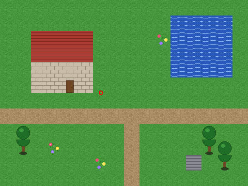
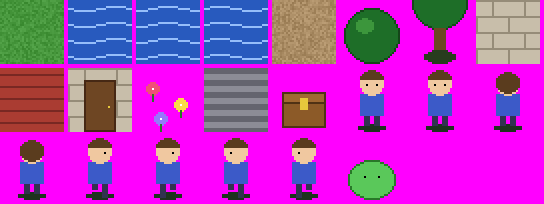
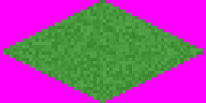

# Example game

A small game in every RPG Toolkit 3 format, generated by [../tools/build_example_game.py](../tools/build_example_game.py) with art drawn by that script. Every binary file was read back with [../tools/rpgtk_formats.py](../tools/rpgtk_formats.py) and ends exactly at its last byte. Regenerate with `python3 build_example_game.py` in `tools/`. One example file for **every version** of every format is in [versions/](versions/README.md).

## Layout

`game/` is laid out like a Toolkit folder: `game/Main/example.gam` names the project folder `Game\Example\`, and `game/Saved/slot1.sav` is a saved game.

| Listing | File | What it shows |
|---|---|---|
| [listings/main.gam.txt](listings/main.gam.txt) | `game/Main/example.gam` | main file, minor 9, every field |
| [listings/board.brd.txt](listings/board.brd.txt) | `game/Game/Example/Boards/village.brd` | board: two layers, runs in the tile stream, shading, a light, solid / stairs / waypoint vectors, a run-once program, an item, a layer image, a link |
| [listings/hero.tem.txt](listings/hero.tem.txt) | `game/Game/Example/Chrs/ada.tem` | character, minor 8, with a special move and a custom stance |
| [listings/chest.itm.txt](listings/chest.itm.txt) | `game/Game/Example/Item/chest.itm` | item, minor 7, usable as a board object |
| [listings/slime.ene.txt](listings/slime.ene.txt) | `game/Game/Example/Enemy/slime.ene` | enemy, with one custom stance in the layout the editor writes |
| [listings/hero_walk_s.anm.txt](listings/hero_walk_s.anm.txt) | `game/Game/Example/Misc/hero/hero_walk_s.anm` | two-frame animation (51 slots) |
| [listings/village.tst.txt](listings/village.tst.txt) | `game/Game/Example/Tiles/village.tst` | tileset header and tiles |
| [listings/grass.iso.txt](listings/grass.iso.txt) | `game/Game/Example/Tiles/grass.iso` | isometric tileset (version 30, detail 150) |
| [listings/water.tan.txt](listings/water.tan.txt) | `game/Game/Example/Tiles/water.tan` | animated tile, 3 frames |
| [listings/house.tbm.txt](listings/house.tbm.txt) | `game/Game/Example/Bitmap/house.tbm` | tile bitmap 2x2 (written as 3x3) |
| [listings/fireball.spc.txt](listings/fireball.spc.txt) | `game/Game/Example/SpcMove/fireball.spc` | special move |
| [listings/burn.ste.txt](listings/burn.ste.txt) | `game/Game/Example/StatusE/burn.ste` | status effect |
| [listings/forest.bkg.txt](listings/forest.bkg.txt) | `game/Game/Example/Bkrounds/forest.bkg` | fight background |
| [listings/slot1.sav.txt](listings/slot1.sav.txt) | `game/Saved/slot1.sav` | saved game, minor 4, no running threads |

| File | Format |
|---|---|
| [files/example_game.tpk](files/example_game.tpk) | the whole game as a PAK (`main.gam` at the root, `\`-separated names) |
| [files/standalone_layout.exe.bin](files/standalone_layout.exe.bin) | standalone-EXE layout: placeholder bytes instead of an engine, the PAK, then the `CMP1` trailer ([listing](listings/standalone_trailer.txt)) |
| [files/flower.gph](files/flower.gph) | a single text tile with run-length encoding (also `game/Game/Example/Tiles/flower.gph`) |
| `game/Game/Example/Prg/*.prg` | RPGCode programs, CRLF text |

## Renders

| | |
|---|---|
|  |  |
| `village.brd`: 16x12 tiles, 2 layers, animated water (first frame shown), red circle = start position | `village.tst`: 22 tiles; magenta = transparent |

 `grass.iso`: one tile poured into the 64x32 diamond.
