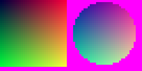
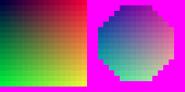
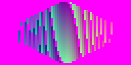

# Every version of every asset format

One example file per version of each game-asset format, as fixtures for an importer that **upgrades older files on the fly**. Saved games are not included (they are not game assets).

**How they were made.** Each binary file was produced by running the reader's own layout definition in write mode ([../../tools/build_version_examples.py](../../tools/build_version_examples.py)), so it follows exactly the layout that [../../formats/](../../formats/README.md) and [../../formats/legacy/](../../formats/legacy/README.md) document for that version, and was then read back. Text files were produced and read back the same way with the line-based layouts. "Parses" means the reader consumed every byte (or line) and nothing more.

**What they are not.** Only the current versions are confirmed against files from the original programs (the shipped sample games). The older-version and Toolkit 1/2 examples follow the documented layouts, which come from the original programs' reading logic; no original files of those versions were available to compare with.

| Format | Version | File | Listing | Parses | What changes in this version |
|---|---|---|---|---|---|
| main | minor 1 | [main_minor1.gam](main/main_minor1.gam) | [listing](main/main_minor1.gam.txt) | yes | Toolkit 2 binary: plugins as numbered flags |
| main | minor 2 | [main_minor2.gam](main/main_minor2.gam) | [listing](main/main_minor2.gam.txt) | yes | Toolkit 2 binary (same layout as minor 1) |
| main | minor 3 | [main_minor3.gam](main/main_minor3.gam) | [listing](main/main_minor3.gam.txt) | yes | adds plugin names, cursor sounds, joystick, colour depth |
| main | minor 4 | [main_minor4.gam](main/main_minor4.gam) | [listing](main/main_minor4.gam.txt) | yes | adds game speed (unbiased) and pixel movement |
| main | minor 5 | [main_minor5.gam](main/main_minor5.gam) | [listing](main/main_minor5.gam.txt) | yes | adds a mouse-cursor flag |
| main | minor 6 | [main_minor6.gam](main/main_minor6.gam) | [listing](main/main_minor6.gam.txt) | yes | full mouse cursor |
| main | minor 7 | [main_minor7.gam](main/main_minor7.gam) | [listing](main/main_minor7.gam.txt) | yes | custom resolution |
| main | minor 8 | [main_minor8.gam](main/main_minor8.gam) | [listing](main/main_minor8.gam.txt) | yes | FPS flag; game speed stored +128 |
| main | minor 9 | [main_minor9.gam](main/main_minor9.gam) | [listing](main/main_minor9.gam.txt) | yes | current |
| board | minor 4 | [board_minor4.brd](board/board_minor4.brd) | [listing](board/board_minor4.brd.txt) | yes | current vector layout |
| board | minor 2 | [board_minor2.brd](board/board_minor2.brd) | [listing](board/board_minor2.brd.txt) | yes | pre-vector: per-cell tile types and tints, tile coordinates |
| board | minor 3 | [board_minor3.brd](board/board_minor3.brd) | [listing](board/board_minor3.brd.txt) | yes | pre-vector: per-cell tile types and tints, tile coordinates; adds threads and coordType |
| character | minor 3 | [character_minor3.tem](character/character_minor3.tem) | [listing](character/character_minor3.tem.txt) | yes | Toolkit 2 binary; levelType is one byte |
| character | minor 4 | [character_minor4.tem](character/character_minor4.tem) | [listing](character/character_minor4.tem.txt) | yes | Toolkit 2 binary: tile names, converted on import |
| character | minor 5 | [character_minor5.tem](character/character_minor5.tem) | [listing](character/character_minor5.tem.txt) | yes | 3.0: animations and custom stances |
| character | minor 6 | [character_minor6.tem](character/character_minor6.tem) | [listing](character/character_minor6.tem.txt) | yes | adds idle animations |
| character | minor 7 | [character_minor7.tem](character/character_minor7.tem) | [listing](character/character_minor7.tem.txt) | yes | adds idle time and speed |
| character | minor 8 | [character_minor8.tem](character/character_minor8.tem) | [listing](character/character_minor8.tem.txt) | yes | current: collision and activation polygons |
| item | minor 2 | [item_minor2.itm](item/item_minor2.itm) | [listing](item/item_minor2.itm.txt) | yes | Toolkit 2 binary: shorts for prices and stats, tile names |
| item | minor 3 | [item_minor3.itm](item/item_minor3.itm) | [listing](item/item_minor3.itm.txt) | yes | ints; still tile names |
| item | minor 4 | [item_minor4.itm](item/item_minor4.itm) | [listing](item/item_minor4.itm.txt) | yes | animations instead of tile names |
| item | minor 5 | [item_minor5.itm](item/item_minor5.itm) | [listing](item/item_minor5.itm.txt) | yes | adds idle animations, speed, idle time |
| item | minor 6 | [item_minor6.itm](item/item_minor6.itm) | [listing](item/item_minor6.itm.txt) | yes | rest animation no longer moved to idle |
| item | minor 7 | [item_minor7.itm](item/item_minor7.itm) | [listing](item/item_minor7.itm.txt) | yes | current: collision and activation polygons |
| enemy | minor 1 | [enemy_minor1.ene](enemy/enemy_minor1.ene) | [listing](enemy/enemy_minor1.ene.txt) | yes | only binary version; custom-stance count written as an int |
| animation | minor 3 | [animation_minor3.anm](animation/animation_minor3.anm) | [listing](animation/animation_minor3.anm.txt) | yes | only binary version (51 frame slots) |
| tile-bitmap | major 3 | [tilebitmap.tbm](tile-bitmap/tilebitmap.tbm) | [listing](tile-bitmap/tilebitmap.tbm.txt) | yes | only version; extra row and column written |
| tile-animation | minor 0 | [water.tan](tile-animation/water.tan) | [listing](tile-animation/water.tan.txt) | yes | only version |
| fight-background | minor 3 | [background_minor3.bkg](fight-background/background_minor3.bkg) | [listing](fight-background/background_minor3.bkg.txt) | yes | only binary version |
| status-effect | minor 2 | [status_minor2.ste](status-effect/status_minor2.ste) | [listing](status-effect/status_minor2.ste.txt) | yes | only binary version |
| special-move | minor 2 | [special_minor2.spc](special-move/special_minor2.spc) | [listing](special-move/special_minor2.spc.txt) | yes | only binary version |
| tileset | detail 1 | [tileset_detail1.tst](tileset/tileset_detail1.tst) | [listing](tileset/tileset_detail1.tst.txt) | yes | 32x32 true colour (current) |
| tileset | detail 2 | [tileset_detail2.tst](tileset/tileset_detail2.tst) | [listing](tileset/tileset_detail2.tst.txt) | yes | 16x16 true colour |
| tileset | detail 3 | [tileset_detail3.tst](tileset/tileset_detail3.tst) | [listing](tileset/tileset_detail3.tst.txt) | yes | 32x32 palette |
| tileset | detail 4 | [tileset_detail4.tst](tileset/tileset_detail4.tst) | [listing](tileset/tileset_detail4.tst.txt) | yes | 16x16 palette |
| tileset | detail 5 | [tileset_detail5.tst](tileset/tileset_detail5.tst) | [listing](tileset/tileset_detail5.tst.txt) | yes | 32x32 "16-colour" palette |
| tileset | detail 6 | [tileset_detail6.tst](tileset/tileset_detail6.tst) | [listing](tileset/tileset_detail6.tst.txt) | yes | 16x16 "16-colour" palette |
| tileset | iso (version 30, detail 150) | [tileset_iso.iso](tileset/tileset_iso.iso) | [listing](tileset/tileset_iso.iso.txt) | yes | isometric |
| single-tile | version 2, compressed | [tile_v2_compressed.gph](single-tile/tile_v2_compressed.gph) | [listing](single-tile/tile_v2_compressed.gph.txt) | yes | what the 3.x editor writes |
| single-tile | version 2, uncompressed | [tile_v2_uncompressed.gph](single-tile/tile_v2_uncompressed.gph) | [listing](single-tile/tile_v2_uncompressed.gph.txt) | yes | one value per pixel |
| single-tile | version 2, 16x16 (detail 2) | [tile_v2_detail2.gph](single-tile/tile_v2_detail2.gph) | [listing](single-tile/tile_v2_detail2.gph.txt) | yes | 16x16, drawn doubled |
| single-tile | version 1 (Toolkit 1) | [tile_v1.gph](single-tile/tile_v1.gph) | [listing](single-tile/tile_v1.gph.txt) | yes | 16 rows of 16 characters, palette indices |
| main | Toolkit 2 text | [main_tk2_text.gam](main/main_tk2_text.gam) | [listing](main/main_tk2_text.gam.txt) | yes | header written as RPGTLKIT MAIN; the 3.1 editor expects RPGTLKIT mainForm (see legacy notes) |
| main | Toolkit 1 | [main_tk1.gam](main/main_tk1.gam) | [listing](main/main_tk1.gam.txt) | yes | plus a separate fight file |
| main | Toolkit 1 fight file | [fight.dat](main/fight.dat) | [listing](main/fight.dat.txt) | yes | 251 enemy/skill pairs |
| character | Toolkit 2 text, minor 0 | [character_text_minor0.tem](character/character_text_minor0.tem) | [listing](character/character_text_minor0.tem.txt) | yes | sizeType 0: pixels embedded (about 44,000 lines) |
| character | Toolkit 2 text, minor 1 | [character_text_minor1.tem](character/character_text_minor1.tem) | [listing](character/character_text_minor1.tem.txt) | yes | sizeType 1, minor 1: one-column battle frames |
| character | Toolkit 2 text, minor 2 | [character_text_minor2.tem](character/character_text_minor2.tem) | [listing](character/character_text_minor2.tem.txt) | yes | sizeType 1, minor 2: 2x2 battle frames |
| item | Toolkit 2 text, minor 0 | [item_text_minor0.itm](item/item_text_minor0.itm) | [listing](item/item_text_minor0.itm.txt) | yes | sizeType 0: embedded pixels; "-2" marks an empty tile |
| item | Toolkit 2 text, minor 1 | [item_text_minor1.itm](item/item_text_minor1.itm) | [listing](item/item_text_minor1.itm.txt) | yes | sizeType 1: tile names |
| enemy | Toolkit 2 text | [enemy_text.ene](enemy/enemy_text.ene) | [listing](enemy/enemy_text.ene.txt) | yes | fixed 19x7 tile grid; only width x height used |
| fight-background | Toolkit 2 text | [background_text.bkg](fight-background/background_text.bkg) | [listing](fight-background/background_text.bkg.txt) | yes | 19x11 tile grid with per-tile tints |
| status-effect | Toolkit 2 text | [status_text.ste](status-effect/status_text.ste) | [listing](status-effect/status_text.ste.txt) | yes | same fields as binary |
| special-move | Toolkit 2 text | [special_text.spc](special-move/special_text.spc) | [listing](special-move/special_text.spc.txt) | yes | same fields as binary |
| animation | Toolkit 2 text | [animation_text.anm](animation/animation_text.anm) | [listing](animation/animation_text.anm.txt) | yes | one value per line; 51 frames |
| program | source text | [start.prg](program/start.prg) | [listing](program/start.prg) | yes | current: plain text |
| program | compiled | [start_compiled.prg](program/start_compiled.prg) | [listing](program/start_compiled.prg.txt) | yes | layout example only: no shipped tool wrote this form |

## Upgrade path summary

| Format | Upgrade to current |
|---|---|
| main | read with the minor-version conditions in [main-file.md](../../formats/main-file.md#layout); re-bias game speed for minor < 8; text files: [legacy/text-formats.md](../../formats/legacy/text-formats.md#main-file-toolkit-2-text) |
| board | minors 2-3: convert tile types to vectors, tints to one shading layer, tile to pixel positions ([older-binary-versions.md](../../formats/legacy/older-binary-versions.md#board-minor-2-and-3-pre-vector)) |
| character | minors 5-7: fill defaults; minor < 5 and text: build tile bitmaps and animations ([conversion.md](../../formats/legacy/conversion.md#characters)) |
| item | minors 4-6: fill defaults, move rest to idle south (minors 4-5); minor < 4 and text: build tile bitmaps and animations ([conversion.md](../../formats/legacy/conversion.md#items)) |
| enemy, fight background | text: build the REST tile bitmap and animation / background tile bitmap ([conversion.md](../../formats/legacy/conversion.md#enemies)) |
| status effect, special move, animation | text: same fields, re-write as binary |
| tileset | details 2-6: decode (doubling 16x16, palette lookup) and re-write as detail 1 if a single depth is wanted |
| single tile | any `.gph`: decode pixels and add to a tileset |

Tileset renders:       
